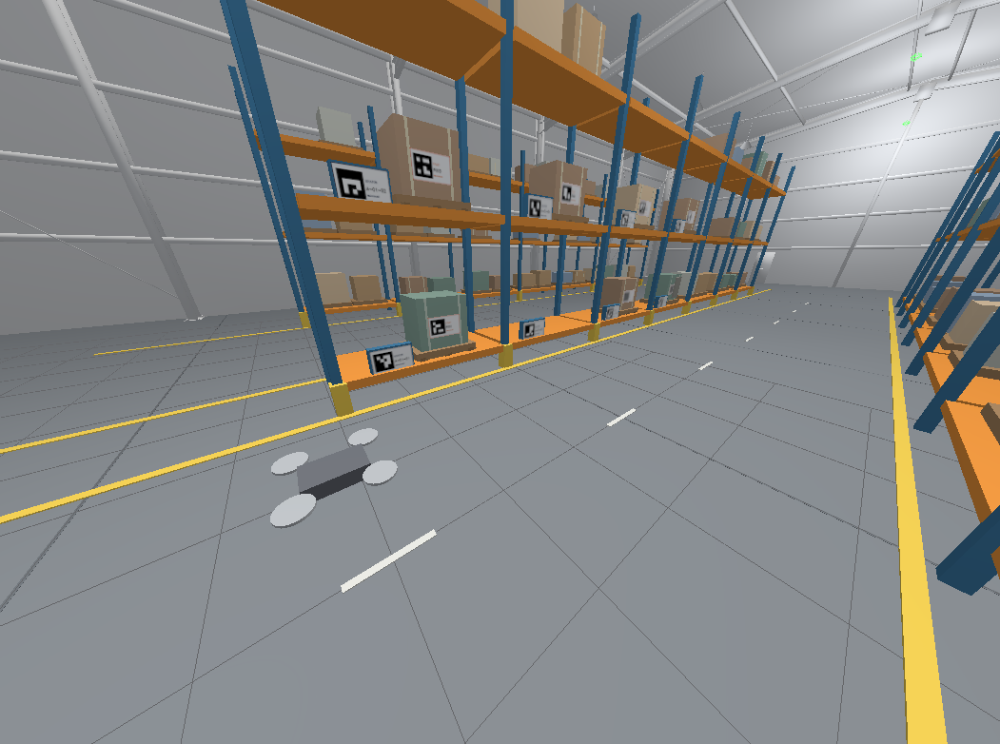
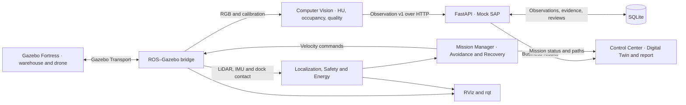

# Rackonaut

[](https://github.com/Adiksoon/rackonaut/actions/workflows/contract-tests.yml)

Rackonaut is a RobotHack 2026 prototype that helps warehouse supervisors decide which inventory discrepancies to investigate. A simulated drone visits selected storage locations, photographs handling unit (HU) labels and checks occupancy and visible packaging damage. The Control Center combines those observations with a synthetic Mock SAP inventory to flag misplaced HUs, unexpected empty locations, discontinued products and damaged cartons. A supervisor can inspect the evidence and export a portable report with recommended actions.



## Start here

Clone the private repository after accepting the GitHub invitation. On WSL2, clone to the Linux filesystem. Run the commands from the repository root in Bash.

**Requirements.** Ubuntu 22.04 or WSL2 Ubuntu 22.04, ROS 2 Humble, Gazebo Fortress, system Python 3.10 with cv_bridge, OpenCV and NumPy, plus Git, colcon and rosdep. Use a WebGL2-capable browser for 3D. RViz2, rqt_graph, rqt_plot and rosbag2 are used by Engineering Showcase. Native GUI windows require a display such as WSLg. The simulator starts headless by default.

If you are setting up ROS and Gazebo for the first time, follow the linked installation guide and review its rosdep commands. [Environment and dependency setup](docs/onboarding/ADRIAN.md#set-up-in-ubuntu-2204-or-wsl2)

```bash
git clone https://github.com/Adiksoon/rackonaut.git
cd rackonaut
scripts/robotics/check
python3.10 scripts/api/setup.py
scripts/robotics/build
```

The setup command installs pinned backend packages into `.venv-backend`. ROS nodes use system Python. Run one demo at a time and stop it with Ctrl+C in the launch terminal. Control Center runs on port 8765 and its local inventory API uses port 8000. Override them with `http_port:=` and `mock_port:=` when needed. Use a separate `data_dir:=/absolute/path` for a fresh database and report archive. [Ports, profiles and logs](ros2_ws/src/rackonaut_control/README.md)

### A. Business Demo

This short profile focuses on HU reads, carton quality, Mock SAP comparison and the supervisor's decisions.

```bash
source scripts/robotics/activate.bash
LP_NUM_THREADS=4 ros2 launch rackonaut_control control.launch.py \
  api_profile:=mock_sap safety:=true adaptive_world:=true
```

1. Open Control Center and wait for **Mock SAP online** and the drone at the pad. [Control Center](http://127.0.0.1:8765)
2. Choose **Selected locations** and select **A-01-01**, **A-01-02** and **A-01-03**. In **Inspection options**, enable **Check for package damage** and **Retry difficult readings**. Start the inspection.
3. After landing, open **Results**. Choose a finding to compare the expected and observed stock, review available evidence and export the HTML report. The recorded reference run identified discontinued P001 at A-01-01, found P003 in the wrong location with visible damage at A-01-02, and found its expected location A-01-03 empty.

The local API serves the v1 Swagger UI on port 8000. [Swagger UI](http://127.0.0.1:8000/docs) · [Mock SAP and business endpoints](docs/SAP_BUSINESS_INTELLIGENCE.md)

### B. Full Robotics Demo

The full profile enables protected aerial corridors, LiDAR–IMU localization, onboard obstacle checks, energy and docking, operator-approved Recovery, Digital Twin and Mock SAP.

```bash
scripts/robotics/checkpoint live
```

Use **A-01-01 → A-01-03** in **Selected locations**. Wait for localization `TRACKING` and the dock to be ready before dispatch. The verified run uses **virtual Safety presence** for ground-zone interlocks. The onboard LiDAR and simulated physical dock contact remain active. Switch between **2D Map**, **3D Model** and **3D Scan** to compare the plan, reference warehouse and live LiDAR measurements. Use `gazebo_gui:=true` at launch to see the same simulation in Gazebo. [Full profile and launch details](docs/ENGINEERING_SHOWCASE.md#engineering-live) · [Measured 3D map](docs/MEASURED_3D_MAP.md)

Use the **Service** tab to prepare a new warehouse configuration and return the drone to its dock during an active inspection. [Service Center setup and recorded trial](docs/SERVICE_CENTER.md)

Use **Service → Open manual controls** to fly inside reserved space with the live camera, measured 3D scan and onboard collision protection. [Controls and validation](docs/PROTECTED_MANUAL_FLIGHT.md)

Use **Service → Start Calibration → Open mapping flight** to build and export a LiDAR map. Launch with `mapping_only:=true` for a survey profile that starts with onboard localization at the known dock. [Warehouse mapping and SLAM](docs/UNKNOWN_WAREHOUSE_MAPPING.md) · [Teach storage locations from the camera and SLAM](docs/STORAGE_LOCATION_TEACHING.md)

After verified docking, choose **Review Route** in Service to compare the recorded trajectory with its directed waypoint graph, validate the recorded flight envelope, and approve the proposal for the calibration archive. [Learn a flight route](docs/ROUTE_TEACHING.md)

Launch `scripts/robotics/checkpoint live learned_warehouse:=true` for teach-and-repeat with a saved measured map. Unlock Service and activate the saved warehouse at the dock. Open **Plan inspection** to select its taught locations and start an inspection. [Autonomous inspection of a learned warehouse](docs/LEARNED_WAREHOUSE_AUTONOMY.md)

### C. Engineering Showcase

Run the full profile in the first terminal. Open one engineering view at a time in another terminal.

| View | Command from the repository root |
| --- | --- |
| Navigation & Mapping | `scripts/robotics/checkpoint tools` |
| Computer Vision | `scripts/robotics/checkpoint tools view:=vision` |
| Safety & Recovery | `scripts/robotics/checkpoint tools view:=safety` |
| Validation | `scripts/robotics/checkpoint tools view:=validation` with `localization_diagnostics:=true` on the live launcher |
| ROS graph | `scripts/robotics/checkpoint tools view:=graph adapter:=false` |
| Telemetry | `scripts/robotics/checkpoint tools view:=plot_energy` or `plot_flight`, `plot_localization`, `plot_avoidance`, `plot_validation` in the same `view:=` argument |

If the engineering adapter is already running, add `adapter:=false` to the next viewer. The Vision view has separate live raw and processed streams. For offline playback, run these commands in two terminals on the same separate Evidence ROS domain.

```bash
# Terminal 1
scripts/robotics/checkpoint evidence rviz
# Terminal 2
scripts/robotics/checkpoint evidence play
```

The bag contains recorded measurements and visualization topics. Its playback domain defaults to 193. [Showcase views, diagnostics and replay](docs/ENGINEERING_SHOWCASE.md)

## Architecture



[Architecture](docs/ARCHITECTURE.md) · [ROS and HTTP interfaces](docs/INTERFACES.md) · [Integration and historical baseline](docs/INTEGRATION.md)

## Demonstration evidence

| Material | What it shows |
| --- | --- |
| [Business demo video](docs/bi-evidence/demo.mp4) · [Supervisor report](docs/bi-evidence/warehouse-report.html) | Recorded GOAL 17 flight with business comparisons and recommended actions. Download the HTML and open it locally for an offline report. |
| [P003 original photo](docs/bi-evidence/p003-original.png) · [Annotated photo](docs/bi-evidence/p003-annotated.png) | Visible carton damage and its linked inspection evidence. |
| [Engineering video](docs/engineering-evidence/showcase.mp4) · [ROS graph](docs/engineering-evidence/active-ros-graph.png) · [LiDAR map](docs/engineering-evidence/map-complete.png) | Recorded engineering views, obstacle avoidance and Recovery. |
| [Historical full inventory run](docs/DEMO_COMPLETE.md) | The `demo-complete` tag records an 11-location run and selected reinspection on an earlier profile. |

[Safety sensor coverage](ros2_ws/src/rackonaut_safety/docs/SENSOR_SAFETY.md) · [Autonomous Recovery](docs/AUTONOMOUS_RECOVERY.md) · [Localization and mapping](docs/SENSOR_LOCALIZATION.md) · [Obstacle avoidance](docs/OBSTACLE_AVOIDANCE.md) · [Asset provenance](ros2_ws/src/rackonaut_warehouse/docs/ASSETS.md)

## Tests

The first command matches GitHub Actions and discovers both fixture contract tests and Mock SAP tests. The suite runs without launching Gazebo or an HTTP server. The second command starts a temporary loopback fixture API and exercises real HTTP requests.

```bash
.venv-backend/bin/python -m unittest discover -s tests -v
.venv-backend/bin/python scripts/api/smoke.py
source scripts/robotics/activate.bash
/usr/bin/python3 -m pytest -q ros2_ws/src
```

Use Ubuntu's system `python3-pytest` for the ROS tests. Backend-only contributors can follow the Windows setup and run the same unittest suite.

```powershell
python scripts/api/setup.py
& .\.venv-backend\Scripts\python.exe -m unittest discover -s tests -v
```

[Backend setup and test data](backend/README.md) · [Baseline test evidence](docs/TEST_RESULTS.md) · [Troubleshooting](docs/TROUBLESHOOTING.md)

## Team onboarding

Adrian owns the integrated demonstrator, computer vision, autonomy, backend and business recommendations. Michał's drone and camera work is independent until he provides a reproducible model and test evidence for review. The dashboard onboarding material remains available for independent development. [Current responsibilities and historical assignments](docs/TEAM_TASKS.md) · [Adrian's setup](docs/onboarding/ADRIAN.md) · [Michał's integration checklist](docs/onboarding/MICHAL.md) · [Dashboard guide](docs/onboarding/DASHBOARD.md)

## Known limitations

- In the **aerial** profile, the descent from A-01-02 toward A-01-03 repeatedly stopped with `ROUTE_BLOCKED`. LiDAR returns align with a crossbar in shaft A. In the reproduced case, Recovery also stopped and kept the A and D reservations. Use the two-location route for the full profile. [Recorded failure](docs/engineering-evidence/recovery-blocked.json) · [Integration constraints](docs/INTEGRATION.md#route-and-operator-constraints)
- The refreshed Control Center displays raw camera video. The current mission-start gate uses a flag set when an annotated frame is received, without checking frame age. Engineering Showcase Vision displays annotated frames independently.
- WSL2 software rendering slows simulated time. Stationary laser monitoring and extra graphics windows add load. The historical laser comparison at the dock measured an RTF of 0.4135 without RViz and 0.3842 with Navigation RViz. Keep one optional window open at a time. [Performance evidence](docs/engineering-evidence/laser-performance.json)
- The warehouse, flight, safety interlocks and charging are simulated. Safety has no physical validation. Mock SAP uses synthetic inventory and product records. The operator reviews proposed actions in the demonstrator.
