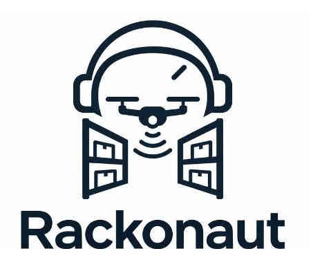
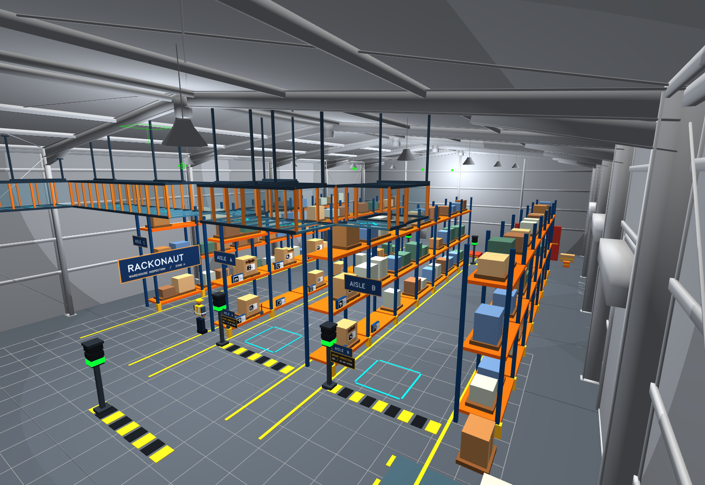
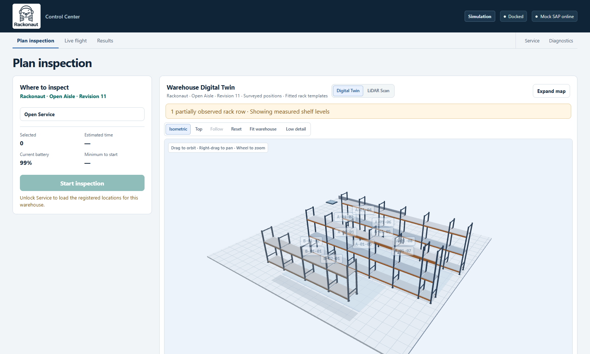
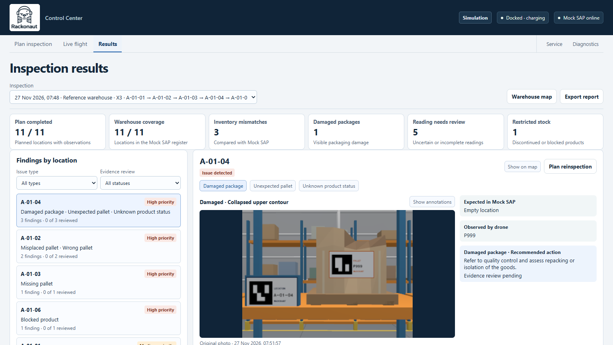

# Rackonaut

**Less time. Less effort. More control.**

An autonomous warehouse inspection prototype built with ROS 2 and Gazebo Fortress, combining LiDAR-based localization, visual inspection, digital twin reconstruction and inventory discrepancy detection.

Rackonaut is an integrated simulation prototype for **RobotHack 2026**, addressing the automated warehouse inventory and quality inspection challenge. [Judge's guide](docs/JUDGES_GUIDE.md) · [Run the demo](docs/GETTING_STARTED.md) · [Gallery](docs/GALLERY.md) · [Technical documentation](docs/README.md)



*The open-aisle warehouse in Gazebo Fortress. The X3 and reference models share this environment. [Open-aisle X3 startup evidence](docs/open-aisle-evidence/x3-startup.json)*

## Problem

A warehouse can show stock in its management system while a shelf is empty, a pallet is in the wrong location, or a carton is visibly damaged. Physically checking those discrepancies takes time. Supervisors need to see where to look, what the camera observed, and which findings need a human decision.

## Our solution

**Warehouse calibration → Digital Twin → Mission planning → Autonomous inspection → Inventory comparison → Actionable results**

A survey collects LiDAR measurements and teaches shelf locations from camera frames. The Control Center turns the approved survey into a warehouse model and plans a flight through reserved space. During inspection, the drone sends camera observations to Mock SAP. The supervisor reviews expected stock alongside observed stock, original photos and suggested actions, then exports an HTML report.

| Measured Digital Twin | Inventory review |
| --- | --- |
| [](docs/FULL_WAREHOUSE_CALIBRATION.md) | [](docs/full-system-evidence/x3-known-report.html) |
| Open-aisle reference survey restored after restart. | X3 known-map results. Download the HTML report to view it offline. |

## Key capabilities

| Capability | What Rackonaut does |
| --- | --- |
| Warehouse calibration | Records LiDAR–IMU SLAM, synchronized location photos and separately approved dock-to-dock sorties. Saves a sealed archive with file integrity checks. [Calibration and archive](docs/FULL_WAREHOUSE_CALIBRATION.md) |
| Digital Twin | Shows measured point clouds, fitted rack rows, taught locations and validated route geometry. [Reconstruction evidence](docs/full-warehouse-calibration-evidence/verified-survey/twin-validation.json) |
| Mission planning and flight | Plans selected locations or an inventory route. Safety manages zone reservations, Collision Prevention checks onboard LiDAR clearance, and Recovery handles guarded return when authorized. [Mission and recovery evidence](docs/AUTONOMOUS_RECOVERY.md) |
| Energy management | Estimates route cost and reserve. With the verified X3 known-map profile, the drone can dock, charge and resume the same inspection. [Charging telemetry](docs/full-system-evidence/x3-known-inventory.json) |
| Computer vision and Mock SAP | Associates ArUco reads, occupancy and visible carton damage with an inspection location. Matches observations to synthetic inventory and presents reviewable findings and exportable reports. [Business trial](docs/FULL_SYSTEM_INTEGRATION.md#d--business-demo) |
| CSV inventory importer | Validates inventory and product CSVs against the shared contracts and prepares Mock SAP JSON for deliberate import. [Importer examples](scripts/inventory/README.md) |
| Warehouse in Motion | Runs a scripted warehouse scenario in which X3 stops for a moving cart, continues once clear and reports inventory discrepancies. [Obstacle and mission telemetry](docs/final-branch-audit-evidence/result.json) |
| Warehouse environments | The main demo offers historical and open-aisle worlds. A pinned companion profile provides three larger layouts with separate geometry and fixtures. [Environment library and launch instructions](docs/GETTING_STARTED.md#additional-warehouses) |

## System architecture

```mermaid
flowchart LR
    Gazebo["Gazebo Fortress · warehouse, drone and dock"] <-->|"transport"| Bridge["ROS 2 · ROS–Gazebo bridge"]
    Bridge -->|"LiDAR and IMU"| Localization["Localization / SLAM"]
    Bridge -->|"LiDAR range data"| Collision["Collision Prevention"]
    Bridge -->|"presence measurements"| Safety["Safety Manager"]
    Bridge -->|"dock contact"| Energy["Energy Manager"]
    Bridge -->|"RGB frames + calibration"| Perception["Computer Vision · Perception"]
    Localization -->|"pose and mapping state"| Mission["Mission Manager and Recovery"]
    Localization -->|"pose"| Safety
    Energy -->|"verified dock state"| Safety
    Safety -->|"reservations and permits"| Mission
    Energy -->|"battery and charging state"| Mission
    Collision -->|"path clearance"| Mission
    Mission -->|"flight commands"| Bridge
    Mission -->|"inspection context"| Perception
    Perception -->|"HTTP Observation v1 + photo evidence"| SAP["Mock SAP · inventory comparison"]
    CSV["Standalone CSV importer"] -.->|"compatible JSON for manual import"| Fixtures["Synthetic inventory and products"]
    Fixtures -->|"expected stock"| SAP
    SAP -->|"fresh observation confirmation"| Mission
    Control["Control Center · plan, dispatch and review"] -->|"plan and dispatch"| Mission
    Mission -->|"mission progress"| Control
    Localization -->|"measured cloud and pose"| Twin["Digital Twin · measured and reference views"]
    Control -->|"taught locations and approved routes"| Twin
    SAP -->|"expected vs. observed stock"| Control
    Control -->|"evidence and recommended actions"| Report["Portable HTML report"]
```



[Architecture and code boundaries](docs/ARCHITECTURE.md) · [ROS and HTTP interfaces](docs/INTERFACES.md)

## Quick start

### Start here

On **Ubuntu 22.04** or **WSL2 Ubuntu 22.04**, install **ROS 2 Humble**, **Gazebo Fortress** and the system Python dependencies. Follow the clean-checkout instructions for dependencies and the repository clone. [Environment and setup](docs/GETTING_STARTED.md#clean-checkout)

```bash
scripts/robotics/check
python3.10 scripts/api/setup.py
scripts/robotics/build
scripts/robotics/checkpoint live warehouse_variant:=open-aisle drone_model:=reference
```

<a id="b-full-robotics-demo"></a>

### Full Robotics Demo

Open the [local Control Center](http://127.0.0.1:8765/). Wait for Mock SAP, a fresh camera image, localization `TRACKING` and confirmed dock contact. Under **Selected locations**, select **A-01-01** and start the inspection. After docking, use **Results** to inspect the evidence and export the report. [Reference flight evidence](docs/open-aisle-evidence/reference-flight.json)

<a id="a-business-demo"></a>

### Business and X3 profiles

For the X3 known-map inventory run, Warehouse in Motion and steps to restore the verified open-aisle archive, use the profile commands in the demo guide. [Demo profiles](docs/GETTING_STARTED.md#demo-profiles)

## Validation highlights

These measurements come from distinct recorded trials.

| Trial | Recorded result | Source evidence |
| --- | --- | --- |
| Open-aisle full calibration · **reference drone** | **94,194** measured LiDAR points, **11/11** registered inspection locations, **4** completed sorties over **335.11 m**, and **13.71 mm** localization RMSE | [Point cloud and checkpoints](docs/full-warehouse-calibration-evidence/verified-survey/checkpoint-coverage.json) · [Location photos](docs/full-warehouse-calibration-evidence/verified-survey/photos.json) · [Flight metrics](docs/full-warehouse-calibration-evidence/verified-survey/flight-metrics.json) |
| Open-aisle archive and replay · **reference drone** | **496** validated directed edges. The archive restored **11/11** locations and a four-sortie plan after restart. Two separate autonomous replays inspected one location in each functional aisle. | [Route validation](docs/full-warehouse-calibration-evidence/verified-survey/route-validation.json) · [Restart plan](docs/full-warehouse-calibration-evidence/verified-survey/restart-plan.json) · [Replay telemetry](docs/full-warehouse-calibration-evidence/verified-survey/restart-replay-metrics.json) |
| Historical known-map inventory · **X3** | **11/11** inspected locations. Automatic docking, charging and mission resumption, followed by return to dock. | [Mission telemetry](docs/full-system-evidence/x3-known-inventory.json) · [Charging and resumption](docs/FULL_SYSTEM_INTEGRATION.md#c--x3-na-znanej-mapie) |
| Warehouse in Motion · **X3** | Detected the cart, stopped after **0.094 m** of further motion, resumed autonomously and finished **3/3** inspections. | [Scenario result](docs/final-branch-audit-evidence/result.json) · [Portable report](docs/final-branch-audit-evidence/report.html) |
| Companion warehouse library | **3** additional environments with generated SDF and recorded dock startup checks. | [Static validation and telemetry](https://github.com/Adiksoon/rackonaut/blob/6b9ebfaba39bd5e091d5de5f7d23301a9ec35115/docs/MULTI_WAREHOUSE_ENVIRONMENTS.md#pr%C3%B3by-uruchomienia-przy-doku) |

## Project structure

| Path | Contents |
| --- | --- |
| [`ros2_ws/src/`](ros2_ws/src/) | Simulation, drone profiles, localization, mission and protection modules, perception, Control Center and Digital Twin. |
| [`backend/`](backend/) and [`contracts/`](contracts/) | Mock SAP service, REST schemas, ROS interfaces and observation contracts. |
| [`scripts/`](scripts/) and [`tests/`](tests/) | Build and launch entry points, inventory importer, API and contract tests. |
| [`docs/`](docs/README.md) and [`test_data/`](test_data/) | Technical documentation, original validation evidence and synthetic fixtures. |

## Tests

The release checks cover the ROS build and tests, backend and importer tests, HTTP, SDF, archive integrity and documentation. Recorded flights have their original revision and evidence. [Release checks](docs/RELEASE_VALIDATION.md) · [GitHub Actions](https://github.com/Adiksoon/rackonaut/actions/workflows/contract-tests.yml)

## Team

- **Adrian Zygarowski** integrated the simulated warehouse, autonomy and protection modules, perception, Control Center and Mock SAP workflows. He implemented and validated the multi-sortie reference calibration and its Digital Twin.
- **Michał** (`michalczaplinski5`) submitted the X3 model integration with camera, ROS bridges and frame setup, and contributed flight and localization acceptance work. [X3 contribution](https://github.com/Adiksoon/rackonaut/pull/7)
- **Vahid Abdullayev** authored the CSV inventory importer, including templates, sample inputs and 54 regression tests. [CSV contribution](https://github.com/Adiksoon/rackonaut/pull/8)

### Team onboarding

[Contribution record and Git history](docs/TEAM_TASKS.md) · [Robotics onboarding](docs/onboarding/ADRIAN.md) · [Drone onboarding](docs/onboarding/MICHAL.md) · [Dashboard onboarding](docs/onboarding/DASHBOARD.md) · [Third-party notices](docs/ATTRIBUTION.md)

## Limitations & roadmap

Flight, docking, charging and stock data are simulated. Physical drone commissioning, site safety validation and certification, and production SAP integration are future work. Automatic battery swapping is a concept. The reference calibration captures a partial third rack and has a finite archived keyframe budget. Learned sorties are dispatched individually. The larger warehouses have startup and static evidence and require independent calibration, energy qualification and autonomous inspections. [Known limitations and next engineering steps](docs/JUDGES_GUIDE.md#limitations-and-roadmap)
