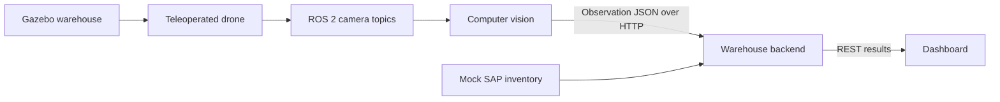

# Architecture

Rackonaut inspects named storage locations and compares observed occupancy and labels with an expected inventory. The first milestone is a teleoperated drone with a camera in a Gazebo warehouse. Mapping and autonomous flight are outside this milestone.

| Boundary | Responsibility |
|---|---|
| Warehouse and drone | The world provides compatible physics, rendering, and a spawn pose. The model and teleoperation are supplied independently. |
| Drone and computer vision | ROS 2 transports camera calibration, images, simulation time, and any supported odometry and transforms. The bridge maps simulator endpoints to the canonical topics. |
| Vision and backend | Vision assigns a slot from visible evidence or a controlled test input and submits a validated observation. Gazebo ground truth stays in the evaluation path. |
| Backend and dashboard | Backend compares observations with expected mock SAP inventory. The dashboard polls a small REST API and exposes result and review states. |

Robotics development uses an isolated ROS workspace. Backend and dashboard development can proceed with shared fixtures and the HTTP mock. Integration runs on one host with ROS traffic local to that host. [Interface contracts](INTERFACES.md) · [Integration sequence](INTEGRATION.md)

The Git repository contains the reference world and camera publisher, synthetic inventory and observation fixtures, and the REST mock. Product package locations and role ownership are listed in the [task register](TEAM_TASKS.md).
