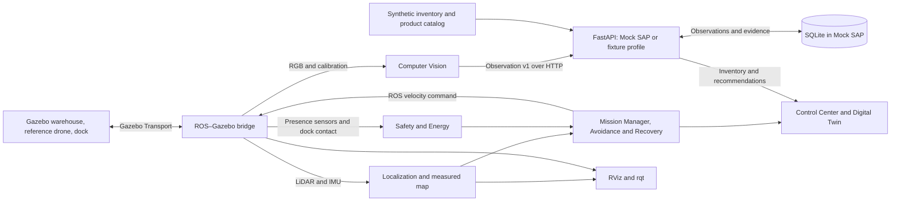

# Architecture

Rackonaut inspects selected warehouse positions and compares visible occupancy, handling unit labels and packaging evidence with a simulated inventory. It runs as a single-host demonstrator on Gazebo Fortress, ROS 2 Humble and a local browser.

| Boundary | Responsibility |
| --- | --- |
| Warehouse and reference drone | Gazebo provides the scene, simulated physics and readings from camera, LiDAR, IMU and dock contacts, depending on the launch profile. |
| ROS transport | The bridge exposes sensor data, time and commands using the canonical ROS topics. The full profile derives odometry from LiDAR and IMU. The optional validator receives Gazebo reference poses for independent comparison. |
| Mission and protection | Mission Manager owns autonomous flight commands. Safety owns zone reservations and the start and continuation permits. The full profile checks onboard clearance, battery budget and dock contact. Recovery requires operator authorization. |
| Perception and backend | Perception uses visible markers and camera frames for the scoped inspection. The Mock SAP backend compares those observations with synthetic records and stores outcomes, evidence and verification in SQLite. |
| Operator views | Control Center offers planning, camera monitoring, Digital Twin, business results and report export. The Engineering Showcase adapter reads ROS telemetry for RViz, rqt and recorded evidence. |

The business profile uses the short adaptive warehouse. The full robotics profile uses aerial corridors, sensor localization, onboard LiDAR and virtual ground-zone presence by default. The optional laser Safety profile adds three stationary simulated scanners. [Launcher profiles](../README.md#start-here) · [Interface contracts](INTERFACES.md) · [Integration gates](INTEGRATION.md) · [Ownership](TEAM_TASKS.md)
