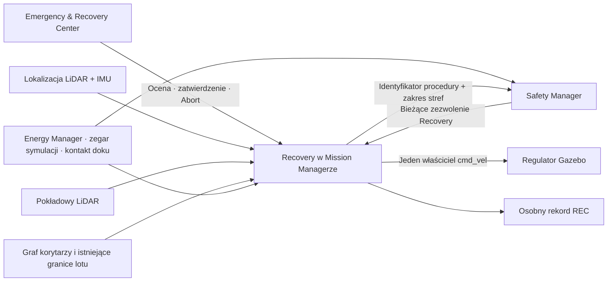

# Rackonaut — kontrolowany powrót po przerwaniu inspekcji

Recovery jest odrębną procedurą nad tą samą misją i symulacją. Operator ocenia możliwość powrotu, sprawdza trasę i osobno zatwierdza ruch. Po dotarciu do doku Safety zwalnia strefy na podstawie potwierdzonego kontaktu i stabilnego położenia. Raport inspekcji zachowuje pierwotny wynik oraz zebrane obserwacje i zdjęcia. Osobny raport `REC-…` wskazuje identyfikator tej inspekcji.

## Uruchomienie

Z katalogu repozytorium, na Ubuntu 22.04 lub WSL2 z ROS 2 Humble i Gazebo Fortress.

```bash
python3.10 scripts/api/setup.py
scripts/robotics/build
source scripts/robotics/activate.bash
LP_NUM_THREADS=4 ros2 launch rackonaut_control control.launch.py \
  localization:=sensor_based recovery:=true safety:=true safety_sensor:=virtual
```

1. Otwórz [Control Center](http://127.0.0.1:8765), wybierz *3D Digital Twin* i zaplanuj inspekcję `A-01-01` i `A-01-03`.
2. Po pierwszym odczycie skieruj pracownika do A w *Simulation Controls*. Zaczekaj na stan przerwania inspekcji i pojawienie się *Emergency & Recovery Center*.
3. Wybierz *Evaluate recovery*. Zajęta strefa blokuje zatwierdzenie. Skieruj pracownika na zewnątrz i obejrzyj plan powrotu po spełnieniu warunków. Pomarańczowa linia pokazuje plan, różowa drogę rzeczywiście przebytą, a czerwony znacznik miejsce zatrzymania.
4. Wybierz *Authorize return to dock*. Możesz w dowolnej chwili użyć *Abort recovery*. Po potwierdzeniu doku i zwolnieniu stref użyj *Plan new inspection*, aby załadować niedokończone lokalizacje. Następnie wyślij nowe zlecenie po zatwierdzeniu jego budżetu.
5. Pierwotny raport i rekord Recovery znajdziesz w sekcji wyników. Domyślny katalog danych jest pod logami ROS. Ustaw `data_dir:=/ścieżka/do/danych`, aby przechować je w wybranym miejscu.

Profil `virtual` używa pozycji symulowanego pracownika do nadzoru stref. `safety_sensor:=laser` korzysta ze stacjonarnych skanów w alejkach, z zachowaniem wirtualnego czujnika obszaru doku. W obu profilach dron lokalizuje się na podstawie własnych pomiarów LiDAR i IMU, a powrót wymaga pokładowych skanów.

## Architektura



Recovery działa w dotychczasowym procesie Mission Managera. Zatrzymanie usuwa jego wydawcę `cmd_vel`, a ponowne przejęcie następuje po zgodnym zezwoleniu Safety. Zwykłe zezwolenie inspekcji pozostaje osobne. Zatwierdzenie wiąże się z identyfikatorem procedury i aktualną wersją planu. Zmiana warunków przed rozpoczęciem ruchu wymaga kolejnej oceny. W trakcie powrotu cofnięcie zezwolenia kończy bieżącą procedurę i utrzymuje blokadę stref. Istniejący serwis ROS Abort zatrzymuje też aktywny powrót, a serwis startu inspekcji odrzuca terminalne zlecenie.

Bezpośrednio przed ruchem Mission Manager wymaga aktualnej odometrii sensorowej i co najmniej 1,25 s ciągłego `TRACKING`, postoju, pozycji w objętości lotu, świeżego skanu pokładowego, połączenia grafem z dokiem, obserwowanego początku trasy, budżetu energii i wyłączności sterowania. Safety sprawdza heartbeat, bieżące rezerwacje, świeżość pomiarów wszystkich wymaganych stref, stabilną wolną strefę i potwierdzoną czerwoną sygnalizację. Zezwolenie może dotyczyć wyłącznie stref pierwotnej rezerwacji. Podczas ruchu oba moduły ponawiają kontrole odpowiednio do etapu. Pole zajęte, utrata źródła danych lub utrata zezwolenia blokuje kolejne polecenia.

Planer dołącza aktualną pozycję do istniejącego grafu tuneli, szybów i alejek. Kontroler weryfikuje każdy odcinek pokładowym LiDAR-em, do 1,5 m przed dronem. Odcinki poza zasięgiem skanu są planem geometrycznym, którego dostępność zostanie sprawdzona w locie. W tunelu i szybach zatrzymanie jest jedyną reakcją na trwałą przeszkodę. Recovery używa tego samego konserwatywnego obrysu co Obstacle Avoidance i nie wyznacza bocznych obejść. Po dokowaniu Safety osobno potwierdza kontakt, prędkość i pozycję w doku oraz wynik zezwolonej procedury. Mission Manager wyłącza ciąg przy fizycznym kontakcie i czeka na jego stabilne potwierdzenie. Ponowne włączenie następuje dopiero po spełnieniu warunków kolejnego lotu. Mechanizm korzysta z natywnego `enable` regulatora Gazebo. [Gazebo Fortress MulticopterVelocityControl](https://gazebosim.org/api/gazebo/6/classignition_1_1gazebo_1_1systems_1_1MulticopterVelocityControl.html)

## Przyczyny i warunki

| Przyczyna zgłoszona operatorowi | Warunek ponownej gotowości |
| --- | --- |
| Naruszenie strefy | Człowiek opuścił obszar, wszystkie wymagane pola są wolne i sygnalizacja potwierdza rezerwację. |
| Utrata stacjonarnego sensora | Świeże pomiary wszystkich wymaganych pól i potwierdzenie ich wolnego stanu. |
| Utrata pokładowego LiDAR-u | Świeży skan przetransformowany estymatą z czasu pomiaru i zweryfikowany początek trasy. |
| Utrata lokalizacji | Stabilne `TRACKING`, świeża odometria i pozycja mieszcząca się w objętości lotu. |
| Zablokowana droga | Połączony plan w ramach rezerwacji i nowe pomiary pozwalające rozpocząć weryfikowany odcinek. |
| Niedostateczna energia | Zweryfikowany budżet pokrywa szacunek powrotu, rezerwę i 1,5 pp marginesu. |
| Ręczny Abort | Ocena po zatrzymaniu, przegląd trasy i nowe zatwierdzenie operatora. |
| Awaria komunikacji | Dostępny pierwotny właściciel sterowania oraz aktualne sygnały Safety, lokalizacji, skanu i energii. |
| Niepotwierdzone dokowanie | Dostępny zweryfikowany odcinek podejścia albo potwierdzony stabilny kontakt z przełącznika. |

W czasie oczekiwania przy świeżej odometrii model rozlicza rzeczywisty ruch, w tym **0,26 pp na sekundę symulacji** dla zawisu. Przerwę w odometrii rozlicza jednokrotnie według postępu `/clock` i konserwatywnej stawki **0,696 pp/s**, chyba że nadal potwierdzony jest kontakt w doku. Nieaktualny zegar oznacza budżet niezweryfikowany. Panel pokazuje poziom baterii, prognozowany koszt, rezerwę i koszt dalszego oczekiwania.

Podczas researchu w Chrome porównano akcje ROS 2, procedury Nav2 oraz tryb Return PX4. Akcje ROS 2 są wzorcem oddzielnego zlecenia i anulowania. Gotowe procedury Nav2 i PX4 mają własne założenia o przestrzeni ruchu lub właścicielu sterowania. Powrót Rackonaut korzysta z istniejącego grafu, czujnika kontaktu i blokad Safety. [ROS 2 Humble Actions](https://docs.ros.org/en/humble/Concepts/Basic/About-Actions.html) · [Nav2 Humble Behaviors](https://github.com/ros-navigation/navigation2/tree/humble/nav2_behaviors) · [PX4 Return](https://docs.px4.io/main/en/flight_modes/return.html)

## Wyniki prób w Gazebo Fortress

Pełne próby odbyły się w WSL2 z ROS 2 Humble i Gazebo Fortress 6.16.0. Użyto `sensor_based` z wyłączoną odometrią referencyjną oraz wirtualną warstwą obecności pracownika. Rzeczywisty pokładowy LiDAR, IMU, kontakt doku, zegar i ruch pracownika pracowały w uruchomionych symulacjach. Czasy poniżej są czasem rzeczywistym. Spadek baterii podczas powrotu liczono od początku sterowania do najniższego poziomu odczytanego podczas lotu, przed późniejszym ładowaniem.

| Przypadek | Wynik |
| --- | --- |
| A. Wejście pracownika do A | Pierwotne zlecenie zakończyło się jako `ABORTED`. Raport zachował dwie obserwacje z A-01-01. Po opuszczeniu strefy i nowej zgodzie `REC-E258E82B9432` wrócił przez tunel. Kontakt po wyłączeniu ciągu, zwolnienie D i A oraz ładowanie potwierdzono w danych. |
| B. Utrata lokalizacji | Wstrzymanie mostu IMU na 3,14 s dało `LOST` po 0,45 s i powrót `TRACKING` po 0,46 s od wznowienia. Po ponownym sprawdzeniu warunków i zatwierdzeniu `REC-1D3B59405269` autonomicznie wrócił z tunelu. Fizyczny kontakt utrzymał się po zwolnieniu stref. |
| C. Niespełnione warunki | Zajęta strefa A i brak stabilnej lokalizacji osobno wywołały odmowę autoryzacji. Wywołanie starej usługi ROS Start z terminalnej inspekcji odmówiło startu. W grafie ROS był jeden wydawca ruchu. |
| D. Blokada powrotu | Wstawienie kolizyjnej zapory w tunelu utrzymało `RECOVERY_BLOCKED`. Po usunięciu zapory rzeczywisty skan pokładowy pozwolił zweryfikować początek powrotu. |
| E. Ponowne naruszenie | Podczas pierwszego powrotu w próbie B pracownik znów wszedł do A. Safety cofnął zezwolenie `REC-DE0E8F69EA6A`, zatrzymał procedurę i zachował D i A. Dalszy powrót wymagał nowego ID i ponownego zatwierdzenia. |
| F. Następna inspekcja bez restartu | `INS-CONTROL-20261125-165006-F71CB32F` obejmowała niedokończone A-01-03 i zakończyła się jako `COMPLETE`. Potwierdzono kontakt, ładowanie i zwolnienie stref. Odczyt fizyczny został zarejestrowany jako puste miejsce, a wynik porównania API pozostał `pending`. |

| Udany powrót | Czas od przerwania do zgody | Czas od przejęcia sterowania do doku | Spadek baterii do autoryzacji | Spadek podczas powrotu |
| --- | ---: | ---: | ---: | ---: |
| Po wejściu pracownika z alejki A | 14,62 s | 125,60 s | 2,22 pp | 25,54 pp |
| Po utracie lokalizacji w tunelu | 47,33 s | 46,40 s | 7,73 pp | 7,21 pp |

Czas oczekiwania w B obejmuje sprawdzenie blokady tunelu i przerwaną pierwszą procedurę. W przerwie odometrii model rozliczył **1,296 pp** na podstawie zegara symulacji. W uzupełniającej próbie z laserowym nadzorem stref stacjonarny czujnik A stracił świeżość. Gdy powtórzyło się to po wydaniu zezwolenia, Safety je cofnął i utrzymał rezerwacje. [Pomiary i identyfikatory procedur](recovery-evidence/metrics.json)

W próbie A i F działał ten sam proces Gazebo z ciągłym zegarem symulacji. Raport A pozostał bajtowo identyczny po zakończeniu F. Zawiera dwie obserwacje A-01-01 i zero zdjęć jakościowych z tej próby. [Dowód ciągłości i archiwum](recovery-evidence/continuous-run.json)

Build ROS objął dziewięć pakietów. Przeszło 38 testów ROS i cztery testy kontraktu HTTP. Kod kontraktu magazynowego HTTP, modele i generatory SDF odpowiadają bazie GOAL 15.

## Ograniczenia

Brak dostępu do istniejącego właściciela sterowania, trwale zablokowany graf i wyczerpany budżet wymagają fizycznego odzyskania drona. Nie ma procedury lądowania poza dokiem ani globalnej relokalizacji po dużym przemieszczeniu w trakcie awarii. W utracie świeżości skanu profil laserowy może zasadnie przerwać lot na wolnym hoście. Czas i energia zależą od symulacji i od bieżącego RTF. Mosty ROS działają lokalnie w zaufanej domenie demonstratora. Przed wdrożeniem fizycznym potrzebne są odporna warstwa sterowania awaryjnego, niezależne egzekwowanie rezerwacji, pomiar energii sprzętu i sprawdzenie marginesów dla rzeczywistych sensorów.

## Materiały demonstracyjne

- [Film z powrotu, ładowania i nowej inspekcji, 43 s](recovery-evidence/demo.mp4)
- [Zatrzymanie po wejściu pracownika](recovery-evidence/zone-intrusion.png) · [Odmowa przy zajętej strefie](recovery-evidence/occupied-zone.png) · [Plan i warunki Recovery](recovery-evidence/return-preview.png) · [Zatwierdzenie](recovery-evidence/operator-approved.png)
- [Proponowana trasa w Digital Twin](recovery-evidence/return-plan-twin.png) · [Przebyty powrót](recovery-evidence/flown-return-twin.png) · [Dok i ładowanie](recovery-evidence/dock-and-charge.png)
- [Utrata lokalizacji](recovery-evidence/localization-hold.png) · [Blokada tunelu](recovery-evidence/blocked-tunnel.png) · [Dok po utracie lokalizacji](recovery-evidence/localization-recovered.png)
- [Plan następnego zlecenia](recovery-evidence/followup-planned.png) · [Start](recovery-evidence/followup-start.png) · [Zakończenie](recovery-evidence/followup-complete.png)
