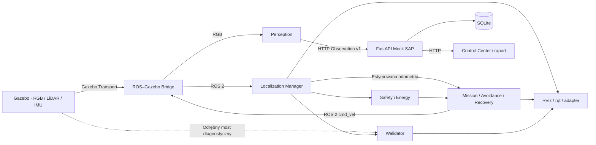

# Rackonaut Engineering Showcase

Checkpoint korzysta z bazowego demonstratora GOAL 17. Osobny pakiet `rackonaut_showcase` subskrybuje aktualne dane i publikuje warstwy oraz telemetrię pod `/rackonaut/engineering/`. Polecenia prędkości są dla adaptera wyłącznie źródłem do porównania z estymowanym ruchem.

## Engineering Live

Na Ubuntu 22.04 lub WSL2 z WSLg i ROS 2 Humble, z katalogu repozytorium.

```bash
python3.10 scripts/api/setup.py
scripts/robotics/build
scripts/robotics/checkpoint live
```

Otwórz [Control Center](http://127.0.0.1:8765). W drugim terminalu uruchom główny widok.

```bash
scripts/robotics/checkpoint tools
```

Poczekaj na `TRACKING` i potwierdzenie doku. Wybierz *Custom inspection*, A-01-01 i A-01-03, *Package quality* oraz *Adaptive inspection*. Pokaż start, narastającą mapę i obie trajektorie. W RViz zapisano ujęcie magazynu, alejki A i widok przy dronie. Użyj przełącznika *Reference infrastructure*, aby porównać odrębną geometrię z odbiciami.

Podczas demonstracji omijania możesz umieścić karton w A na przejeździe do A-01-03, gdy dron leci na poziomie inspekcji około 0,79 m. Zabezpieczenia wstrzymują ruch, gdy skan nie potwierdza kolejnego odcinka. Na krótkim spotkaniu najlepiej pokazać aktywne mapowanie, kamerę i backend. Film i materiały Evidence pozwalają omówić omijanie, Recovery i walidację.

### Wybór narzędzi

| Polecenie dla `scripts/robotics/checkpoint tools` | Widok |
| --- | --- |
| `view:=navigation` | Mapa pomiarowa, aktualny skan, odometria, plan, przebyty tor, dron, punkty inspekcyjne, waypoint, omijanie, ruchy adaptacyjne, dok i TF. |
| `view:=vision` | Dwa widoki Image i opcjonalny Camera korzystający z `camera_info`. Obraz przetworzony pojawia się w trakcie inspekcji. Powiększ oba panele, przeciągając ich prawą krawędź. |
| `view:=safety` | Rezerwacje A, B, D i T, czujniki, powroty w profilu laserowym, pozycja drona oraz plan i przebieg Recovery. |
| `view:=validation` | Estymata, niezależna trajektoria Gazebo, RMSE, maksimum oraz RMS orientacji. Dodaj `localization_diagnostics:=true` przy uruchamianiu Live. |
| `view:=graph adapter:=false` | rqt_graph. Odśwież po starcie zlecenia i wybierz *Nodes/Topics (active)* oraz *Hide Debug*. |
| `view:=plot_energy` | rqt_plot z baterią, kosztem i rezerwą. Analogicznie `plot_flight`, `plot_localization`, `plot_avoidance` i `plot_validation`. |

Konfiguracje RViz ustawiają `rackonaut_odom` oraz 12 FPS dla Navigation, Safety i Validation, a 15 FPS dla Vision. Główny widok używa oryginalnych chmur z buforem jednej wiadomości. Gdy adapter już działa, dodaj `adapter:=false` do następnego okna. Otwieraj kolejny widok pojedynczo. Gazebo dołączysz do tej samej symulacji poleceniem `ign gazebo -g` w aktywowanym terminalu albo ustawieniem `gazebo_gui:=true` podczas uruchamiania Live.

Domyślny Live używa wirtualnego nadzoru obecności. `scripts/robotics/checkpoint live safety_sensor:=laser` uruchamia czujniki A, B i T. W Safety cyjanowe prostokąty oznaczają kalibrowane pola detekcji, osobno od pełnych granic rezerwacji. D korzysta z czujnika wirtualnego także w profilu laserowym. Widok wirtualny jawnie opisuje stan i wyświetla wyłącznie dostępne dane.

## Telemetria i architektura

Grupy są publikowane jako `Float64MultiArray`. Kolejność opisuje `layout.dim[0].label`, a `NaN` oznacza brak aktualnej próbki. W Humble rqt_plot może otworzyć panel przed odkryciem tematów DDS. W takim przypadku skopiuj ścieżki wypisane w terminalu do pola *Topic* i zatwierdź każdą klawiszem Enter. Przykładowe pole to `/rackonaut/engineering/telemetry/flight/data[2]`.

| Grupa | Indeksy od 0 |
| --- | --- |
| `flight` | XYZ w m, moduł prędkości liniowej i kątowej estymowanej, moduł prędkości liniowej i kątowej zadanej. |
| `localization` | RMS dopasowania, największe σ, czas przetwarzania, Hz czasu rzeczywistego, wiek skanu, wiek IMU, udział dopasowania, liczba wokseli. |
| `energy` | Bateria, koszt powrotu, rezerwa, wskaźnik ładowania. Poziomy i koszty w procentach baterii. |
| `avoidance` | Odległość do najbliższego zwrotu przeszkody, zweryfikowany odcinek, dodatkowa długość, wskaźnik hamowania z nawigatora. |
| `validation` | Błąd bieżący, RMSE i maksimum w m, kątowy RMS w stopniach. |



W aktywnej misji mosty LiDAR-u, kamery i IMU publikowały `Reliable / Volatile`. Estymata, mapa i odometria sterująca miały `Best Effort / Volatile`. Widoki chmur i obrazów subskrybują z `Best Effort / Volatile`. Statusy, ścieżki i markery misji używają `Reliable / Transient Local`. TF dynamiczny wiąże `rackonaut_odom` z `rackonaut_base_link`, a mocowania LiDAR-u, IMU i kamery są statyczne. Widok Validation pobiera referencję wyłącznie z niezależnego walidatora. [Audyt typów i QoS](engineering-evidence/live-qos.json) · [Drzewo TF](engineering-evidence/tf-tree.pdf)

## Backend do pokazania

Otwórz [Swagger v1](http://127.0.0.1:8000/docs). Wstaw ID aktywnej lub zakończonej inspekcji.

```bash
run=INS-CONTROL-...
curl -sS "http://127.0.0.1:8000/api/observations?inspection_id=$run" | python3 -m json.tool
curl -sS "http://127.0.0.1:8000/api/summary?inspection_id=$run" | python3 -m json.tool
curl -sS "http://127.0.0.1:8000/api/business/summary?inspection_id=$run" | python3 -m json.tool
```

Odpowiedź biznesowa zawiera adresy zdjęć, gdy inspekcja zapisała dowód. Otwórz je względem adresu API lub w panelu Warehouse Intelligence. Plik `warehouse.sqlite3` jest w `data_dir`, domyślnie w katalogu `control` pod `ROS_LOG_DIR`. W standardowym Pythonie użyj `sqlite3.connect(db.as_uri() + "?mode=ro", uri=True)` dla obiektu `Path` wskazującego bazę. Odczytaj tabele `observations`, `quality` i `verification`, filtrując kolumnę `inspection` po ID inspekcji. [Endpointy biznesowe](SAP_BUSINESS_INTELLIGENCE.md#dodatkowe-endpointy)

Backend checkpointu zwrócił trzy obserwacje i dwa problemy biznesowe. SQLite zapisał trzy obserwacje oraz po zero wpisów jakości i weryfikacji dla tej inspekcji. Do pokazania zdjęcia uszkodzenia i jego weryfikacji służą materiały z przejazdu GOAL 17. [Żądania i odpowiedzi HTTP oraz odczyt SQLite](engineering-evidence/backend-responses.json) · [Zweryfikowany wynik GOAL 17](bi-evidence/verified-business.json)

## Engineering Evidence

Otwórz film, wykresy i zrzuty przed spotkaniem, aby skorzystać z nich przy spadku odświeżania. Opcjonalne odtworzenie lotu używa dwóch terminali i osobnej lokalnej domeny 193.

```bash
# Terminal 1
scripts/robotics/checkpoint evidence rviz
# Terminal 2
scripts/robotics/checkpoint evidence play
```

Launcher odtwarza jawnie wskazane pomiary, TF i warstwy prezentacji. Użyj tej samej wartości `RACKONAUT_EVIDENCE_DOMAIN_ID` w obu terminalach Evidence i domeny odrębnej od aktywnego Live.

Odtworzenie zweryfikowano w domenie 193 przy uruchomionym Live w domenie 158. Zapis ma 4,47 s czasu symulacji, 345 wiadomości z 12 tematów i jest odtwarzany w pętli. Subskrybent odebrał chmurę `/rackonaut/localization/measured_map`. Lista tematów zapisu obejmuje pomiary, ścieżki, warstwy RViz oraz TF. [Metadane zapisu](engineering-evidence/avoidance-bag/metadata.yaml)

| Materiał | Zawartość |
| --- | --- |
| [Film techniczny, 40 s](engineering-evidence/showcase.mp4) | Nagranie odtworzenia w RViz oraz ujęcia omijania, kamery, Safety, Recovery, grafu i telemetrii. |
| [Mapa po locie](engineering-evidence/map-complete.png) · [Narastanie mapy](engineering-evidence/map-live.png) · [Dron i bieżący LiDAR](engineering-evidence/drone-live.png) | Pomiary z rejonów zaobserwowanych przez drona. |
| [Plan i przebyty tor](engineering-evidence/routes-live.png) · [Manewr omijania](engineering-evidence/avoidance-live.png) · [Wykres hamowania](engineering-evidence/avoidance.png) | Widoki aktywnych misji. |
| [Odbicia i pola Safety](engineering-evidence/safety-laser.png) · [Propozycja Recovery](engineering-evidence/recovery-preview.png) · [Przebyty odcinek Recovery](engineering-evidence/recovery-return.png) | Safety z czujnikami A, B i T oraz powrót z osobnej próby w profilu wirtualnym. |
| [Kamera i percepcja](engineering-evidence/vision-rviz.png) · [Surowa klatka P003](bi-evidence/p003-original.png) · [P003 z adnotacją uszkodzenia](bi-evidence/p003-annotated.png) | Aktywny widok kamery z checkpointu oraz para klatek z GOAL 17. |
| [Graf ROS 2](engineering-evidence/active-ros-graph.png) · [rqt_graph](engineering-evidence/active-rqt.png) · [Pełny graf DOT](engineering-evidence/rqt-native.dot) | Rzeczywisty graf podczas pracy Mission Managera i percepcji. |
| [RViz Validation](engineering-evidence/validation-rviz.png) · [Lokalizacja i walidacja](engineering-evidence/localization-validation.png) · [Dynamika i energia](engineering-evidence/flight-energy.png) · [rqt_plot przy doku](engineering-evidence/rqt-energy.png) | Estymacja sensorowa, niezależne porównanie z Gazebo i wykresy z rzeczywistej telemetrii. |

## Próby na WSL2

- Dwupunktowa misja `INS-CONTROL-20261125-173338-B664BB26` odczytała `P001` na A-01-01 po zmianie perspektywy i potwierdziła puste A-01-03. Karton wprowadzono w Gazebo. Dron zahamował, ominął go i wrócił na trasę w obu kierunkach. Nawigator zapisał dodatkowo 1,28 m i 1,33 m. Następnie operator przerwał lot na wysokości przelotowej i zatwierdził Recovery. Po 96,8 s przebiegu procedura potwierdziła dok, ładowanie i zwolnienie rezerwacji. Końcowy status inspekcji to `ABORTED`, a Recovery `RECOVERY_COMPLETE`. [Wynik lotu](engineering-evidence/live-trial.json) · [Zapis Recovery](engineering-evidence/recovery-return.json)
- W trzypunktowej próbie wcześniejszy przejazd między poziomami zakończył się `ROUTE_BLOCKED`. Zatwierdzone Recovery także napotkało niepotwierdzony odcinek i pozostawiło rezerwację. Na pokaz na żywo użyj trasy dwupunktowej. [Zapis zablokowanej próby](engineering-evidence/recovery-blocked.json)
- Na końcu drugiej próby niezależny walidator dysponował 1189 porównaniami. RMSE pozycji wyniósł 0,85 cm, maksymalny błąd 3,38 cm, a RMS orientacji 0,085°. Wyniki dotyczą tej symulacji i użytej trasy. [Ślad walidatora](engineering-evidence/localization-validation.jsonl.gz) · [Ślad adaptera](engineering-evidence/telemetry.jsonl.gz)
- Build zakończył się dla 10 pakietów. Przeszło 38 testów ROS, 7 testów backendu i próba kontraktu v1 po HTTP.

### Wpływ RViz na profil laserowy

Fortress na WSL2, llvmpipe dla symulacji, dron przy doku i ta sama mapa o 1147 wokselach. Każdy pomiar obejmował 96 próbek statystyk Gazebo z około 14 s czasu rzeczywistego. Adapter działał w obu oknach. [Wynik pomiaru](engineering-evidence/laser-performance.json) · [Gazebo bez RViz](engineering-evidence/laser-baseline-stats.txt) · [Gazebo z RViz](engineering-evidence/laser-rviz-stats.txt)

| Metryka | Bez RViz | Navigation RViz, 12 FPS |
| --- | ---: | ---: |
| RTF | 0,4135 | 0,3842 |
| Wiek skanu pokładowego, mediana | 209 ms | 250 ms |
| Wiek skanu pokładowego, p95 | 397 ms | 449 ms |
| Wiek IMU, p95 | 73 ms | 148 ms |
| Lokalizacja `TRACKING` | 45/45 próbek | 47/47 próbek |

Spadek RTF wyniósł 7,1%. A i B raportowały `FRESH` w obu oknach. Jedna próbka T miała `STALE` w oknie bez RViz, przy maksimum 772 ms. W oknie z RViz T miał maksimum 731 ms i status `FRESH`. Ten krótki pomiar przy doku pokazuje koszt jednego okna. Dla pełnego lotu albo kilku jednoczesnych widoków korzystaj z aktualności widocznej w Safety i w razie spadków przejdź na Evidence.

Źródła narzędzi i ustawień. [RViz Humble](https://docs.ros.org/en/humble/Tutorials/Intermediate/RViz/RViz-User-Guide/RViz-User-Guide.html) · [rqt_graph](https://github.com/ros-visualization/rqt_graph/tree/humble) · [rqt_plot](https://github.com/ros-visualization/rqt_plot) · [rosbag2 Humble](https://github.com/ros2/rosbag2/tree/humble)
