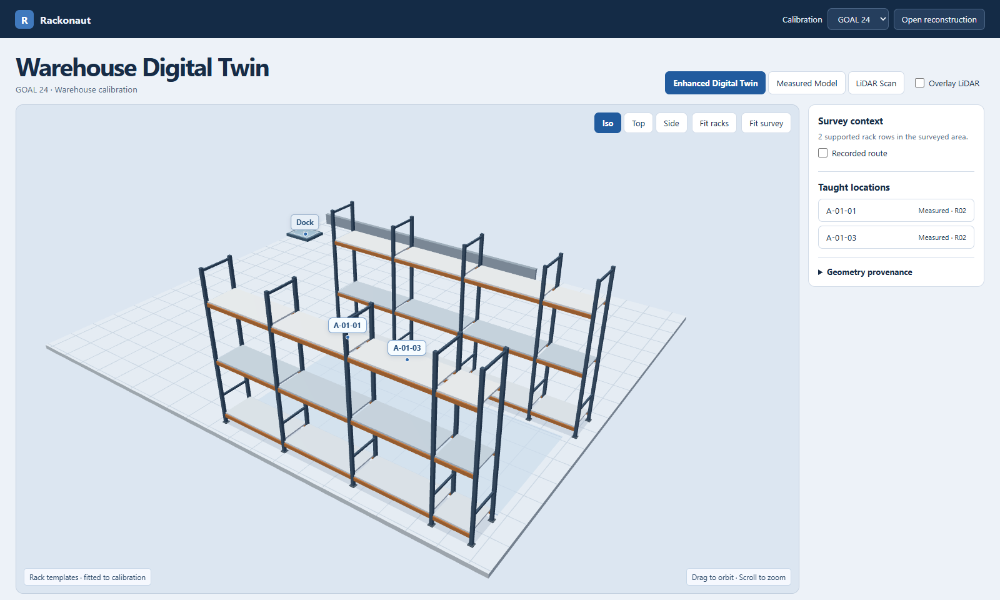

# Rackonaut · Enhanced Digital Twin

Prototyp używa **Template-Based Parametric Reconstruction**. Z pomiarów wyznacza położenie, orientację i wymiary rzędów oraz poziomy składowania. Three.js dopasowuje do tych parametrów modułowy szablon z pełnymi prostokątnymi półkami, słupami i belkami. Cztery kalibracje obejmują podobny wycinek tej samej hali. We wszystkich dopasowano dwa rzędy o długości odtworzonego odcinka 9,28–10,10 m.



## Podgląd i eksport

W katalogu głównym repozytorium uruchom:

```bash
python3 -m http.server 8963 --bind 127.0.0.1
```

[Otwórz Warehouse Digital Twin](http://127.0.0.1:8963/scripts/reconstruction/viewer/). Podgląd wymaga WebGL2. Przykłady GOAL 24 i 26 działają ze statycznych plików JSON.

- **Enhanced Digital Twin** pokazuje szablon, podłogę, skrócony przekrój ściany, alejkę i dok. **Recorded route** włącza zapisaną trasę. **Fit survey** kadruje kontekst, a **Fit racks** wraca do regałów.
- **Measured Model** pokazuje zachowane fragmenty półek i słupów z GOAL 26A. **LiDAR Scan** wyświetla oryginalne punkty z PLY. **Overlay LiDAR** nakłada tę samą chmurę na oba modele. Zmiana warstwy zachowuje kamerę.
- **Iso**, **Top** i **Side** ustawiają kamerę izometryczną, rzut z góry i elewację ortograficzną. Przeciągnięcie obraca kamerę w trybie Iso. Kółko przybliża w każdym trybie.
- Kliknięcie etykiety lub wiersza lokalizacji pokazuje fotografię, wynik przypisania i dostępne parametry. **Geometry provenance** ujawnia parametry i zaznacza opcjonalnie zmierzone fragmenty regału.

Eksport z własnego zamkniętego archiwum używa istniejącego środowiska Humble, NumPy, SciPy i OpenCV z ArUco. Wynik zapisuje do nowego pliku, który można otworzyć przyciskiem **Open reconstruction**.

```bash
scripts/robotics/build
source scripts/robotics/activate.bash
OPENBLAS_NUM_THREADS=1 python3 scripts/reconstruction/twin.py \
  /ścieżka/do/archiwum /tmp/rackonaut-twin.json \
  --camera-calibration scripts/reconstruction/reference-camera.json \
  --source combined
```

**`--source ply`** pozwala porównać dopasowanie z samego PLY. Profil kamery należy podać zgodny z archiwum. Bez niego dostępne są pozycja inspekcyjna drona i zarejestrowane zdjęcie. Przeglądarka również odczytuje starsze pakiety GOAL 26A.

## Algorytm i pochodzenie danych

1. **Wykrycie rzędów.** Istniejący detektor GOAL 26A wyznacza dominujące osie z normalnych i szuka wydłużonych, nakładających się w rzucie skupisk na kolejnych wysokościach. Samo skupisko powierzchni poziomych wystarcza dopiero po potwierdzeniu regularności na co najmniej trzech pasmach. Liczba rzędów wynika z pomiaru.
2. **Dopasowanie pojedynczego rzędu.** Parametry obejmują środek w układzie mapy, orientację, wymiary, poziomy, obwiednię obserwowaną i dopasowaną, granice słupów oraz jakość estymacji. Pozycje z obu stron rzędu grupuje się wzdłuż jego osi. Dopasowanie rozstawu porównuje kandydatów o różnych okresach i wymaga co najmniej trzech pozycji. Przy słabym podparciu szablon stosuje moduły o domyślnym podziale, a pole rozstawu pozostaje puste. Przy krawędzi uciętej przez pomiar ostatni segment może być krótszy. Dodatkowy odcinek wzdłuż osi wymaga zgodności z rozstawem słupów oraz wokseli NPZ na co najmniej dwóch poziomach. Limit wydłużenia jednego końca to mniejsza z wartości 0,85 m i 45% okresu.
3. **Poziomy i szablon.** Poziom jest dopasowany do powtarzalnego skoku, jeśli maksymalna odchyłka od obserwacji kandydujących mieści się w tolerancji 0,105 m. W bogatszym wariancie lokalne, poziome woksele mogą doprecyzować medianę przed wyznaczeniem skoku. `templates.js` buduje osobno słupy, kotwy, poprzeczki, belki i decki na wszystkich poziomach i w każdym module. Przekroje profili są proporcjami szablonu. Krawędzie i powierzchnie półek są prostokątne w całym dostępnym zakresie. Mierzone fragmenty pozostają osobną warstwą.
4. **Kontekst.** Nachylenie normalnych i dolna warstwa PLY wyznaczają wysokość podłogi. Jej zasięg jest obwiednią wyznaczoną z kwantyli rozszerzoną wizualnie, aby objąć dopasowane regały, dok i widoczne ściany. Linie ścian wymagają pionowych zwrotów rozłożonych wzdłuż krawędzi. Przeglądarka pokazuje jedynie niskie przekroje. Alejka jest geometryczną przerwą między rozpoznanymi sąsiadami. Lokalizacja doku pochodzi z kotwicy archiwum, a jego bryła jest symbolem. Trasa pochodzi z krawędzi `route.json` albo zachowanej trajektorii kalibracji w starszym archiwum. Przeglądarka nie wyznacza nowych tras.
5. **Taught locations.** Oryginalny dekoder sprawdza dokładnie jeden zgodny znacznik ArUco na JPEG. Kalibracja kamery i zarejestrowana poza drona wyznaczają promień optyczny. Wpis **Measured** wymaga jednej powierzchni wejściowej i lokalnych zwrotów. Poziom wskazywany jest osobno. Wpis **Estimated** może powstać przy braku takiego pomiaru, gdy promień przecina jedną dopasowaną powierzchnię w obserwowanym zakresie rzędu, zgadza się z jednym poziomem i jest blisko zwrotów. **Unplaced** pokazuje oryginalne miejsce wykonania zdjęcia. Pozycje inspekcyjne i fotografie w archiwum są zachowane. [Profil kamery i metoda GOAL 26A](MEASURED_WAREHOUSE_RECONSTRUCTION.md)

### PLY i NPZ

`map.ply` zawiera zwokselizowane punkty w `rackonaut_odom`, w metrach i z pionem Z. `localization.npz` zawiera już zarejestrowane w tej samej ramie końcówki i normalne. Pozy klatek są używane do grupowania stanowisk obserwacji w przestrzeni oraz według kierunku. Grupowanie w wokselach 0,12 m ogranicza głos każdej grupy poz do jednego. Woksel pozostaje, jeśli ma co najmniej dwie grupy widoku albo leży do 0,18 m od PLY. Normalne wybierają poziome zwroty przy wykrytych półkach.

| Archiwum | Punkty PLY | Klatki / surowe zwroty NPZ | Woksele zachowane | Zachowane ponad 0,18 m od PLY |
| --- | ---: | ---: | ---: | ---: |
| GOAL 22 | 56 549 | — | — | — |
| GOAL 23 | 55 955 | — | — | — |
| GOAL 24 | 56 059 | 183 / 488 727 | 70 885 | 6 241 |
| GOAL 26 | 55 775 | 182 / 488 243 | 70 641 | 6 284 |

W GOAL 24 i 26 zarejestrowano odpowiednio 64 i 62 grupy widoku. Woksele z poparciem wielu grup to 51 553 i 51 328. Nadmiar zwrotów występuje też na podłodze i infrastrukturze, dlatego samo zwiększenie gęstości nie uzasadnia dodania rzędu.

## Porównanie metod

Research wykonano w Chrome przez rozszerzenie Playwright. Kryterium wyboru stanowił dopasowany, dający się kontrolować obiekt CAD z informacją o pomiarach i estymacji.

| Metoda | Dopasowanie do prototypu |
| --- | --- |
| Point Cloud Completion i Shape Completion | PoinTr i AdaPoinTr uzupełniają zbiory punktów. Dostępne eksperymenty i wagi dotyczą benchmarków obiektów, między innymi ShapeNet i PCN. Wydzielenie całego regału i przeliczenie zwrotów na parametry konstrukcji nadal wymagałyby dodatkowych etapów. [PoinTr i wagi](https://github.com/yuxumin/PoinTr) · [Publikacja AdaPoinTr](https://arxiv.org/abs/2301.04545) |
| Semantic Point Cloud Segmentation | Pointcept i Point Transformer V3 mogą dostarczyć maskę klasy. To potencjalne wejście do detektora, gdy dostępne są wagi dla magazynu. Domyślne benchmarki scen wnętrz, np. ScanNet i S3DIS, nie dały gotowego dopasowania rzędów i modułów tej hali. [Pointcept](https://github.com/Pointcept/Pointcept) · [Point Transformer V3](https://openaccess.thecvf.com/content/CVPR2024/html/Wu_Point_Transformer_V3_Simpler_Faster_Stronger_CVPR_2024_paper.html) |
| Geometria ogólna | Woksele, normalne, RANSAC i segmentację płaszczyzn opisuje Open3D. Wielkie płaszczyzny tej sceny często należą do podłogi lub tuneli. Powtarzalność poziomów i wspólna obwiednia dają dodatkowy sygnał o konstrukcji regału. [Open3D](https://www.open3d.org/docs/release/tutorial/geometry/pointcloud.html) |
| Rekonstrukcja parametryczna i generacja proceduralna | Istniejący detektor, dopasowanie skoku i Three.js dają kontrolę nad każdym polem szablonu. `InstancedMesh` grupuje powtarzające się profile, półki i belki. Ten wariant ma porównanie z niezależną geometrią i działa na obecnym stosie. [Three.js InstancedMesh](https://threejs.org/docs/pages/InstancedMesh.html) |

W zbadanych źródłach nie znaleziono gotowych wag dla skanów rzędów przemysłowych o takim celu. Lokalny test gotowości uruchomieniowej zakończył się błędem wykonania prostego kernela CUDA. Zainstalowany PyTorch 2.5.1+cu121 obsługuje architektury do sm_90, a RTX 5060 Laptop ma sm_120. Eksperyment porównawczy obejmuje warianty geometryczne. Brak wyniku inferencji modelu AI.

## Walidacja

Cztery archiwa zostały odczytane osobno. Walidator zapisał kompletne pakiety i ich SHA-256 przed wczytaniem SDF i tekstur referencyjnych. W każdym przypadku porównał też część pomiarową pakietu z oryginalnym eksporterem i uzyskał identyczną zawartość. SDF i tekstury wykorzystano wyłącznie w osobnym pomiarze walidacyjnym. [Wyniki, skróty i identyfikatory archiwów](enhanced-twin-evidence/validation.json)

| Pomiar | Wynik |
| --- | --- |
| Rzędy i pokrycie | W każdej kalibracji 2 poprawnie przypisane z 4 obecnych w świecie i 0 fałszywych rzędów. Zakres podłużny modeli stanowi 47–51% pełnych rzędów. Oba warianty zachowały ich rozmieszczenie. |
| Położenie i orientacja | Błąd środka w poprzek rzędu 2,6–6,4 cm. Różnica osi 0,04–0,13°. Środki odcinków wzdłuż rzędu odpowiadają części objętej lotem. |
| Wymiary i rozstaw | Wysokość szablonu 5,54–5,63 m przy 5,70 m w świecie. Głębokość 1,17–1,21 m przy 1,32 m po zewnętrznych profilach. Dopasowany okres słupów 2,76–2,77 m przy 2,80 m w świecie. |
| Półki i kompletność | 3 pełne poziomy każdego wykrytego rzędu. Wyjściowe mierzone fragmenty pokrywają 38–89% powierzchni poszczególnych poziomów. Mediany GOAL 26A różnią się od najbliższej fizycznej powierzchni tej samej półki o 1,3–2,5 cm. Poziomy regularnego modelu różnią się o 1,1–4,3 cm. Najbliższa powierzchnia może stanowić spód półki. |
| Wpływ NPZ | Przesunięcie dopasowanych poziomów do około 1 cm. Średni błąd względem najbliższej płaszczyzny dla GOAL 24 wyniósł 2,93 cm z PLY i 2,91 cm z NPZ, a dla GOAL 26 odpowiednio 2,93 i 2,94 cm. Dodatkowy zakres 22 cm po jednym końcu R02 w GOAL 26. Liczba rzędów, poziomów i przypisań pozostała zgodna. |
| Lokalizacje | 5 z 8 przypisano do właściwego rzędu z odchyłką 2,2–3,5 cm względem środka ArUco. Dla A-01-01 w GOAL 24 i 26 potwierdzono stronę rzędu, a pole poziomu pozostało puste. Trzy zdjęcia bez jednoznacznego ID pozostały w pozycjach inspekcyjnych. Wariant Estimated i niejednoznaczny przypadek dwóch rzędów sprawdzono w testach kontrolowanych. |
| Usunięcie fragmentów | Wycięcie 0,62 m w środku jednego pasma zostawiło 2 rzędy i po 3 pełne poziomy. Usunięcie pomiarów jednego rzędu zostawiło 1 rząd. Sama dolna część chmury dała 0. Po obrocie o 27° i przesunięciu nadal znaleziono 2 rzędy z osiami 26,87°. |
| Czas generowania | GOAL 26A 0,24–0,28 s. Szablon z PLY 0,45–0,52 s. Szablon z PLY i NPZ 0,90–1,00 s. Ubuntu 22.04 pod WSL2, Python 3.10, jeden wątek OpenBLAS. |
| Płynność Chrome | Chrome 158, WebGL2 ANGLE na Radeon 610M, płótno 1252×781. W próbie 70 kolejnych odstępów `requestAnimationFrame` przy cyklicznym przybliżaniu P95 wyniósł 4,3 ms dla trzech warstw podstawowych i 5,1 ms dla nakładki. Wynik opisuje odstępy klatek tego stanowiska przy odświeżaniu około 240 Hz. |

W tym zbiorze PLY wystarcza do położenia rzędów, rozstawu i jakości wizualnej. Wariant łączony stanowi domyślny eksport, kiedy archiwum zawiera NPZ. Dodatkowe zwroty są cenne przede wszystkim jako drugi sygnał o zasięgu i lokalnym podparciu. Wersja z PLY jest szybsza i daje niemal ten sam wygląd.

Testy obejmują regularny szablon z przerwą pomiarową, ograniczenie powtórzeń zależnych od pozy kamery, projekcję i niejednoznaczność lokalizacji, pomiary zmienionej chmury oraz stan ze starszym pakietem. Izolowany smoke test ROS z danymi testowymi przeszedł dla obrazu 640×360. W Chrome przetestowano okna 1600×960, 1366×768 i 425×850, import lokalny, zmianę warstw, obrót, zoom, wszystkie rzuty i fotografie. [Wynik próby w Chrome](enhanced-twin-evidence/browser-proof.json)

```bash
source scripts/robotics/activate.bash
OPENBLAS_NUM_THREADS=1 python3 -m unittest discover -s scripts/reconstruction -v
OPENBLAS_NUM_THREADS=1 python3 scripts/reconstruction/evaluate_twin.py \
  --case goal22 /ścieżka/do/GOAL22 --case goal23 /ścieżka/do/GOAL23 \
  --case goal24 /ścieżka/do/GOAL24 --case goal26 /ścieżka/do/GOAL26 \
  --camera-calibration scripts/reconstruction/reference-camera.json \
  --world ros2_ws/install/rackonaut_warehouse/share/rackonaut_warehouse/worlds/localization_showcase.sdf \
  --warehouse-assets ros2_ws/src/rackonaut_warehouse \
  --output-dir /tmp/rackonaut-twin-validation
```

## Materiały do oceny

| Materiał | Co można sprawdzić |
| --- | --- |
| [GOAL 26A](enhanced-twin-evidence/measured-iso.png) · [Enhanced](enhanced-twin-evidence/enhanced-iso.png) · [LiDAR](enhanced-twin-evidence/lidar-iso.png) | Trzy warstwy tego samego zapisu GOAL 24 przy tej samej kamerze. |
| [Z góry](enhanced-twin-evidence/top.png) · [Z boku](enhanced-twin-evidence/side.png) · [Zbliżenie](enhanced-twin-evidence/rack-close.png) · [Po obrocie](enhanced-twin-evidence/orbit.png) | Odstępy, poziomy, moduły i profile konstrukcyjne. |
| [Taught location i fotografia](enhanced-twin-evidence/location.png) · [Dok i zapisana trasa](enhanced-twin-evidence/survey-route.png) | Powiązania modelu z danymi kalibracji. |
| [Nałożony LiDAR](enhanced-twin-evidence/overlay.png) · [Podświetlone pomiary](enhanced-twin-evidence/provenance.png) | Dane źródłowe i miejsca wypełnione szablonem. |
| [Nagranie interakcji, 14 s](enhanced-twin-evidence/enhanced-digital-twin.mp4) · [Pakiet GOAL 24](enhanced-twin-evidence/goal24.json) · [Pakiet GOAL 26](enhanced-twin-evidence/goal26.json) | Przejście przed i po, obrót, zoom, nakładka, rzuty oraz wybór zdjęcia. |

## Ograniczenia

Badanie dotyczy dwóch obserwowanych rzędów w tej samej hali. Na krótkich regałach z dwoma poziomami, regałach ustawionych pod różnymi kątami lub przy silnej okluzji dowody mogą okazać się zbyt słabe. Zwroty powierzchniowe rejestrują dostępne strony konstrukcji, więc górna płaszczyzna szablonu może odpowiadać poziomowi zmierzonemu pod półką. Obwiednia podłogi, odstęp alejki, model doku i przekroje ścian są uproszczeniami. Obiekty takie jak palety i kartony występują wyłącznie w oryginalnych zdjęciach i pomiarach.

Prototyp działa jako statyczny podgląd, z oddzielnym eksporterem do JSON. Ścieżki ROS, zapisane mapy, lokalizacja, planowanie i zabezpieczenia korzystają z oryginalnych danych. Wyniki szablonu są przeznaczone do wizualnej oceny magazynu.
