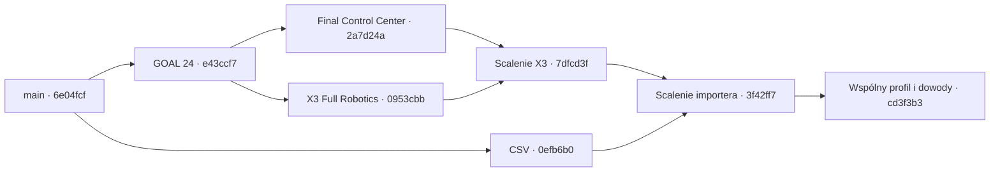

# GOAL 27 — Full System Integration

## Audyt przed scaleniem

| Źródło | Commit po fetch | Znaczenie |
| --- | --- | --- |
| `feature/final-control-center-ux` | `2a7d24a4fef54431096bcc05a240f1c9d3b3708c` | Baza integracji i zaakceptowane GUI |
| `integration/x3-full-robotics` | `0953cbb738280b9709a8f92e4970f0932e8d1729` | Model X3 z tym samym stosem, korekty lokalizacji i odbiór inwentaryzacji |
| `feature/inventory-import` | `0efb6b03ab87c84862d22ea082965441bdd8d3b9` | Samodzielny importer CSV, przykłady, szablony i testy |
| Wspólna baza GUI i X3 | `e43ccf7c0525296f52308fdba7db53ef1810256b` | Zweryfikowany GOAL 24 |
| Baza importera | `6e04fcfa6b8c5abd5db15598f03fb4ca54b9e099` | Wspólny przodek importera i GUI |
| `integration/competition-main` | `5e3696dab2b35290a239dbd29478420a8890c0c4` | Przodek finalnego GUI |

Nowe dla tego checkoutu zdalne gałęzie sprawdzono względem trzech wskazanych źródeł. `codex/x3-full-robotics-acceptance` jest już w `0953cbb`. `feature/drone` i `codex/x3-full-mission-acceptance` zawierają historię modułu Michała oraz alternatywny samodzielny runner X3. Wspólny Full Robotics ma własne zweryfikowane odpowiedniki tych funkcji. `codex/control-center-operator-flow` i `codex/control-center-reliability` pochodzą ze starszych wersji GUI. Ich unikalne zmiany obejmują konkurencyjny interfejs i modyfikacje telemetrii i Safety. `codex/warehouse-in-motion` to osobny scenariusz z dnia 27 listopada 2026 poza zakresem odbioru GOAL 27. Pozostałe rozbieżne zmiany dokumentacyjne dotyczą wcześniejszego sposobu uruchamiania i są pokryte bieżącym README. Gałęzie pozostają dostępne w swoich oryginalnych wersjach.

### Rejestr modułów

Status w tej tabeli odnosi się do zawartości źródeł przed scaleniem. Dowody wskazują wcześniejsze wyniki i pozostają przypisane do swoich pierwotnych wersji.

| Moduł | Odpowiedzialność | Źródło i commit | Główne zależności | Status przed scaleniem i dowód |
| --- | --- | --- | --- | --- |
| Magazyn i infrastruktura | Świat Gazebo, regały, stacja i chroniona przestrzeń | GUI `4b7a039`, `1818d64` | Gazebo Fortress, Fuel, kontrakt ROS | Obecny w bazie GUI. [Infrastruktura](AERIAL_INFRASTRUCTURE.md) |
| Dron referencyjny | Podstawowy model i interfejsy pomiarowe | GUI `cc8f742`, `48f30c6` | Gazebo, most ROS, stacja | Domyślny w bazie. [Demo](DEMO_COMPLETE.md) |
| X3 | Alternatywny model, napęd, sensory i TF | X3 `4bae245`, `0953cbb` | Asset Fuel X3 UAV 4, kontrola sum, wspólny stos | Do scalenia. [Odbiór X3](X3_FULL_ROBOTICS_INTEGRATION.md) |
| Mission Manager | Autonomia, plan, sekwencja i raport | GUI `b5e310d`, `4b7d930`, X3 `0953cbb` | Safety, Energy, CV, lokalizacja | Baza plus poprawki X3. [Learned warehouse](LEARNED_WAREHOUSE_AUTONOMY.md) |
| Computer Vision | Przetwarzanie obrazu i publikacja obserwacji | GUI `4d971fc`, `39d5a86` | RGB, CameraInfo, OpenCV | Obecny. [Adaptive Inspection](ADAPTIVE_INSPECTION.md) |
| Rozpoznawanie lokalizacji i towaru | Powiązanie markerów lokalizacji i HU | GUI `4d971fc`, `39d5a86` | ArUco, CV, kontrakt obserwacji | Obecny. [Adaptive Inspection](ADAPTIVE_INSPECTION.md) |
| Zajętość | Klasy occupied, empty i uncertain | GUI `4d971fc`, `39d5a86` | Obraz i powiązanie z miejscem | Obecny. [Adaptive Inspection](ADAPTIVE_INSPECTION.md) |
| Uszkodzenia opakowań | Ocena widocznych kartonów i dowody | GUI `593d51a` | CV, opcja inspekcji jakości | Obecny. [Dowody biznesowe](SAP_BUSINESS_INTELLIGENCE.md) |
| Mock SAP | Porównanie zapasu i zapis wyników | GUI `3c7c97b` | FastAPI, SQLite, kontrakt v1 | Obecny. [Mock SAP](SAP_BUSINESS_INTELLIGENCE.md) |
| Raportowanie biznesowe | Rozbieżności, rekomendacje, oryginały i HTML | GUI `de57a33`, `3c7c97b`, `f50cfee` | Mission Manager, Mock SAP, Control Center | Obecne. [Raport biznesowy](bi-evidence/warehouse-report.html) |
| Safety | Obecność, rezerwacja, Start i Abort | GUI `2a60fa5`, `ca1fa1e` | Strefy magazynu i sensor wirtualny lub laserowy | Obecny. [Sensor Safety](../ros2_ws/src/rackonaut_safety/docs/SENSOR_SAFETY.md) |
| Collision Prevention | Weryfikacja prześwitu i obwiedni ruchu | GUI `541948b`, X3 `0953cbb` | LiDAR, odometria zgodna czasowo | Baza plus poprawki X3. [Obstacle avoidance](OBSTACLE_AVOIDANCE.md) |
| Energy | Budżet oraz rezerwa energii | GUI `e3a0d79`, X3 `0953cbb` | Odometria, stacja, Mission Manager | Baza plus profil X3. [Energy](ENERGY_MANAGEMENT.md) |
| Ładowanie i wznowienie | Powrót, kontakt fizyczny, ładowanie i kontynuacja | GUI `e3a0d79`, X3 `0953cbb` | Energy, stacja, Safety | Baza plus zmiany napędu X3. [Odbiór X3](X3_FULL_ROBOTICS_INTEGRATION.md) |
| Recovery | Nadzorowany powrót po przerwaniu | GUI `dd854a4` | Lokalizacja, Safety, Energy, zgoda operatora | Obecny. [Recovery](AUTONOMOUS_RECOVERY.md) |
| Lokalizacja LiDAR–IMU | Poza na podstawie pomiarów | GUI `48f30c6`, X3 `0953cbb` | Chmura, IMU, TF i kontakt doku | Baza plus dopasowanie X3. [Lokalizacja](SENSOR_LOCALIZATION.md) |
| SLAM | Rejestracja, klatki kluczowe, mapa pomiarowa | GUI `222c0d0`, `75c83d4`, X3 `f4ca62f` | LiDAR i IMU | Baza plus korekta płaszczyzn i wydajności. [Bramka pełnej trasy](SLAM_FULL_ROUTE_VALIDATION.md) |
| Chronione sterowanie ręczne | Polecenia operatora i watchdog | GUI `3745e74`, `f50cfee` | Mission Manager, Collision Prevention, Safety | Obecne. [Walidacja GUI i ochrony](FINAL_CONTROL_CENTER_UX.md) |
| Mapowanie nieznanego magazynu | Pusta sesja SLAM i eksport pomiarów | GUI `222c0d0`, `75c83d4` | Odometria pomiarowa i tryb serwisowy | Obecne. [Unknown Warehouse](UNKNOWN_WAREHOUSE_MAPPING.md) |
| Nauczanie lokalizacji | Powiązanie pomiarowej pozy i obrazu | GUI `4d5a8a5` | Kamera, SLAM, katalog sesji | Obecne. [Storage Location Teaching](STORAGE_LOCATION_TEACHING.md) |
| Nauczanie tras | Rejestracja, ocena obwiedni i zatwierdzenie grafu | GUI `c931e36` | Pozy i miejsca z kalibracji, Safety | Obecne. [Route Teaching](ROUTE_TEACHING.md) |
| Teach-and-Repeat | Odtwarzanie zatwierdzonej trasy z pomiarów | GUI `e43ccf7`, X3 `f4ca62f` | Archiwum, lokalizacja, Mission Manager | Oba modele zweryfikowano osobno. [GOAL 24](LEARNED_WAREHOUSE_AUTONOMY.md) i [X3](X3_FULL_ROBOTICS_INTEGRATION.md) |
| Enhanced Digital Twin | Model parametryczny i trzy widoki pomiaru | GUI `e417074`, `3126276` | PLY, dane kalibracyjne kamery, Three.js | Obecny. [Enhanced Digital Twin](ENHANCED_DIGITAL_TWIN.md) |
| Final Control Center | Plan, Live, Results, Service i Diagnostics | GUI `2a7d24a` | Wspólny Control Center, Mock SAP, telemetria | Baza. [Final UX](FINAL_CONTROL_CENTER_UX.md) |
| Engineering Showcase | RViz, rqt, telemetria oraz odtwarzanie bagów | GUI `44ea9e3` | ROS, RViz, rosbag2 | Obecny. [Showcase](ENGINEERING_SHOWCASE.md) |
| Import CSV | Walidacja i zapis JSON zgodnego z Mock SAP | Import `0efb6b0` | Python 3.10, kontrakt OpenAPI | Do scalenia. [Importer](../scripts/inventory/README.md) |
| Launchery | Uruchamianie wspólnych profili i narzędzi | GUI `44ea9e3`, X3 `4bae245` | ROS, Gazebo, środowisko systemowe i backend | Wspólny `checkpoint`, do weryfikacji z nowym worktree. [README](../README.md) |

## Graf i konflikty



- `control/node.py` zawierał konflikt inicjalizacji. Złożono inicjalizację jednej instancji archiwum z profilem drona z pracownikiem Digital Twin. Zachowano wyznaczanie i walidację tras, listę rewizji, historyczne raporty, warunki Service i blokady autoryzacji. Plan X3 zachowuje ortogonalne podejścia z gałęzi X3.
- `control/warehouse.py` scalił się tekstowo. Przejrzano relację metadanych sensorów, listy modeli oraz wyświetlanej trasy. Weryfikacja sprawdza podpisane źródło i dopasowanie modelu przed aktywacją. Lokalizator niezależnie sprawdza profil dla `sensors.json` i `result.json`. Punkty do wyświetlania pochodzą z wybranego odcinka i są oddzielone od skierowanego grafu używanego przez misję.
- `control.launch.py`, launcher referencyjny, Mission Manager, Energy i SLAM zachowują zmiany X3. Przy dwóch profilach identyczne nazwy interfejsów prowadzą do tych samych węzłów. Wybór uruchomieniowy zmienia model, ekstrynsykę, mocowanie doku i profil sensorów.
- Importer dodał osobne CLI, przykłady, szablony i testy. Przykładowe pliki przechodzą walidację dla 11 miejsc oraz 9 produktów. Domyślny zestaw Mock SAP zostaje bez zmian.

## Profile i dane

| Właściwość | Reference | X3 |
| --- | --- | --- |
| Launcher | `drone_model:=reference`, także domyślnie | `drone_model:=x3`, model Fuel X3 UAV 4 z kontrolą sum |
| Kamera i TF | 320 × 240, przesunięcie `[0.23, 0, 0]` m | 320 × 240, przesunięcie `[0.27, 0, 0.04]` m |
| Ramy | `rackonaut_odom`, `rackonaut_base_link`, `rackonaut_camera_optical_frame` | Te same interfejsy. Most X3 dostosowuje natywne nazwy ramek. |
| Dok dla testowanego archiwum | `[-4.70, 10.30, 0.050]` m | `[-4.70, 10.30, 0.059]` m |
| LiDAR | 8 m w standardowym uruchomieniu, 16 m w trybie nauczonego magazynu | Te same profile. Scenariusz 11/11 korzysta z 8 m. |
| Zgodne archiwum w odbiorze | GOAL 24, `WH-E83B9581352A5C6DBC06694FE5E70FFA`, rewizja 2 | GOAL 25, `WH-216C75B710D2AF0D46B298CEC6B92350`, rewizja 2 |
| Starszy format bez wpisu `drone_model` | Obsługiwany jako referencyjny, z pełną weryfikacją integralności | Odrzucany przy aktywacji |
| Archiwum drugiego modelu | Blokada aktywacji | Blokada aktywacji, sprawdzona na poprawnym archiwum GOAL 24 |

Binding Digital Twin zawiera profil kamery i skrót parametrów. Dla prawidłowo zidentyfikowanego archiwum używa pomiarowej pozy i profilu jego kamery. Przy braku rozpoznanego profilu lub niespójności danych kamera jest pomijana i lokalizacja pozostaje `unplaced`. Można nadal odczytać zmierzoną chmurę, uproszczony model i punkt inspekcyjny. Konfiguracja wyświetlona dla raportu historycznego pochodzi z zapisu misji. Wybór bieżącego profilu nie zmienia mapy historycznej.

## Dowody obserwacji

Przyczyna braku obrazu pustego miejsca w GOAL 26E była w ścieżce zapisu. Uruchamiał ją stabilny wynik oceny kartonu po obserwacji zajętego miejsca. Pusta półka omijała tę ścieżkę.

W locie zarządzanym przez Control Center producent zapisuje oryginalną klatkę używaną do nowej obserwacji i równoległy podgląd z adnotacjami, jeśli zsynchronizowana klatka jest aktualna i poprawna. Wspólny mechanizm dowodowy zapisuje ją jako `CAPTURED`, z ID misji, ID obserwacji, miejscem, zajętością, znacznikiem czasu ROS kamery oraz czasem UTC z obserwacji. Mock SAP porównuje te pola z przyjętym zdarzeniem. Dane `CAPTURED` trafiają do Results i raportu bez wpływu na klasyfikację jakości kartonów. Zapis dowodu może się nie udać i raport wymienia wtedy obserwacje pozbawione obrazu. Zdjęcia kalibracyjne pozostają w swoim archiwum, a starsze raporty zachowują oryginalną treść. [Kontrakt](../contracts/http.md#functional-mock-sap-profile)

## Uruchomienie

We wspólnym worktree uruchom `scripts/robotics/check`, `python3.10 scripts/api/setup.py` i `scripts/robotics/build`. Wybierz profil poniżej, uruchamiając jeden serwer Gazebo naraz. Każdy profil powinien mieć własne dane, porty, domenę ROS i partycję Gazebo.

| Tryb | Launcher |
| --- | --- |
| Business Demo | `scripts/robotics/checkpoint business` |
| Full Robotics reference | `scripts/robotics/checkpoint live drone_model:=reference` |
| Pełny spis X3 na znanej mapie | `scripts/robotics/checkpoint live drone_model:=x3 full_route_slam:=false safety_sensor:=virtual` |
| Learned Warehouse | `scripts/robotics/checkpoint live drone_model:=reference learned_warehouse:=true data_dir:=/absolute/path`. Dla X3 wybierz `x3` i katalog z kompatybilnym zapieczętowanym archiwum. |
| Calibration | `scripts/robotics/checkpoint live drone_model:=reference mapping_only:=true full_route_slam:=true`. W Service otwórz kontrolki mapowania. |
| Engineering Showcase | `scripts/robotics/checkpoint tools view:=navigation` przy tej samej domenie ROS co live. Do odtwarzania offline służy `checkpoint evidence rviz` i `checkpoint evidence play`. |

`http_port:=`, `mock_port:=`, `data_dir:=`, `RACKONAUT_ROS_DOMAIN_ID` i `RACKONAUT_GZ_PARTITION` pozwalają odizolować poszczególne uruchomienia. `RACKONAUT_SERVICE_CODE` ustawia dostęp do sekcji Service. Ścieżkę do zaufanej kopii modelu X3 można podać przez `x3_source:=`. [README](../README.md#start-here) · [Engineering Showcase](ENGINEERING_SHOWCASE.md)

Przykład przygotowania kopii zapieczętowanego archiwum X3. Po starcie w **Service → Warehouse Configuration** zweryfikuj i aktywuj konfigurację w fizycznym doku. W `Plan inspection` wybierz A-01-01 i A-01-03.

```bash
archive_id=WH-216C75B710D2AF0D46B298CEC6B92350
archive_dir="docs/full-system-evidence/warehouse-configurations/$archive_id"
run_dir="$PWD/.rackonaut-data/x3-learned"
mapping_id="$(python3 -c 'import json,sys; print(json.load(open(sys.argv[1]))["mapping_id"])' "$archive_dir/manifest.json")"
mkdir -p "$run_dir/warehouse-configurations" "$run_dir/mapping"
cp -a "$archive_dir" "$run_dir/warehouse-configurations/"
cp -a "$archive_dir" "$run_dir/mapping/$mapping_id"
RACKONAUT_ROS_DOMAIN_ID=212 RACKONAUT_GZ_PARTITION=rackonaut-x3-learned \
  scripts/robotics/checkpoint live drone_model:=x3 learned_warehouse:=true \
  http_port:=8822 mock_port:=8122 data_dir:="$run_dir"
```

Dla `reference` wybierz archiwum GOAL 24, niezależny katalog danych i odpowiednie parametry uruchomienia. Kopia X3 pochodzi z poprzedniego odbioru, z zachowanym manifestem, trasą, mapą i referencyjnymi zdjęciami kalibracji. [Archiwum X3](full-system-evidence/warehouse-configurations/WH-216C75B710D2AF0D46B298CEC6B92350/manifest.json) · [Archiwum reference](learned-warehouse-evidence/warehouse-configurations/WH-E83B9581352A5C6DBC06694FE5E70FFA/manifest.json)

## Walidacja

Build z czystego worktree w WSL2 Ubuntu 22.04, ROS 2 Humble, Gazebo Fortress 6.16.0 i systemowy Python 3.10.12 zakończył się kompilacją 11 pakietów. `pytest -q ros2_ws/src` zaliczył 76 testów. `unittest discover -s tests` zaliczył 62 testy, w tym Mock SAP, kontrakt i importer. Smoke HTTP zaliczył zapis, powtórkę, błędy i odczyt ośmiu scenariuszy. Nowe próby obejmują wiązanie kamery z archiwum i foto dowód pustej lokalizacji.
