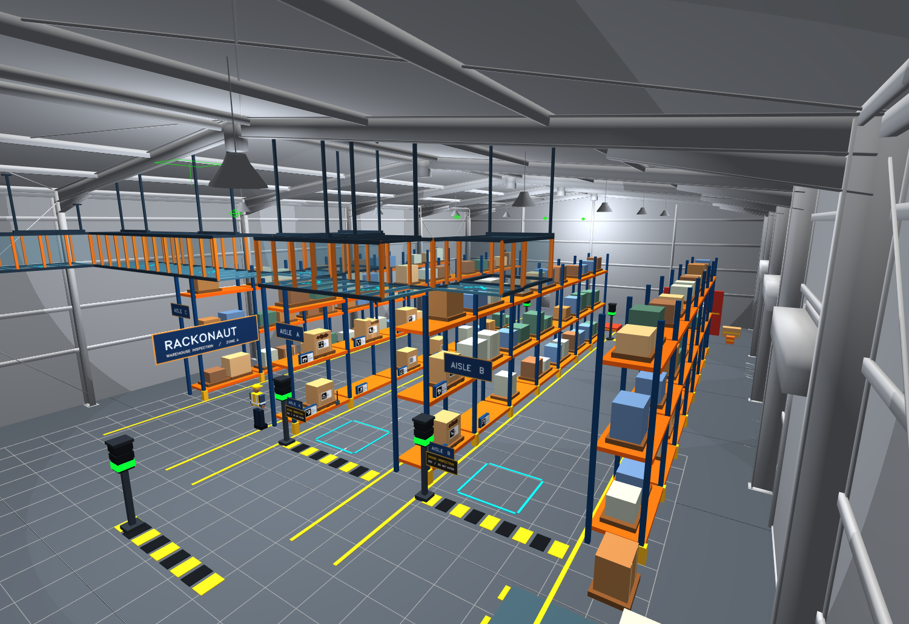
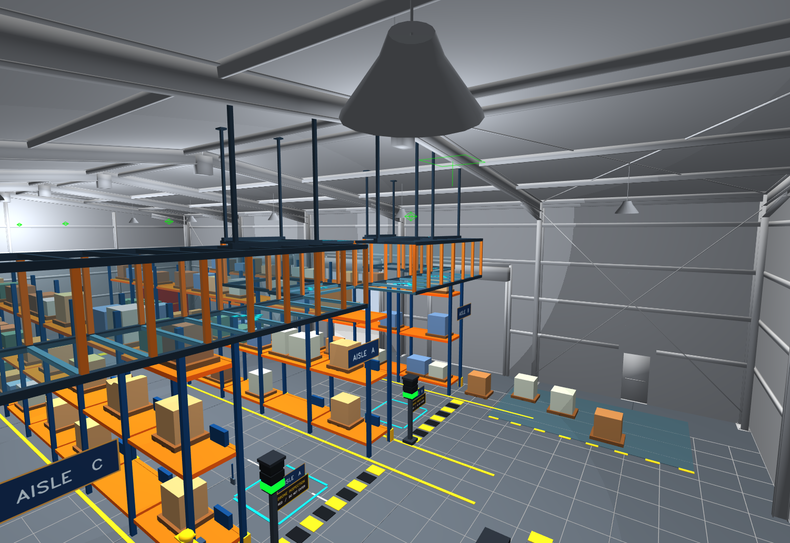
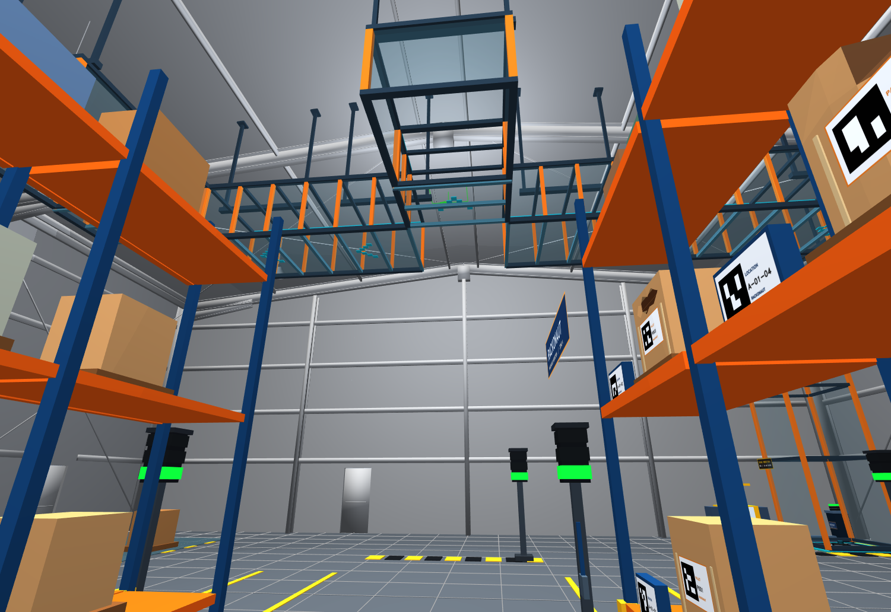
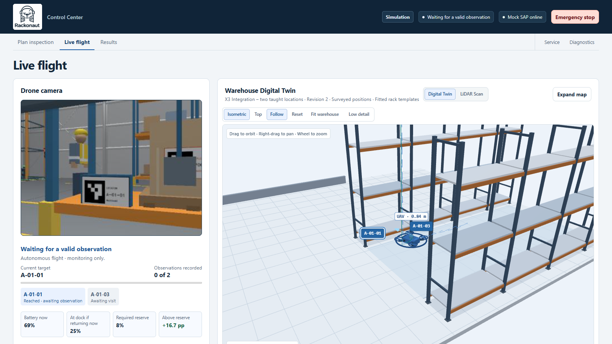
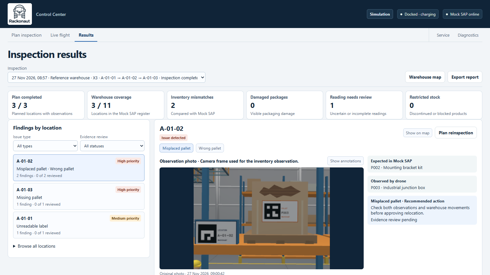
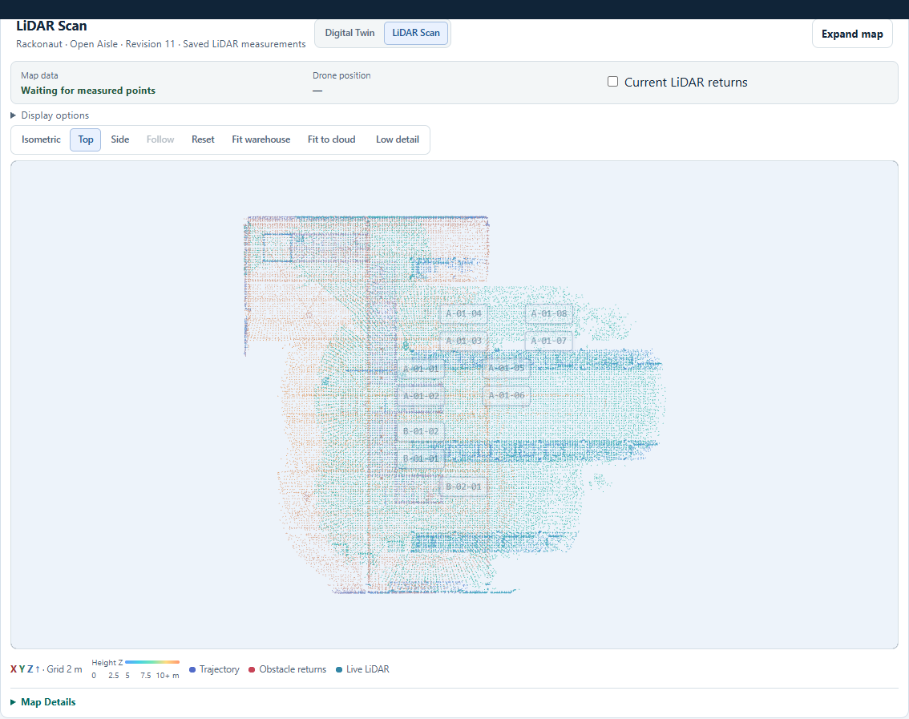
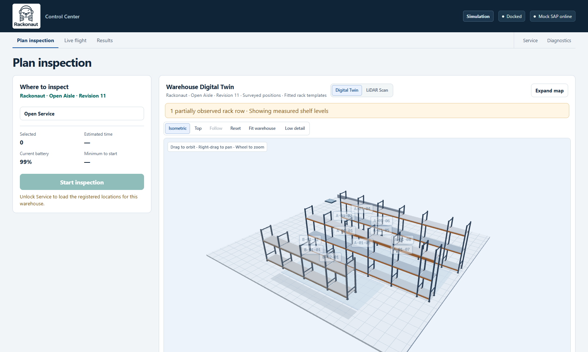
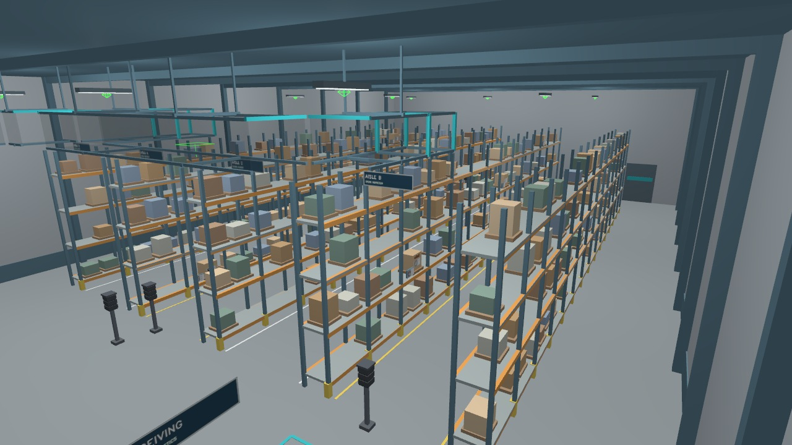
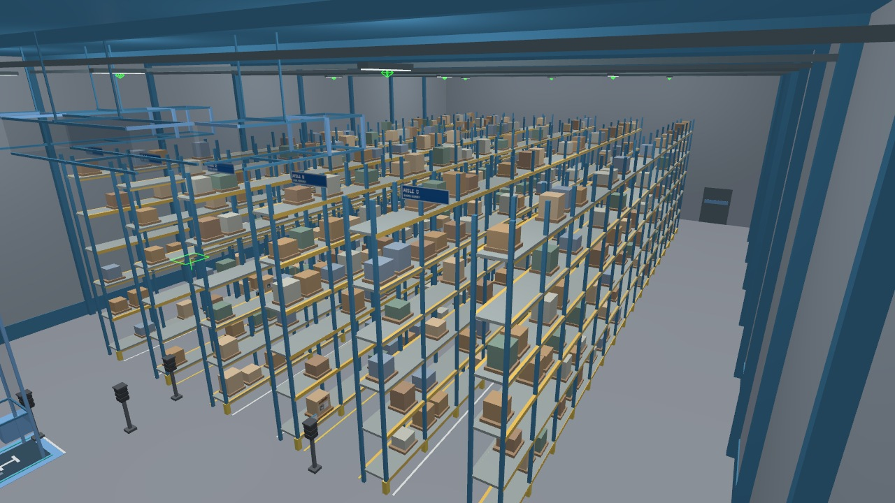
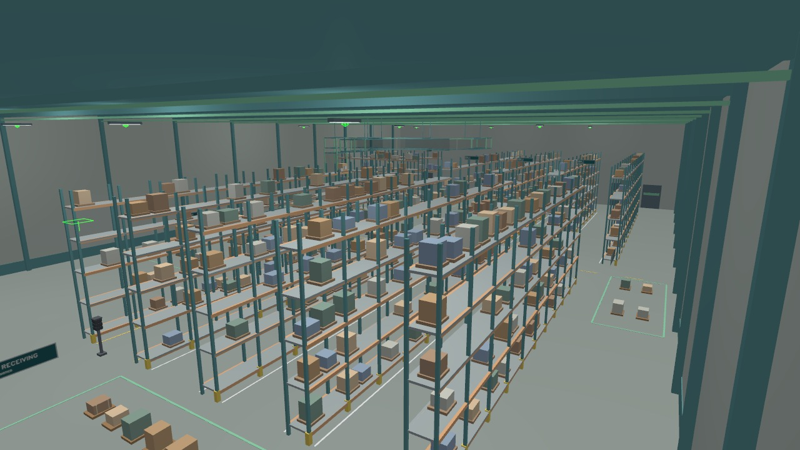

# Product gallery

## Open-aisle warehouse

| Ceiling infrastructure | Open descent |
| --- | --- |
|  |  |

The open-aisle design leaves the floor beneath portals A and B clear. The evidence shows the Gazebo scene and the independently toggleable infrastructure and flight corridor in Control Center. [Portal A](open-aisle-evidence/03-portal-a.png) · [Portal B](open-aisle-evidence/04-portal-b.png) · [Geometry and startup](OPEN_AISLE_DESCENT.md)

## X3 camera and Control Center

| Live flight | Expected vs. observed |
| --- | --- |
|  |  |

The live capture is from the integrated X3 learned-route trial in the historical warehouse. The finding is from Warehouse in Motion, where the X3's onboard LiDAR measured the moving cart, registered a stop and permitted the same flight to resume. [X3 trial](FULL_SYSTEM_INTEGRATION.md) · [Original X3 camera image](final-branch-audit-evidence/A-01-02-original.png) · [Obstacle response telemetry](final-branch-audit-evidence/result.json) · [Download the final HTML report](final-branch-audit-evidence/report.html)

The earlier SLAM obstacle test has a recorded visualization of a measured obstacle and protected volume. [Obstacle-stop visualization](slam-full-route-evidence/active-obstacle-blocked.png) · [Trial details](SLAM_FULL_ROUTE_VALIDATION.md)

## LiDAR and Digital Twin

| Measured cloud | Restored Digital Twin |
| --- | --- |
|  |  |

Both views come from the restored reference-drone open-aisle calibration. [Cloud and model comparison](full-warehouse-calibration-evidence/verified-survey/cloud-model-top.png) · [Original PLY](full-warehouse-calibration-evidence/verified-survey/map.ply) · [Measured route overlay](full-warehouse-calibration-evidence/verified-survey/restart-twin-routes.png)

## Additional warehouses

| Distribution Center | High-Bay Warehouse | Large Logistics Hub |
| --- | --- | --- |
|  |  |  |

These are simulator captures from the pinned companion revision. The High-Bay dock trials include the integrated X3 camera. [X3 onboard view](https://github.com/Adiksoon/rackonaut/blob/6b9ebfaba39bd5e091d5de5f7d23301a9ec35115/docs/multi-warehouse-evidence/high-bay/onboard-x3.jpg) · [Original gallery and capture metadata](https://github.com/Adiksoon/rackonaut/blob/6b9ebfaba39bd5e091d5de5f7d23301a9ec35115/docs/MULTI_WAREHOUSE_ENVIRONMENTS.md#uj%C4%99cia-z-gazebo) · [Run the companion profile](GETTING_STARTED.md#additional-warehouses)
