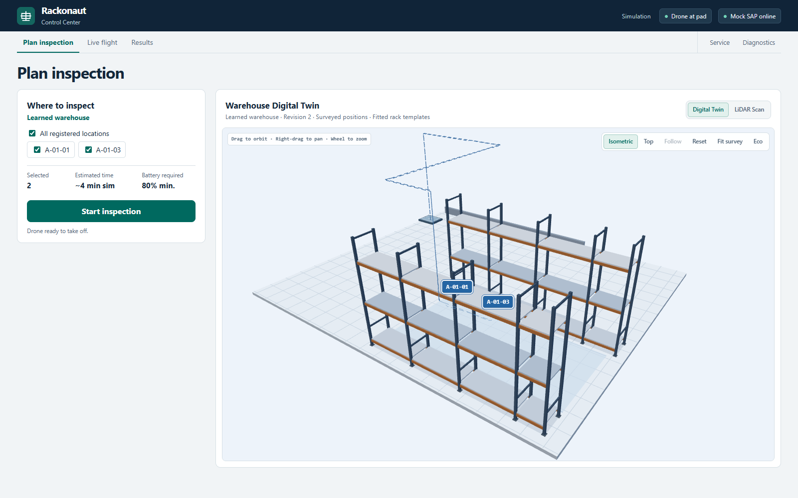
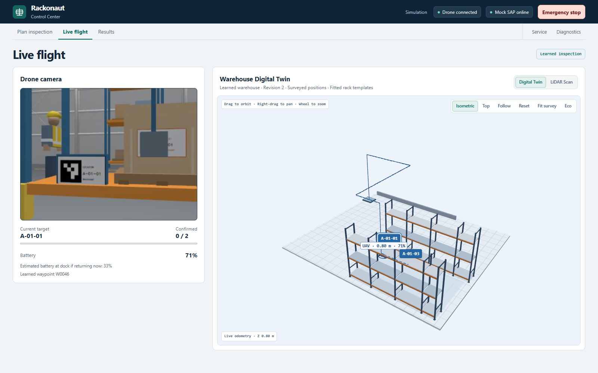
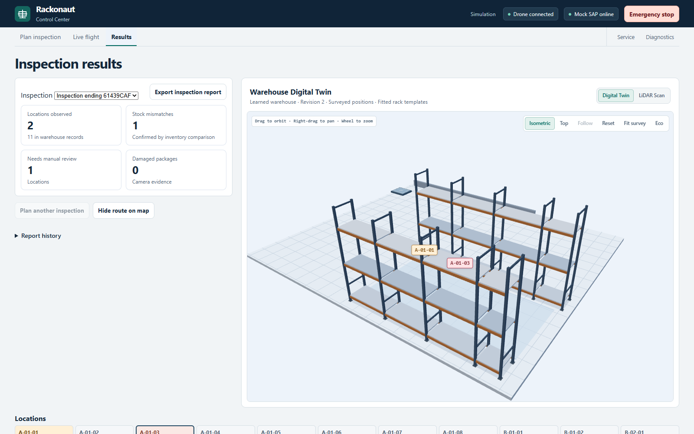
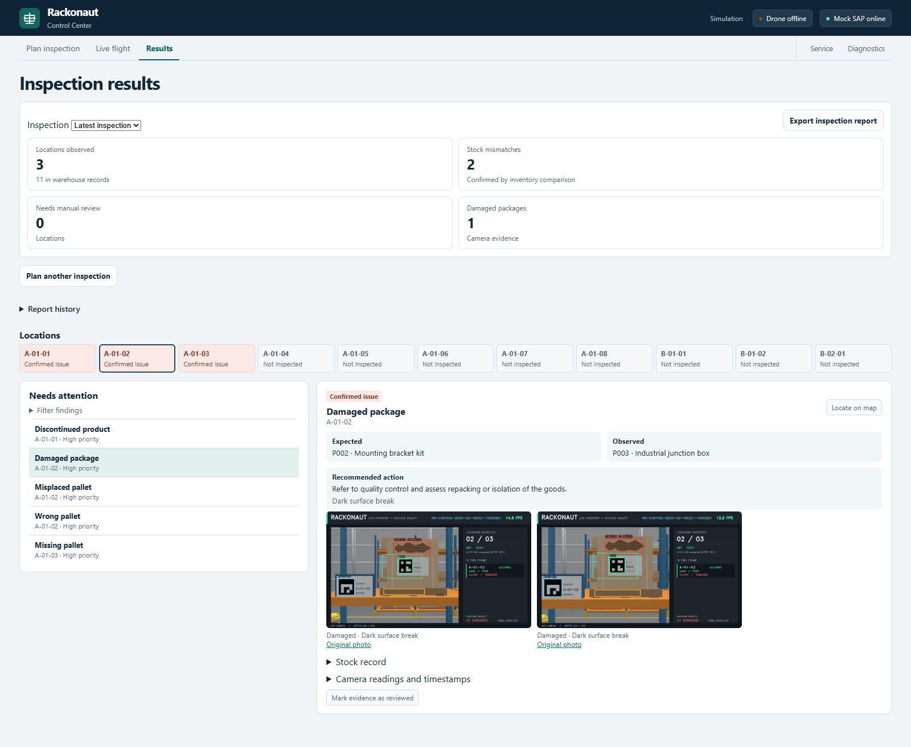
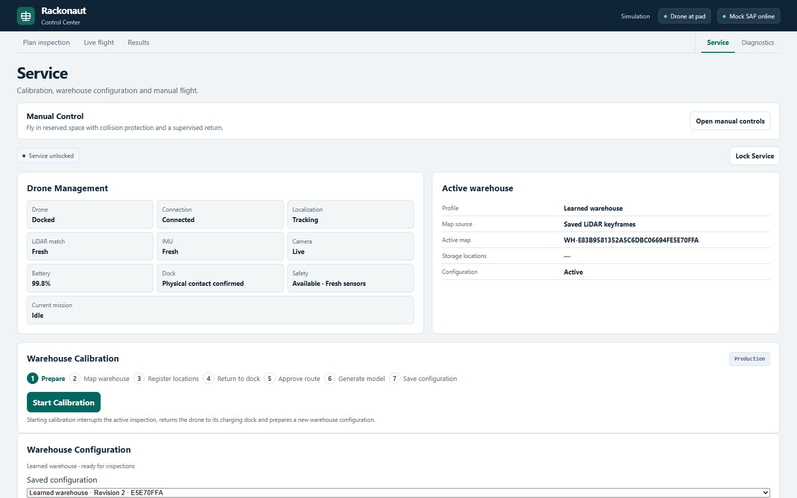
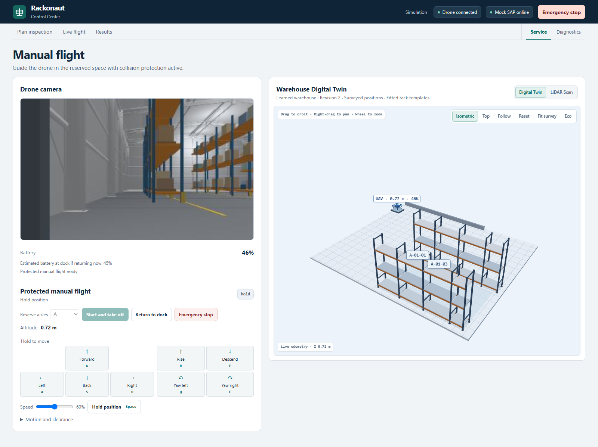
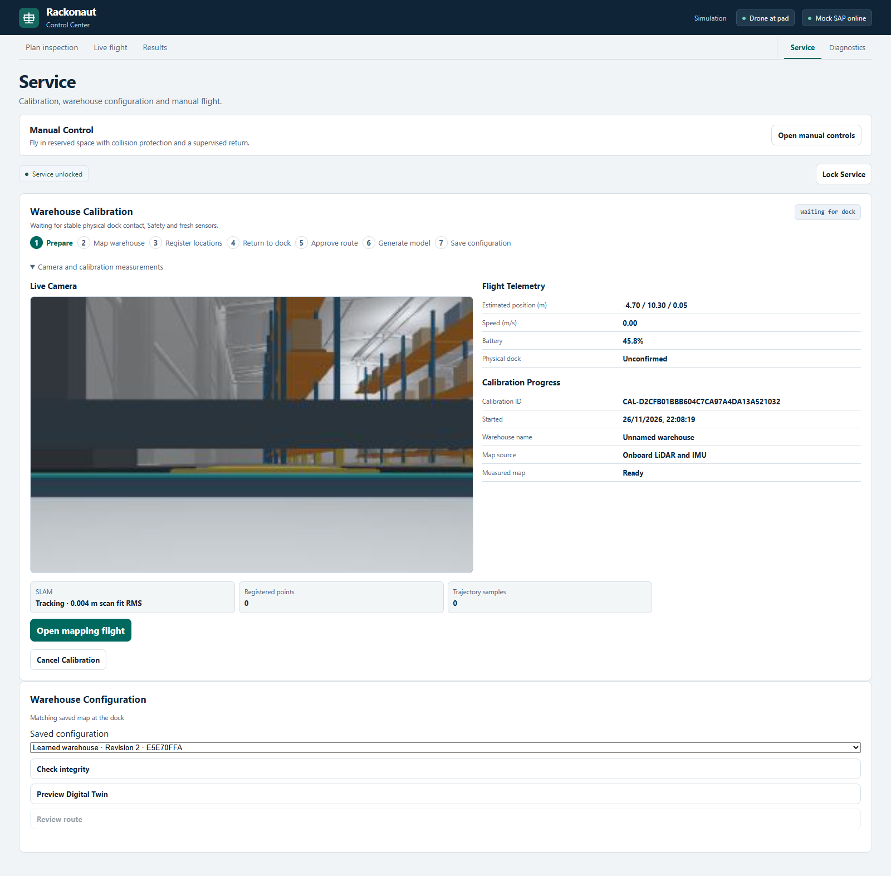
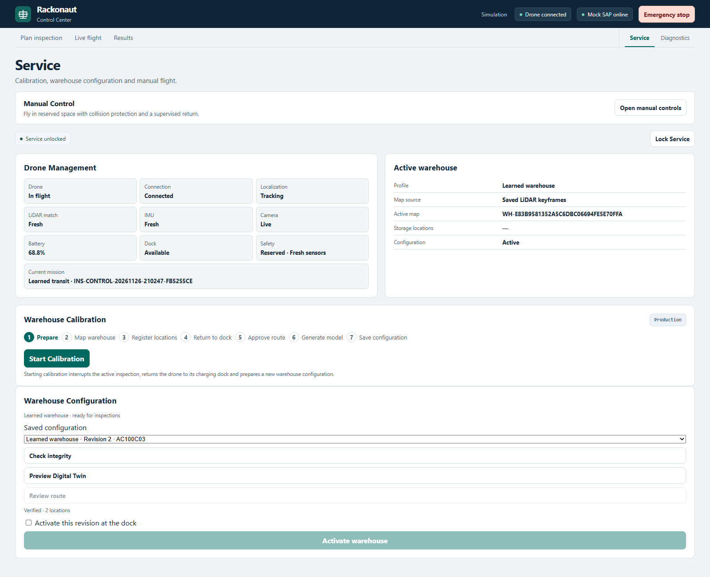
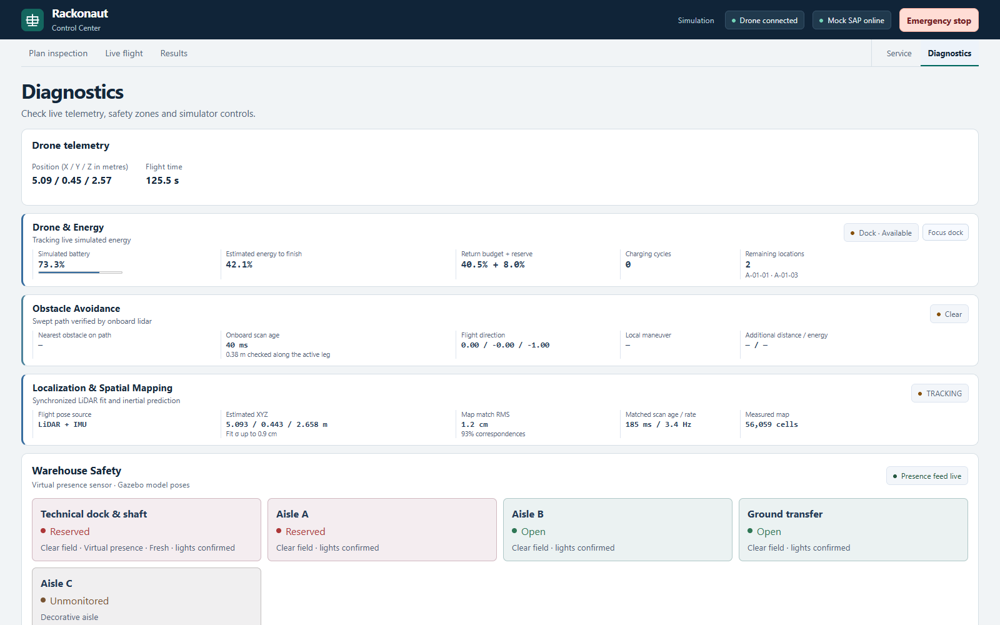

# GOAL 26D — Rackonaut Blind GUI Audit

26 listopada 2026 · `feature/digital-twin-control-center` · badany commit `15bce96`

Dziewięć zrzutów wykonano w działającym Control Center za pomocą Playwright w Chrome 158.0.8127.88, przy szerokości okna 1600 px. Zrzuty pokazują aktualną symulację albo odczyt danych z wcześniejszych inspekcji. Wybrane dłuższe widoki zapisano w całości, aby objąć sterowanie, zdjęcia i sekcje poniżej pierwszego ekranu. Bieżąca inspekcja `INS-CONTROL-20261126-210247-FB5255CE` odczytała A-01-01 i A-01-03 oraz zakończyła się przy potwierdzonym doku. Zrzut z dowodami używa archiwalnej inspekcji `74392821`, w której zapisano obrazy uszkodzenia.

GPT‑6.2 Astra dostała po jednym obrazie w dziewięciu nowych sesjach. Jedynym tekstem każdej z tych sesji było „GUI dla operatora. Oceń ten interfejs.”. Po zakończeniu tych sesji w dziesiątej Astra dostała wszystkie dziewięć obrazów wraz z pytaniem „Oceń spójność całej aplikacji z perspektywy operatora.”. Wnioski z pojedynczych sesji i kontekst projektu pozostały poza sesją zbiorczą.

Oceny dotyczą tego, co widać na zrzutach, oraz tego, jakie decyzje operator może na ich podstawie podjąć. Propozycje poniżej są materiałem do wyboru przez zespół. Kod aplikacji pozostał bez zmian.

## Oceny poszczególnych ekranów

### Plan inspection

Dwie nauczone lokalizacje i gotowość do startu przed lotem `FB5255CE`.

Pełna odpowiedź Astry

Ekran dobrze odpowiada na pytanie **„co mam sprawdzić i jak rozpocząć inspekcję?”**. Słabiej odpowiada na **„czy zaznaczyłem właściwe miejsca i czy dron jest gotowy do tego lotu?”**. To właśnie te dwie kwestie poprawiłbym w pierwszej kolejności.

**Co działa**

- Podział na plan po lewej i model magazynu po prawej jest czytelny. Operator widzi wybór lokalizacji, liczbę punktów i szacowany czas bez przełączania widoku.
- „Start inspection” jest łatwy do znalezienia. To jedyny duży przycisk akcji, a podsumowanie planu znajduje się tuż nad nim.
- Identyfikatory A-01-01 i A-01-03 są takie same na liście i w modelu. Operator ma konkretny punkt odniesienia przy sprawdzaniu planu.

**Co warto poprawić**

1. **Pokazać podstawę oceny gotowości.** „Battery required 80% min.” podaje próg, a „Drone ready to take off” ogłasza gotowość. Brakuje aktualnego poziomu baterii, więc operator nie może sam porównać wartości. Obok przycisku startu pokazałbym je razem, np. „Bateria 92% · wymagane minimum 80%”, jeśli taki jest rzeczywisty odczyt.
2. **Wyróżnić dokładne miejsca inspekcji w modelu.** Niebieskie etykiety są widoczne, ale z tej perspektywy trudno ustalić, do której półki i którego poziomu odnosi się każda z nich. Podświetlenie konkretnego miejsca na regale oraz krótka linia łącząca je z etykietą ułatwiłyby weryfikację. Cienka niebieska linia nad regałami również wymaga opisu, jeśli ma pomagać w ocenie planu.
3. **Oznaczyć symulację przy samej akcji.** „Simulation” znajduje się w prawym górnym rogu, daleko od przycisku startu. Etykieta „Uruchom symulację inspekcji” pozwoliłaby rozpoznać skutek kliknięcia dokładnie w chwili podejmowania decyzji.
4. **Poprawić czytelność sterowania widokiem.** Instrukcja obracania i przesuwania modelu jest drobna, a „Eco” nie wyjaśnia, co zmieni po kliknięciu. Powiększyłbym instrukcję i doprecyzował nazwę tej funkcji. Jeśli stanowisko jest polskojęzyczne, ujednoliciłbym też język całego ekranu.

Zachowałbym obecny układ. Najwięcej dałoby umożliwienie operatorowi sprawdzenia jednym spojrzeniem **dokładnego miejsca na regale, zapasu baterii i trybu uruchomienia**. Ocena dotyczy widocznego stanu ekranu.

**Ocena Astry** · opisowa.

**Problemy i zmiany wskazane przez Astrę** · skrót SOL-a.

| Problem | Propozycja Astry |
| --- | --- |
| Sam próg minimalny baterii nie pozwala zweryfikować gotowości. | Pokazać bieżący poziom i minimum obok przycisku startu. |
| Etykiet nie można łatwo powiązać z konkretną półką i poziomem, a niebieska linia nie ma opisu. | Podświetlić miejsce, połączyć je z etykietą i opisać linię. |
| Oznaczenie symulacji jest daleko od startu. Instrukcja mapy jest drobna, a `Eco` niejasne. | Pokazać tryb przy akcji, poprawić instrukcję i nazwać funkcję mapy wprost. Ujednolicić język, jeżeli stanowisko jest polskojęzyczne. |

### Live flight

Bieżący obraz kamery i faza oględzin A-01-01 w locie `FB5255CE`.

Pełna odpowiedź Astry

Widok dobrze odpowiada na pytanie **„co widzi dron i gdzie się znajduje?”**. Trudniej z niego odczytać **„czy inspekcja przebiega prawidłowo i czy mam zareagować?”**. To najważniejszy obszar do poprawy z perspektywy operatora.

**Co działa**

- Obraz z kamery i plan magazynu są widoczne równocześnie. Ten sam identyfikator `A-01-01` na regale, pod kamerą i na mapie pozwala sprawdzić, czy dron obserwuje właściwe miejsce.
- Przycisk „Emergency stop” ma wyraźny podpis, wyróżnia się kolorem i znajduje się z dala od narzędzi mapy. Warto zachować tę hierarchię.

**Co poprawiłbym w pierwszej kolejności**

1. **Pokazać fazę inspekcji obok celu.** Przy `A-01-01` widać „Confirmed 0 / 2”, ale nie wiadomo, co jest liczone ani czy operator ma coś zrobić. Nazwij liczoną rzecz i pokaż rzeczywisty stan, np. „Odczyt etykiety w toku”. Jeśli potrzebne jest potwierdzenie operatora, komunikat powinien wskazać konkretną czynność.
2. **Zestawić oba odczyty baterii.** Obecne `71%` jest czytelne, a prognozowane `33%` po powrocie ginie w drobnym tekście. Umieściłbym je obok siebie pod krótkimi etykietami „Teraz” i „Po powrocie do stacji”. Operator zobaczy wtedy obie wartości jednym spojrzeniem.
3. **Poprawić domyślny kadr mapy.** Regały zajmują głównie dolną część widoku, a etykieta UAV zasłania część oznaczenia bieżącego celu. Podczas inspekcji warto kadrować drona razem z aktywnym regałem i rozsunąć te dwie etykiety. Pełny widok magazynu może pozostać dostępny pod „Fit survey”.
4. **Wyraźniej oznaczyć symulację.** Drobny napis „Simulation” łatwo przeoczyć obok bardziej widocznego „Drone connected”. Umieszczenie oznaczenia „SYMULACJA” przy tytule „Live flight” ułatwi rozpoznanie trybu zaraz po otwarciu ekranu.

Ocenę opieram na pojedynczym zrzucie. W pierwszym teście z operatorem poprosiłbym go, by bez przełączania widoków wskazał aktualny cel, wyjaśnił `0 / 2` i powiedział, czy system oczekuje od niego działania.

**Ocena Astry** · opisowa.

**Problemy i zmiany wskazane przez Astrę** · skrót SOL-a.

| Problem | Propozycja Astry |
| --- | --- |
| `Confirmed 0 / 2` nie mówi, co jest liczone ani czego oczekuje system. | Obok celu pokazać fazę inspekcji i wymaganą reakcję operatora. |
| Prognoza baterii po powrocie ginie przy bieżącym odczycie. | Zestawić oba poziomy obok siebie. |
| Kadr modelu jest luźny, etykieta UAV zasłania cel, a oznaczenie symulacji jest mało widoczne. | Kadrować drona z celem, rozsunąć etykiety i wyeksponować tryb przy tytule. Zachować czytelny `Emergency stop`. |

### Results

Zapisana misja `61439CAF` z dwiema odczytanymi lokalizacjami i ich położeniem na modelu.

Pełna odpowiedź Astry

**Operator szybko zobaczy, że inspekcja wykazała problem, ale musi sam ustalić, gdzie zajrzeć i co sprawdzić.** Ekran ma czytelną hierarchię, aktywna zakładka „Results” jest wyraźna, a liczniki dają szybki przegląd wyników. Najwięcej do poprawy jest w przejściu od podsumowania do konkretnej lokalizacji.

| Priorytet | Co widać na ekranie | Co warto zmienić |
|---|---|---|
| Wysoki | „Locations observed” pokazuje duże **2**, a dopiero drobny dopisek podaje **11** lokalizacji w ewidencji. Trudno ocenić, czy inspekcja objęła cały plan. | Pokazać liczbę sprawdzonych miejsc względem liczby zaplanowanych. Jeśli plan obejmował dwie lokalizacje, napisać „Sprawdzono 2 z 2 zaplanowanych”, a liczbę 11 zostawić jako kontekst. |
| Wysoki | Liczniki pokazują jedną rozbieżność i jedną lokalizację do weryfikacji. Na mapie są dwie kolorowe etykiety, ale bez opisu statusu. | Pod licznikami umieścić listę spraw z kodem miejsca, powodem i akcją „Sprawdź”. Wybór pozycji powinien wskazać regał na mapie i pokazać dane porównania lub zdjęcie. |
| Średni | Model 3D zajmuje większość ekranu, podczas gdy pod lewym panelem jest dużo wolnego miejsca. Przy tej wysokości okna widać jedynie początek sekcji „Locations”. | Wykorzystać miejsce po lewej na sprawy wymagające uwagi. Zachować duży model jako pomoc w odnalezieniu wybranego regału. |
| Średni | Przełącznik opisany „Inspection ending 61439CAF” utrudnia rozpoznanie inspekcji, a „Simulation” i „Drone connected” wymagają wspólnej interpretacji. | W selektorze pokazać datę, godzinę i obszar inspekcji. W nagłówku jednoznacznie oznaczyć, czy połączenie dotyczy drona symulowanego, czy fizycznego. |

**Pierwsza zmiana:** wykorzystać wolne miejsce pod licznikami na listę „Do sprawdzenia”. To skróci drogę od zauważenia rozbieżności do otwarcia dowodu i pozwoli zachować najbardziej użyteczną cechę widoku 3D — orientację w magazynie.

**Ocena Astry** · opisowa.

**Problemy i zmiany wskazane przez Astrę** · skrót SOL-a.

| Problem | Propozycja Astry |
| --- | --- |
| Liczba obserwacji na tle całej ewidencji nie mówi, czy zrealizowano plan. | Pokazać sprawdzone pozycje względem liczby zaplanowanych. |
| Mapa dominuje nad kolejką spraw, a kolory etykiet nie wyjaśniają statusu. | Pod licznikami umieścić sprawy z kodem, powodem i akcją prowadzącą do regału i dowodu. |
| Końcówka ID utrudnia wybór inspekcji, a nagłówek wymaga interpretacji trybu połączenia. | Dodać datę, godzinę i zakres w selektorze oraz jednoznaczny status symulowanego drona. |

### Results z wybraną lokalizacją i dowodami

Archiwalna inspekcja `74392821`, lokalizacja A-01-02 i zapisane zdjęcia uszkodzenia. Widok raportu przy odłączonym dronie.

Pełna odpowiedź Astry

**Widok dobrze sprawdza się jako podsumowanie inspekcji. W pracy operatora najsłabiej wspiera decyzję, czym zająć się najpierw i kiedy można uznać problem za rozwiązany.** To ocena na podstawie zrzutu ekranu. Zachowanie interfejsu po kliknięciu wymagałoby osobnego sprawdzenia.

Warto zachować układ **lista ustaleń po lewej, szczegóły po prawej**. Operator widzi zaznaczone zgłoszenie w kontekście pozostałych, a przy nim ma lokalizację, zdjęcia i zalecane działanie. Zestawienie „Expected” i „Observed” ułatwia porównanie towaru. Statusy lokalizacji mają też etykiety tekstowe, więc ich odczytanie nie zależy wyłącznie od koloru.

| Priorytet | Co widać na ekranie | Co bym zmienił |
|---|---|---|
| Wysoki | Podsumowanie pokazuje „Needs manual review 0”, poniżej widnieje pięć ustaleń „High priority”, a przy zdjęciu jest przycisk „Mark evidence as reviewed”. Trudno rozstrzygnąć, jaka praca pozostała. | Doprecyzować, co liczy zero. Jeśli chodzi o niepewne odczyty, nazwać wskaźnik „Lokalizacje wymagające weryfikacji odczytu”. Przy zgłoszeniu osobno pokazać stan dowodu i stan obsługi problemu. |
| Wysoki | Trzy z pięciu ustaleń dotyczą A-01-02. Wszystkie pięć ma ten sam priorytet, więc lista nie podpowiada kolejności pracy. | Grupować ustalenia według lokalizacji i pokazywać ich liczbę, np. „A-01-02 · 3 ustalenia”. Operator przygotowujący się do sprawdzenia regału zobaczy cały zakres pracy w jednym miejscu. |
| Wysoki | Po wybraniu „Damaged package” najpierw widać różnicę między produktami P002 i P003. Informacja o uszkodzeniu „Dark surface break” pojawia się dopiero pod zaleceniem, a oba zdjęcia mają identyczny podpis. | Przy tytule podać wykrytą oznakę uszkodzenia i pokazać powiększenie odpowiedniego fragmentu zdjęcia. Ujęcia opisać czasem lub perspektywą, jeśli te dane są dostępne. |
| Średni | Cztery liczniki zajmują dwa rzędy, a kolejka „Needs attention” zaczyna się dopiero w połowie ekranu. Zakres inspekcji trzeba odczytać z wartości „3” i drobnego dopisku o 11 lokalizacjach. | Na szerokim ekranie ułożyć liczniki w jednym rzędzie i pokazać wprost „Skontrolowano 3 z 11 lokalizacji”. Odzyskaną przestrzeń przeznaczyć na kolejkę i większy podgląd dowodu. |

**Pierwsza zmiana do wdrożenia** to doprecyzowanie statusów. Dla A-01-02 operator powinien móc od razu ustalić, co system wykrył, czy ktoś obejrzał dowód i czy zalecone działanie nadal czeka na wykonanie.

**Ocena Astry** · opisowa.

**Problemy i zmiany wskazane przez Astrę** · skrót SOL-a.

| Problem | Propozycja Astry |
| --- | --- |
| Licznik zero do ręcznej weryfikacji, pięć spraw wysokiego priorytetu i przycisk przeglądu dowodu opisują różne etapy bez wyraźnego rozróżnienia. | Osobno nazwać jakość odczytu, przegląd dowodu i stan obsługi sprawy. |
| Trzy sprawy dotyczą jednego miejsca, wszystkie wpisy mają ten sam priorytet. | Grupować ustalenia według lokalizacji i pokazywać ich liczbę. |
| Opis uszkodzenia jest nisko, podpisy zdjęć są identyczne, a podsumowanie zajmuje dużo miejsca. | Pokazać objaw przy tytule, powiększyć fragment zdjęcia i opisać każde ujęcie. Zmniejszyć wysokość liczników. |

### Service

Odblokowany panel na zadokowanym dronie przed lotem `FB5255CE`.

Pełna odpowiedź Astry

Na podstawie zrzutu **to czytelny panel serwisowy, ale operator musi sam zestawić kilka informacji, żeby zdecydować, czy rozpocząć kalibrację**. Układ jest logiczny, a siedem nazwanych etapów dobrze pokazuje przebieg pracy. Największej poprawy wymaga komunikacja stanu tuż przed wykonaniem polecenia.

| Priorytet | Co widać | Co zmienić |
|---|---|---|
| Wysoki | Nagłówek pokazuje `Simulation`, a panel kalibracji ma etykietę `Production`. Nie wiadomo, czego dotyczy druga z nich. | Przy przycisku startu jednoznacznie określić, gdzie wykona się polecenie. Jeśli `Production` oznacza typ konfiguracji, podpisać go wprost. |
| Wysoki | Bieżąca misja ma stan `Idle`, ale opis pod przyciskiem mówi o przerwaniu aktywnej inspekcji. | Nad przyciskiem pokazać skutek właściwy dla bieżącego stanu. Gdy inspekcja trwa, podać jej nazwę i nazwać akcję „Przerwij inspekcję i rozpocznij kalibrację”. |
| Średni | `Storage locations` ma wartość `—`, choć konfiguracja jest aktywna i opisana jako gotowa do inspekcji. | Rozróżnić „0 zarejestrowanych”, „Brak danych” i „Nie dotyczy”. Jeśli ten stan ogranicza inspekcję, wskazać konkretnie jak. |
| Średni | Dziewięć jednakowo wyróżnionych kafelków wymaga osobnego odczytania. Stan misji znajduje się dopiero pod nimi. | Na początku sekcji pokazać krótkie podsumowanie, np. „Dron w stacji · Brak aktywnej misji”. Szczegóły czujników zachować poniżej, a odchylenia wyróżniać tekstem i ikoną. |

**Zachowałbym** oddzielenie sterowania ręcznego od kalibracji, tekstowe nazwy stanów i wyraźny przycisk startu. Powiększyłbym drobny tekst opisujący skutki operacji i przeniósł go nad przycisk, gdzie operator przeczyta go przed podjęciem decyzji.

Pierwszy test z operatorem można oprzeć na jednym pytaniu: **„Co się stanie po naciśnięciu Start Calibration w tej chwili i w jakim środowisku?”** Odpowiedź powinna wynikać bezpośrednio z panelu kalibracji.

**Ocena Astry** · opisowa.

**Problemy i zmiany wskazane przez Astrę** · skrót SOL-a.

| Problem | Propozycja Astry |
| --- | --- |
| `Simulation` i `Production` występują razem, a opis przerwania inspekcji pojawia się również przy `Idle`. | Nazwać zakres obu stanów i dopasować ostrzeżenie oraz przycisk do bieżącej misji. |
| `Storage locations —` jest niejednoznaczne przy aktywnej konfiguracji. | Rozróżnić zero, brak odczytu i brak zastosowania. |
| Stan misji ginie pod kafelkami o tym samym znaczeniu wizualnym. | Pokazać gotowość i stan misji na początku. Wyróżnić odchylenia i przenieść skutek rozpoczęcia kalibracji nad przycisk. |

### Manual Control

Chroniony lot ręczny w stanie utrzymywania pozycji na wysokości 0,72 m. Sterowanie należy do sesji, która uruchomiła lot.

Pełna odpowiedź Astry

**To czytelny pulpit do nadzorowania drona, ale podczas ręcznego lotu operator musi szukać części informacji potrzebnych do następnego manewru.** Najlepiej działa zestawienie obrazu z kamery z modelem magazynu. Najwięcej poprawiłoby pokazanie stanu lotu i prześwitu bezpośrednio przy obrazie z kamery.

| Priorytet | Co widać na ekranie | Co bym zmienił |
|---|---|---|
| Wysoki | Dron jest na wysokości 0,72 m. Jednocześnie widać „Protected manual flight ready”, „Hold position”, małe „hold” i przygaszony „Start and take off”. Operator musi złożyć te sygnały, żeby ustalić, czy dron już leci. | Przy kamerze pokazać jeden stan, np. **„W locie · utrzymywanie pozycji”**, jeśli tak wskazuje telemetria. Obok umieścić wysokość i oznaczenie zarezerwowanej alejki. |
| Wysoki | Ochrona przed kolizją jest włączona, ale sekcja „Motion and clearance” pozostaje zwinięta. Na obrazie widać bliski regał, a operator nie widzi od razu, jaki ma zapas miejsca. | Przy krawędzi obrazu pokazywać najmniejszy zmierzony prześwit i jego kierunek. Gdy ochrona ograniczy ruch, podać konkretną przyczynę, np. „Ruch w prawo zablokowany · przeszkoda”. |
| Średni | Model magazynu zajmuje więcej miejsca niż kamera, choć duża część jego pola jest pusta, a dron i etykiety regałów są małe. | Lepiej dopasować domyślny kadr modelu do drona i sąsiednich regałów. W trybie ręcznym dać operatorowi możliwość powiększenia kamery jednym kliknięciem. |
| Średni | „Simulation” i „Drone connected” stoją obok siebie. Przy szybkim spojrzeniu łatwiej dostrzec zielony wskaźnik połączenia niż informację o symulacji. | Wyróżnić tryb **„SYMULACJA”** w nagłówku i doprecyzować status jako „Symulowany dron połączony”. |

**Warto zachować** prognozę baterii po powrocie do stacji. „46% teraz, 45% po powrocie” pomaga podjąć decyzję lepiej niż sam poziom naładowania. Czytelny jest też przestrzenny układ klawiszy ruchu, a „Emergency stop” pozostaje dobrze widoczny w nagłówku.

Pierwszy test z operatorem przeprowadziłbym na tym właśnie widoku. Po krótkim spojrzeniu powinien umieć odpowiedzieć na trzy pytania: **Czy dron już leci? Czy utrzymuje pozycję? Ile mam miejsca po stronie regału?** Ze statycznego zrzutu można ocenić widoczność tych informacji. Reakcję po puszczeniu klawisza i zachowanie ochrony przed kolizją trzeba sprawdzić w działającej symulacji.

**Ocena Astry** · opisowa.

**Problemy i zmiany wskazane przez Astrę** · skrót SOL-a.

| Problem | Propozycja Astry |
| --- | --- |
| Równoczesne `ready`, `hold` i nieaktywne `Start and take off` wymagają interpretacji. | Wyświetlić jeden stan lotu przy kamerze, wraz z wysokością i zarezerwowaną alejką. |
| Informacja o prześwicie jest zwinięta mimo aktywnej ochrony. | Pokazać prześwit, kierunek i powód ograniczenia manewru w pobliżu obrazu. |
| Mapa ma dużo pustej przestrzeni, a symulacja jest słabo oznaczona. | Kadrować drona z sąsiednimi regałami, dać możliwość powiększenia kamery i ujednoznacznić tryb sesji. |

### Warehouse Calibration

Nowa sesja w kroku Prepare. Dron przy stacji, oczekiwanie na stabilny kontakt, Safety i świeże czujniki.

Pełna odpowiedź Astry

Interfejs ma czytelny podział na etapy kalibracji i pokazuje operatorowi obraz z kamery obok telemetrii. Największy problem widać już na etapie **Prepare**. Operator musi sam ustalić, czy dron jest gotowy do mapowania i co zrobić, jeśli kalibracja nadal czeka.

| Priorytet | Co widzi operator | Co warto zmienić |
|---|---|---|
| Wysoki | Nagłówek pokazuje „Drone at pad” z zieloną kropką, kalibracja „Waiting for dock”, a telemetria „Physical dock — Unconfirmed”. Te komunikaty mogą być jednocześnie prawdziwe, ale ich związek jest niejasny. | Przy bieżącym kroku pokazać jeden komunikat, np. **„Dron przy stacji. Oczekiwanie na potwierdzenie kontaktu ze stacją.”** Osobno wskazać stan czujników i zabezpieczeń, żeby operator wiedział, na co jeszcze czeka system. |
| Wysoki | Najbardziej widoczny przycisk „Open mapping flight” pojawia się podczas oczekiwania na dok. Ze zrzutu trudno ocenić, czy otwiera widok, czy inicjuje lot. | Jeśli otwiera widok, nazwać go „Otwórz panel mapowania”. Jeśli uruchamia lot, użyć „Rozpocznij lot mapujący” i udostępnić akcję po spełnieniu warunków. Powód blokady pokazać przy przycisku. |
| Średni | Kamera zajmuje dużą część panelu. Stan doku ma taką samą wagę wizualną jak pozostałe wiersze, a długi identyfikator kalibracji jest równie wyrazisty. | Nad kamerą umieścić bieżący krok, warunek przejścia dalej i powiązaną akcję. Identyfikator sesji oraz czas startu przenieść do zwijanych szczegółów. |
| Średni | W sekcji zapisanej konfiguracji operator widzi „Matching saved map at the dock” i nieaktywny przycisk „Review route”. Brakuje bezpośredniego wyjaśnienia blokady. | Przy przycisku podać rzeczywisty warunek jego odblokowania. Zwiększyć też drobny tekst statusów, szczególnie jeśli operator odczytuje ekran z oddalenia. |

**Pierwszą zmianą powinien być wspólny blok stanu dla kroku „Prepare”.** Warto zachować siedmioetapowy przebieg i zestawienie kamery z telemetrią. Umieszczenie nad nimi informacji o gotowości oraz następnej dostępnej czynności pozwoli operatorowi podjąć decyzję bez porównywania komunikatów w trzech miejscach.

**Ocena Astry** · opisowa.

**Problemy i zmiany wskazane przez Astrę** · skrót SOL-a.

| Problem | Propozycja Astry |
| --- | --- |
| `Drone at pad`, `Waiting for dock` i `Physical dock — Unconfirmed` pojawiają się w trzech miejscach. | Przy kroku pokazać wspólny stan oraz warunki kontaktu, Safety i czujników. |
| `Open mapping flight` nie rozróżnia otwarcia widoku od polecenia lotu. | Nazwać skutek i umieścić powód blokady bezpośrednio przy przycisku. |
| Kamera i długi identyfikator dominują nad stanem doku, a `Review route` nie wyjaśnia blokady. | Podnieść stan i następną czynność nad kamerę, przenieść metadane do szczegółów i podać warunek udostępnienia przeglądu trasy. |

### Warehouse Configuration

Zweryfikowana rewizja 2 z dwoma miejscami, wybrana do podglądu podczas lotu. Aktywna konfiguracja pozostała przypisana do misji.

Pełna odpowiedź Astry

**Interfejs dobrze pokazuje stan drona, ale za słabo wyróżnia fakt, że trwa misja.** Operator widzi połączenie, stan czujników, poziom baterii i dostępność stacji dokującej. Największe ryzyko na tym ekranie to wybranie „Start Calibration” bez zauważenia, że przerwie to bieżącą inspekcję.

| Priorytet | Co widać | Co bym zmienił |
|---|---|---|
| Wysoki | „Start Calibration” to najbardziej wyrazisty przycisk w głównej części ekranu. Informacja o przerwaniu inspekcji i powrocie do stacji jest drobnym tekstem pod nim. | Podczas lotu pokazać **„Trwa inspekcja”** nad przyciskiem. Przed wykonaniem polecenia nazwać jego skutek wprost, np. „Przerwij inspekcję i wróć do stacji”. |
| Wysoki | Nagłówek pokazuje „Simulation”, a karta kalibracji ma oznaczenie „Production”. Z ekranu trudno ustalić, czego dokładnie dotyczy drugie oznaczenie. | Wyraźnie oznaczyć tryb całej sesji. Jeśli „Production” określa profil kalibracji, podpisać go „Profil kalibracji: produkcyjny”. |
| Średni | „Review route” i „Activate warehouse” są wyszarzone. Obok widać pole aktywacji przy stacji, ale zależność między nim, stanem lotu i dostępnością przycisków jest niejasna. | Przy każdej niedostępnej akcji podać faktyczny powód i warunek odblokowania. Jeśli wymagane jest dokowanie, wyświetlić „Dostępne po zadokowaniu”. |
| Średni | „In flight” zajmuje taki sam kafelek jak „Camera · Live”, a nazwa misji dzieli wiersz z długim identyfikatorem. | Na początku sekcji pokazać jeden czytelny wiersz z fazą lotu, nazwą misji i baterią. Pełny identyfikator pozostawić w szczegółach z opcją kopiowania. |

**Warto zachować** stałą pozycję i odrębny kolor „Emergency stop”, tekstowe opisy stanów oraz numerowane etapy kalibracji. W dolnej części ekranu poprawiłbym czytelność drobnych podpisów i mocniej rozdzielił kartę kalibracji od karty zapisanej konfiguracji. Ta druga ma też dobrą okazję do doprecyzowania danych: aktywny magazyn pokazuje „Storage locations —”, a wybrana rewizja „Verified · 2 locations”. Podpisanie obu wartości zakresem pomogłoby operatorowi odróżnić konfigurację używaną w locie od tej wybranej do aktywacji.

**Pierwsza zmiana do wdrożenia:** powiązać przycisk kalibracji ze stanem bieżącej misji i pokazać konsekwencję przed kliknięciem. To usprawnienie ma największe znaczenie dla decyzji operatora na pokazanym ekranie.

**Ocena Astry** · opisowa.

**Problemy i zmiany wskazane przez Astrę** · skrót SOL-a.

| Problem | Propozycja Astry |
| --- | --- |
| Start kalibracji jest silnie widoczny, a skutek przerwania inspekcji opisano drobnym tekstem. | Pokazać stan misji i skutek akcji tuż przed przyciskiem. |
| Brakuje powodu wyszarzenia `Review route` i `Activate warehouse`. | Dla każdej akcji podać rzeczywisty warunek odblokowania. |
| Bieżący i wybrany magazyn są trudne do odróżnienia, a `Simulation` i `Production` nakładają się znaczeniowo. | Rozdzielić sekcje, opisać zakres licznika lokalizacji oraz tryby i wyeksponować fazę lotu. |

### Diagnostics

Telemetria z lotu `FB5255CE` z aktywną rezerwacją dokowania i alejki A.

Pełna odpowiedź Astry

Interfejs dobrze sprawdza się jako **panel diagnostyczny**. Dane są pogrupowane według podsystemów, stany stref mają etykiety tekstowe, a przycisk „Emergency stop” łatwo znaleźć. **Podczas lotu największą trudnością może być szybka ocena, czy sytuacja wymaga reakcji.** Na pokazanym ekranie operator musi sam zestawić kilka wskaźników.

| Priorytet | Co widać na ekranie | Co warto zmienić |
|---|---|---|
| Wysoki | Bateria ma 73,3%, a obok widnieją 42,1% na dokończenie zadania oraz 40,5% na powrót i 8,0% rezerwy. Nie jest jasne, czy koszt dokończenia obejmuje powrót. | Pokazać przewidywany poziom baterii po powrocie i margines względem rezerwy. Wtedy operator może ocenić, czy kontynuować lot, bez zgadywania, które wartości zsumować. |
| Wysoki | „Reserved” ma czerwony kolor, choć ta sama karta podaje „Clear field”. Bursztynowa kropka towarzyszy zarówno „Clear”, jak i „TRACKING”. | Rozdzielić stan rezerwacji od wykrycia obecności. Kolory ostrzegawcze przypisać stanom wymagającym uwagi, aby rutynowa rezerwacja nie wyglądała jak alarm. |
| Średni | Tryb symulacji sygnalizuje niewielki napis „Simulation” tuż obok wyraźnej etykiety „Drone connected”. | W nagłówku pokazać jednoznaczny, stale widoczny status, np. **„Symulacja · dron wirtualny”**. |
| Średni | Karta telemetrii zajmuje całą szerokość dla dwóch odczytów, a niżej opisy parametrów są drobne. | Zmniejszyć kartę telemetrii, powiększyć kluczowe wartości i wykorzystać odzyskane miejsce na zwięzły status lotu u góry ekranu. |

**Pierwsza zmiana, którą bym wdrożył, to jednoznaczny bilans energii.** Obecny ekran precyzyjnie pokazuje stan baterii, ale pozostawia otwarte najważniejsze dla operatora pytanie — czy po wykonaniu pozostałych inspekcji dron wróci z wymaganą rezerwą?

**Ocena Astry** · opisowa.

**Problemy i zmiany wskazane przez Astrę** · skrót SOL-a.

| Problem | Propozycja Astry |
| --- | --- |
| Relacja budżetów ukończenia zadania, powrotu i rezerwy jest niejasna. | Pokazać prognozę baterii przy lądowaniu i margines nad rezerwą. |
| Rutynowa rezerwacja jest czerwona, a `Clear` i `TRACKING` otrzymują bursztynowe oznaczenia. | Rozdzielić rezerwację od detekcji obecności i przypisać alarmowe kolory stanom wymagającym reakcji. |
| Słabo wyróżniona symulacja, za duża karta telemetrii i drobne kluczowe liczby spowalniają odczyt. | Podkreślić tryb oraz skrócić górę panelu na rzecz zwięzłego stanu lotu. |

## Ocena spójności wszystkich ekranów

Pełna odpowiedź Astry z osobnej sesji

**Rackonaut jest spójny jako proces inspekcji. Najwięcej niejasności pojawia się przy zmianie trybu pracy.** Operator łatwo rozpoznaje kolejność „Plan inspection → Live flight → Results”. Te same oznaczenia lokalizacji, np. `A-01-01`, prowadzą od wyboru regału przez podgląd z kamery i mapę aż do wyników. Trudniej na pierwszy rzut oka odpowiedzieć na trzy pytania operacyjne: co dron teraz robi, czy jest gotowy do następnej czynności i jaki skutek będzie miało jej uruchomienie.

| Priorytet | Co widać na ekranach | Co warto zmienić |
|---|---|---|
| **Wysoki — stan drona i doku** | Podczas lotu nagłówek pokazuje „Drone connected”. Podczas kalibracji jednocześnie widać „Drone at pad”, „Waiting for dock” i „Physical dock: Unconfirmed” (2, 7). Te komunikaty mogą być równocześnie prawdziwe, ale operator musi sam odróżnić pozycję drona od potwierdzenia styku. | Pokazywać w stałym miejscu fazę lotu i stan dokowania. W tym przypadku wystarczy „Przy stanowisku · oczekiwanie na potwierdzenie styku”. Stan łącza może pozostać osobnym wskaźnikiem. |
| **Wysoki — przerwanie inspekcji** | „Start Calibration” wygląda tak samo, gdy dron jest zadokowany i bezczynny (5), jak podczas aktywnej misji (8). Dopiero drobny tekst pod przyciskiem wyjaśnia, że kalibracja przerwie inspekcję i sprowadzi drona do doku. | Podczas misji nazwać akcję „Przerwij inspekcję i wróć do doku”. Przed wykonaniem pokazać, której inspekcji dotyczy decyzja i co stanie się z dotychczasowymi obserwacjami. |
| **Wysoki — interpretacja energii** | Plan podaje minimum 80%, lot pokazuje 71% baterii i prognozowane 33% po powrocie, a diagnostyka osobno przedstawia koszt dokończenia, powrotu i rezerwę (1, 2, 9). Każdy widok odpowiada na inne pytanie, ale związek między liczbami jest słabo widoczny. | Nazwać 80% „Minimum do startu”. W locie zestawić prognozę baterii po powrocie z wymaganą rezerwą, aby operator od razu widział margines. |
| **Średni — przejście od wyniku do dowodu** | W wynikach z mapą model 3D zajmuje większość ekranu, a lista lokalizacji dopiero zaczyna się przy dolnej krawędzi (3). Widok bez mapy dobrze łączy wybraną lokalizację, problem, zalecenie i zdjęcia (4). | Otwierać wyniki na liście ustaleń i dowodzie dla wybranej pozycji. Istniejąca akcja „Locate on map” dobrze pasuje do chwili, gdy operator potrzebuje kontekstu przestrzennego. |
| **Średni — język statusów** | W diagnostyce bursztynowa kropka towarzyszy zarówno „Clear”, jak i „TRACKING”, a w nagłówku podobna kropka oznacza „Drone offline” (4, 9). W serwisie obok globalnego „Simulation” pojawia się „Production” bez wyjaśnienia zakresu (5, 8). | Ujednolicić znaczenie kolorów między ekranami. Doprecyzować etykietę „Production”, aby było jasne, czy opisuje profil kalibracji, czy środowisko pracy. |

**Warto zachować** stałe położenie globalnego „Emergency stop” na pokazanych ekranach lotu, te same narzędzia mapy w planowaniu i monitorowaniu oraz zestawienie „Expected / Observed” przy zdjęciach. To elementy, które operator może rozpoznać ponownie bez uczenia się kolejnego widoku.

**Pierwsza zmiana powinna objąć przejście z lotu do kalibracji.** Jednoznaczna nazwa przycisku przed przerwaniem misji i czytelny stan doku po powrocie poprawiłyby oba końce tej samej decyzji operatorskiej. Ocena dotyczy dziewięciu zrzutów ekranu. Zachowanie przycisków, potwierdzeń i blokad wymaga sprawdzenia w działającej aplikacji.

**Ocena Astry** · opisowa. Najwyższy priorytet w odpowiedzi zbiorczej mają stan drona i potwierdzenie zadokowania, skutek rozpoczęcia kalibracji podczas lotu oraz bilans energii.

## Powtarzające się uwagi Astry

| Obszar | Ekrany, na których wraca uwaga | Kierunek wskazany w ocenach |
| --- | --- | --- |
| Stan i następna decyzja operatora | Plan, Live flight, Manual Control, Service, Calibration, Configuration | Powiązać fazę, gotowość i powód blokady bezpośrednio z poleceniem. Pokazać oczekiwaną reakcję operatora. |
| Tryb sesji i znaczenie kolorów | Plan, Live flight, Results, Service, Manual Control, Configuration, Diagnostics | Uczytelnić globalną symulację i lokalny tryb pracy. Stosować kolor ostrzegawczy do stanów wymagających uwagi. |
| Energetyczny margines decyzji | Plan, Live flight, Manual Control, Diagnostics | Zestawić wartości potrzebne w bieżącej decyzji. W planie pokazać dostępny poziom i minimum, w locie prognozę po powrocie i rezerwę. Astra oceniła samą obecność prognozy w Manual Control pozytywnie. |
| Czytelność mapy i kamery | Plan, Live flight, Manual Control, Results | Pokazać dokładne miejsce na regale, rozdzielić etykiety UAV i celu, dobierać kadr do zadania. W wynikach ułatwić przejście z kolejki do dowodu. |
| Zakres inspekcji i obsługa ustaleń | Results, Results z dowodami, ocena spójności | Rozróżnić zakres inspekcji, niepewność odczytu, otwarte sprawy i przegląd zdjęć. Grupować ustalenia według lokalizacji. |

Astra pozytywnie oceniła ciąg **Plan inspection → Live flight → Results**, spójne identyfikatory lokalizacji, równoczesny obraz kamery i mapę w locie, układ listy ustaleń ze szczegółami, numerowane kroki kalibracji oraz stałe położenie **Emergency stop** w oglądanych stanach lotu.

## Własne wnioski SOL-a

1. **Zacząć od przejścia z inspekcji do kalibracji.** Wskazać bieżącą misję i skutek kliknięcia w jej kontekście. Po powrocie pokazać położenie drona przy stacji i potwierdzenie styku jako dwie odrębne informacje oraz podać aktualny warunek przejścia dalej. W aplikacji `Production` jest stanem procesu kalibracji i odpowiada zwykłej pracy inspekcyjnej. Etykieta powinna wskazywać ten stan, a nagłówek nadal określać środowisko jako symulację.
2. **Ujednolicić bilans energii przy akcjach.** W Plan wystarczą aktualny poziom i wymagane minimum. W Live flight i Manual Control na pierwszym planie powinny być aktualny poziom oraz prognoza przy doku względem rezerwy. Diagnostics może nadal pokazywać osobno użyte składniki i ich znaczenie.
3. **Skrócić drogę od wyniku do działania.** Przetestować kolejkę spraw i dowód jako początek Results, z kontekstem przestrzennym pod `Locate on map`. Astra zaproponowała dwa mianowniki dla licznika wyników. Wybór operatora opisuje „sprawdzone z zaplanowanych”, a pokrycie ewidencji „sprawdzone ze wszystkich”. Pierwszy odpowiada na pytanie o wykonanie misji, drugi o skalę magazynu.
4. **Sprawdzić te zmiany na zadaniach operatorskich przed szerszym przeprojektowaniem.** Wystarczą trzy próby. Operator rozpoznaje skutek włączenia kalibracji podczas lotu, ocenia zapas po powrocie i znajduje zdjęcie, które uzasadnia wynik A-01-02. Próby mogą ocenić pracę z interfejsem i jego komunikatami przy rzeczywistych przejściach stanu.
