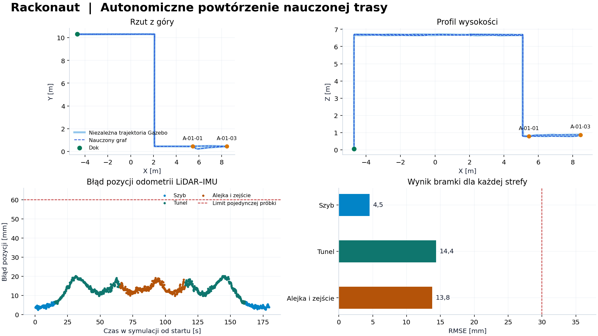

# Rackonaut · Autonomiczna inspekcja nauczonego magazynu

Profil `learned_warehouse:=true` zamyka cykl uczenia i autonomicznego powtórzenia lotu. Operator mapuje magazyn, zapisuje pozycje inspekcyjne, zatwierdza przebieg i zapisuje konfigurację. Po restarcie wybiera konfigurację przy doku, a Mission Manager wykonuje jej skierowaną trasę. Perception odczytuje aktualne klatki i przekazuje obserwacje do istniejącej ścieżki Mock SAP.

## Uruchomienie

Przygotuj środowisko według [README](../README.md#start-here), zbuduj pakiety i wskaż ten sam katalog danych przy kolejnych uruchomieniach.

```bash
scripts/robotics/build
read -rsp 'Kod do panelu Service: ' RACKONAUT_SERVICE_CODE
printf '\n'
export RACKONAUT_SERVICE_CODE
scripts/robotics/checkpoint live learned_warehouse:=true data_dir:="$PWD/run-learned"
```

W [Control Center](http://127.0.0.1:8765) odblokuj **Service**. Uruchom **Start Calibration → Open mapping flight → Start mapping flight** i zarejestruj miejsca po zatrzymaniu drona przy regałach. Wybierz **Return and end session**. Po fizycznym dokowaniu otwórz **Review Route**, zweryfikuj trasę i zatwierdź ją. **Save warehouse configuration** zapisze zweryfikowaną wersję. Zamknij kalibrację przyciskiem **Close calibration** i uruchom stos ponownie z tym samym katalogiem danych. [Uczenie miejsc i trasy](ROUTE_TEACHING.md)

W **Service → Learned warehouses** wybierz zapisaną wersję i kliknij **Check integrity**. Potwierdź **Activate this revision at the dock** i wybierz **Activate warehouse**. Po zakończeniu lokalizacji **View 3D Scan and route** pokazuje zapisaną mapę i graf, a formularz **Inspection stops** uruchamia misję dla zaznaczonych miejsc. Aby wrócić do wcześniejszej poprawnej konfiguracji, wybierz ją z listy i powtórz sprawdzenie oraz aktywację przy doku.

## Konfiguracja i integralność

Podczas zamknięcia pełnej sesji SLAM lokalizator zapisuje mapę PLY, wynik i `localization.npz`. Archiwum NPZ zawiera pozycje i quaternions klatek kluczowych, punkty, normalne, indeksy zakresów, pozycję doku i parametry LiDAR. Dane pochodzą z zaakceptowanych skanów LiDAR z lotu. Punkt PLY reprezentuje zmierzone powierzchnie do 7,5 m od czujnika. Klatki kluczowe zachowują płaszczyzny z pomiarów do 16 m. Obie reprezentacje używają ramy `rackonaut_odom` i jednostek SI.

Zatwierdzenie trasy wiąże SHA-256 obu map, surowego dziennika, profilu przestrzeni lotu, wyniku sesji i rewizji miejsc. Service kopiuje zaakceptowaną wersję do `warehouse-configurations/WH-…/`. Identyfikator jest wyprowadzany ze skrótu kanonicznego manifestu. Stary format kalibracji tworzy archiwum do przeglądu. Do aktywacji wymagane jest zatwierdzenie z dwiema kompletnymi mapami.

| Plik | Zawartość |
| --- | --- |
| `manifest.json` | Wersja formatu, ID sesji i konfiguracji, rewizja, rama, punkt doku, skrót zatwierdzenia i SHA-256 wszystkich plików. |
| `map.ply`, `localization.npz` | Chmura do wyświetlania oraz klatki i płaszczyzny lokalizatora. |
| `locations.json`, `locations/CAP-…/reference.jpg` | Nauczone pozy, czas klatki, identyfikator rekordu i zdjęcia kalibracji. |
| `route.json`, `route-validation.json`, `trajectory.jsonl`, `result.json` | Zatwierdzony skierowany graf, wynik walidacji, surowa odometria oraz metadane sesji. |
| `safety.json`, `sensors.json` | Ograniczenia przestrzeni, profil Safety i konfiguracja pomiarów. |

Aktywacja sprawdza skróty pakietu, zgodność z zatwierdzonym źródłem, profil Safety oraz sensory. Dopuszcza ją aktualny fizyczny kontakt i brak aktywnej misji. `active-warehouse.json` przechowuje wyłącznie wybór konfiguracji. Stos po restarcie wczytuje wybór i sprawdza pozycję, lecz czeka na dyspozycję operatora. [Kontrakt HTTP](../contracts/http.md#learned-warehouse-activation-and-dispatch)

## Ponowna lokalizacja

Obecny estymator LiDAR–IMU startuje przy doku, którego styk weryfikuje Energy Manager. Po spoczynkowej kalibracji IMU dopasowuje aktualny skan do nieruchomych, wcześniej zmierzonych płaszczyzn. Lokalna podmapa korzysta z klatek w otoczeniu przewidywanej pozy. Te same dopasowania punkt–płaszczyzna i bramki obserwowalności działają w locie oraz po restarcie. Trajektoria ma wspólną ramę z grafem, a zapisana mapa pozostaje stała w trakcie inspekcji. Status gotowości wymaga zgodnej rewizji i trzech zaakceptowanych dopasowań. [Kontrakt ROS](../contracts/ros.md#learned-warehouse-replay) · [Point-to-plane ICP](https://www.open3d.org/docs/release/tutorial/pipelines/icp_registration.html) · [Przykład lokalizacji 3D LiDAR z IMU](https://github.com/koide3/hdl_localization)

Przed uruchomieniem sterowania przetestowano dwie mapy odtworzone z tego samego wcześniejszego lotu. Niezależny zapis LiDAR i IMU zawierał 944 pasujące skany. Wariant PLY z estymacją normalnych dał 18,25 mm RMSE dla całości i 23,06 mm w alejce. Wariant z zamrożonymi klatkami dał odpowiednio 18,56 i 25,43 mm. Oba zmieściły się w progach położenia dla każdej strefy w tej próbie. Wybrano klatki, ponieważ zachowują bezpośrednio dane i normalne użyte w locie oraz wsparcie obserwacji do 16 m. Dokładne archiwum nowej sesji przeszło niezależne odtworzenie przed wydaniem komend ruchu.

| Strefa, dokładne archiwum | RMSE | p95 | Maksimum |
| --- | ---: | ---: | ---: |
| Cały lot | 13,05 mm | 19,08 mm | 20,43 mm |
| Szyb | 4,67 mm | 6,08 mm | 6,95 mm |
| Tunel | 14,51 mm | 19,65 mm | 20,43 mm |
| Alejka i zejście | 13,65 mm | 17,47 mm | 18,81 mm |

Największy odstęp między dopasowaniami wyniósł 0,168 s symulacji. Dryf doku wyniósł 0,24 mm. Pozycje porównano ze zsynchronizowaną odometrią Gazebo we wspólnej ramie doku. Częstotliwość w czasie rzeczywistym i RTF podlegają osobnej ocenie na żywo. [Porównanie PLY i klatek](learned-warehouse-evidence/independent-map-comparison.json) · [Bramka przed ruchem dla dokładnego archiwum](learned-warehouse-evidence/prior-gate.json) · [Bramki GOAL 21A](SLAM_FULL_ROUTE_VALIDATION.md#metoda-i-bramka-jakości)

## Sterowanie i energia

Mission Manager wykonuje węzły grafu po kolei. Przy wyborze podzbioru miejsc usuwa postoje, a zachowuje skierowaną pętlę i jej kolejność. Dobiera ruch na wprost tylko wzdłuż bieżącego odcinka i obrębie kolejnego niemal współliniowego odcinka. Warunkiem jest przejście przez bieżący waypoint, zgodność z obwiednią i aktualny skan objętości ruchu. Skręty, zejście do bramki, zawis przy regale i fizyczne dokowanie korzystają z oddzielnych warunków przejścia. Przy bramce zejścia wymagana jest aktualna zgoda Safety.

Przy każdym ruchu istniejący Navigator sprawdza LiDAR, a Mission Manager nadzoruje źródło i świeżość lokalizacji, rezerwację oraz zapas energii. Ruch autonomiczny działa w zatwierdzonej kolejności. Blokada prowadzi do zatrzymania i przekazania sytuacji do Recovery. Safety utrzymuje rezerwację do potwierdzenia bezpiecznego stanu. Żądanie kalibracji w locie wykorzystuje pozostałą nauczoną drogę do doku.

Po zatrzymaniu przed nieobserwowanym końcem odcinka kontroler może ponowić pomiar z pozycji maksymalnie 13 cm dalej na tym samym odcinku. Warunkiem jest brak zmierzonej przeszkody, aktualna obserwacja całego krótkiego ruchu, zgodność z obwiednią i miejsce na zatrzymanie przed nieobserwowanym obszarem. Ponawianie jest ograniczone do trzech prób na waypoint. Pierwszy lot z drugą mapą przerwano przy W0033, gdzie LiDAR widział tylko 0,244 m odcinka przed zakrętem. Powtórka wykonała ponowny pomiar z potwierdzonego fragmentu. [Zapis bezpiecznego zatrzymania przed zakrętem](learned-warehouse-evidence/initial-tunnel-stop.json)

Prognoza stosuje model Energy dla ruchu, wznoszenia i zawisu. Odnosi tempo do parametrów kontrolera i uwzględnia margines na korekty, zatrzymania podczas inspekcji i dokowanie. Koszt powrotu jest fragmentem tego samego planu. Obowiązkowa rezerwa jest dodawana raz i monitorowana osobno podczas lotu. Wszystkie wartości pochodzą z modelu symulacji.

## Korekta stanowiska A-01-01

Pierwsza zapisana konfiguracja wykonała pojedynczą inspekcję A-01-03. W kolejnym locie z dwoma postojami znacznik miejsca A-01-01 na żywej klatce był ucięty przy krawędzi. Misja zakończyła się jako `COMPLETE_WITH_MISSES` z fizycznym dokowaniem. Raport zachował stan `uninspected` dla tego miejsca, a Mock SAP otrzymał tylko potwierdzoną obserwację A-01-03.

W drugiej kalibracji operator ustawił kamerę tak, aby objąć cały znacznik A-01-01. Detektor odczytał oba identyfikatory podczas zapisu. Nową konfigurację zapisano oddzielnie, a wcześniejszą zachowano i ponownie wczytano przy doku w próbie przywracania. Obie wersje miały różne skróty mapy i 3D Scan wczytał wersję zgodną z bieżącym wyborem. [Pierwsza klatka A-01-01](learned-warehouse-evidence/initial-cropped-location.jpg) · [Pierwszy raport dwóch postojów](learned-warehouse-evidence/initial-two-stop-report.html) · [Dowód odtworzenia wcześniejszej konfiguracji](learned-warehouse-evidence/rollback.json)

## Zakres i ograniczenia

Próby obejmują jeden magazyn w symulacji, znany dok, aleję A i chroniony tunel. Lokalizacja po restarcie wymaga fizycznego doku oraz dobrej obserwowalności w aktualnych skanach. Plan używa kierunku nauczonych odcinków i istniejących stref Safety. Przystanek inspekcyjny wymaga pełnego znacznika lokalizacji w obrazie i identyfikatora obsługiwanego przez Mock SAP. Rzeczywisty wynik etykiety palety i odczyt magazynowy pozostają oddzielnymi polami. Progi jakości odnoszą się do odometrii w testowanej symulacji.

## Pomiary głównego lotu

Główną próbę wykonano w Ubuntu 22.04.5 na WSL2, z ROS 2 Humble i Gazebo Fortress 6.16.0. Użyto implementacji z commita `8807046` i konfiguracji `WH-E83B9581352A5C6DBC06694FE5E70FFA`, zapisanej w sesji `CAL-F93BD434D5904B86B940588AE9478BA4`. Kamera dostarczyła klatki w bieżącej misji `INS-CONTROL-20261126-150930-DE9D9F63`. Plik fabrycznej mapy znajdował się poza katalogiem rozwiązywanym przez uruchomienie. Waypointy pochodziły z zatwierdzonego grafu. Odometrię publikował wyłącznie `rackonaut_localization`, a `cmd_vel` wyłącznie `rackonaut_mission`. W zapisie było 3247 komunikatów ruchu i 0 komunikatów ręcznych. Ground truth z Gazebo otrzymywał niezależny walidator. [Zapis źródeł ROS](learned-warehouse-evidence/learned-ros-topology.txt) · [Licznik komend](learned-warehouse-evidence/command-topics.json) · [Kontrola dostępności mapy fabrycznej](learned-warehouse-evidence/factory-absence.txt)

Mapa zawiera 183 klatki kluczowe i 56 059 punktów PLY. Graf zachował 107 waypointów z 934 próbek. Dron wykonał wszystkie 106 odcinków po starcie i fizycznie zadokował. Długość pętli w grafie wynosiła 71,448 m, a niezależna próbkowana trajektoria Gazebo 71,054 m. Rzut na najbliższy odcinek grafu dał 20,14 mm p95 i 33,38 mm maksimum. Dryf estymaty przy doku to 0,32 mm. [Pomiary całej misji](learned-warehouse-evidence/full-score.json) · [Wykres trasy i błędów](learned-warehouse-evidence/route-comparison.png)

| Strefa | Próbki | RMSE | p95 | Maksimum | Estymaty/s | RTF |
| --- | ---: | ---: | ---: | ---: | ---: | ---: |
| Cały lot | 1082 | 12,92 mm | 18,80 mm | 20,22 mm | 3,33 | 0,554 |
| Szyb | 204 | 4,52 mm | 6,02 mm | 6,53 mm | 3,42 | 0,568 |
| Tunel | 578 | 14,37 mm | 19,35 mm | 20,22 mm | 3,33 | 0,552 |
| Alejka i zejście | 300 | 13,79 mm | 17,80 mm | 19,09 mm | 3,28 | 0,545 |

Lot trwał 324,6 s czasu rzeczywistego. Częstotliwości i RTF dla stref wyliczono z sąsiednich próbek tej samej strefy, wiążąc czas ROS z czasem odbioru telemetrii. Oba odczyty spełniły warunek świeżej klatki. W bazie były dwie nowe obserwacje z głównej misji i 0 obserwacji z obu kalibracji. [Wpisy Mock SAP](learned-warehouse-evidence/mock-sap-observations.json) · [Raport biznesowy](learned-warehouse-evidence/business-report.html)

| Stanowisko | Węzeł | Błąd pozycji w estymacie | Błąd pozycji według niezależnej odometrii | Błąd yaw względem nauczonej pozy | Obserwacja |
| --- | --- | ---: | ---: | ---: | --- |
| A-01-01 | W0046 | 5,7 mm | 13,8 mm | 1,68° | Zajęte, etykieta palety nieczytelna |
| A-01-03 | W0055 | 11,8 mm | 23,0 mm | 0,08° | Puste, oczekiwana paleta P003 nieobecna |

Osiągnięty punkt A-01-03 leżał 22,45 cm od fabrycznego waypointu w 3D. Porównano osiągnięty punkt z układem fabrycznym dopiero w teście, a dyspozycja zawierała punkt z archiwum kalibracji. [Porównanie pozy](learned-warehouse-evidence/full-proof.json)

### Energia

GOAL 23 szacował 61,14 p.p. dla wcześniejszej pętli dwóch miejsc. Jej lot kalibracyjny zużył 66,22 p.p. Zapis kalibracji głównej konfiguracji GOAL 24 zawiera 66,67 p.p. Nowa prognoza uwzględnia 12% czasu ruchu i 0,16 s na odcinek jako margines korekt oraz 3 s na postój. Dodatkowy postój na tej samej pętli dodaje 3 s i 0,78 p.p. do prognozy. Obie obserwacje głównego lotu potwierdzono w około 1,2 s czasu rzeczywistego każda. Odcinek W0033 z ponownym pomiarem zajął około 5,2 s czasu rzeczywistego. [Prognozy poszczególnych wersji](learned-warehouse-evidence/learned-plans-and-energy.json) · [Czasy odczytów i ponownego pomiaru](learned-warehouse-evidence/main-flight-mission-events.txt)

| Próba | Prognoza czasu | Czas wykonania | Prognoza energii | Zużycie modelowane | Bateria przy dokowaniu |
| --- | ---: | ---: | ---: | ---: | ---: |
| Jedno miejsce, pierwsza konfiguracja | 211,10 s sim | 176,32 s sim | 70,37 p.p. | 61,02 p.p. | 38,26% |
| Dwa miejsca, główna konfiguracja | 214,86 s sim | 179,68 s sim | 71,36 p.p. | 61,97 p.p. | 37,91% |
| Dwa miejsca, niezależny restart | 214,86 s sim | 180,38 s sim | 71,36 p.p. | 61,96 p.p. | 37,96% |

Przy A-01-01 bieżący model obliczył 37,14 p.p. na sam dalszy ruch do doku, a przy A-01-03 34,20 p.p. Prognozowany przed lotem koszt od drugiego postoju wyniósł 34,15 p.p. Spadek poziomu po tym postoju wyniósł około 29,77 p.p. Sprawdzenie dopuszczenia użyło 79,36% na całość z rezerwą 8 p.p. Wynik przy doku był o 29,91 p.p. wyższy od obowiązkowej rezerwy. [Dane głównego lotu](learned-warehouse-evidence/full-score.json)

## Scenariusze w Gazebo

| # | Próba | Wynik |
| --- | --- | --- |
| 1 | Zapis kompletnej konfiguracji | **PASS.** Archiwum zawiera obie mapy, zdjęcia, zapisaną trasę i manifest SHA-256. |
| 2 | Restart Gazebo, ROS i Control Center | **PASS.** Oddzielne uruchomienia odczytały zapis ze wspólnego katalogu danych lub jego sprawdzonej kopii. |
| 3 | Aktywacja przy doku | **PASS.** Sprawdzono przełączenie wersji przy fizycznym doku. Aktywacja w locie zwróciła 409. |
| 4 | Lokalizacja po restarcie | **PASS.** Wczytany pakiet pasował do świeżych skanów przy doku i utrzymał progi GOAL 21A po starcie. |
| 5 | Pojedynczy postój | **PASS.** A-01-03, jedna obserwacja i fizyczny styk doku. |
| 6 | Dwa postoje | **PASS.** A-01-01 i A-01-03, dwie obserwacje i 106 odcinków. Wcześniejszy lot z uciętym znacznikiem A-01-01 zakończył się z brakiem jednej obserwacji. |
| 7 | Powtórzenie pełnej misji | **PASS.** Nowe procesy Gazebo, ROS i Control Center w domenie 229 odczytały ten sam podpis grafu i pokonały 106 odcinków. RMSE całego lotu wyniósł 12,97 mm. Każda strefa spełniła progi GOAL 21A. Zapisano dwie nowe obserwacje i zakończono przy fizycznym doku. |
| 8 | Nowa pozycja | **PASS.** Wykonany punkt A-01-03 różnił się o 22,45 cm od fabrycznej pozy. |
| 9 | Przeszkoda zmieniona w świecie | **PASS.** Gazebo przesunęło karton na X 6,95 m, Y 0,45 m, Z 0,82 m. LiDAR wykrył przeszkodę, zmierzony odcinek hamowania wyniósł 7,9 cm, a Safety utrzymało D i A w Recovery. |
| 10 | Utrata lokalizacji | **PASS.** Wstrzymanie procesu lokalizatora w locie zwróciło `LOCALIZATION_LOST`, zakończyło publikację ruchu i utrzymało D i A. |
| 11 | Emergency Stop i wejście do strefy | **PASS dwukrotnie.** Niezależne próby zakończyły się `ABORTED` i Safety `RECOVERY`. W drugiej próbie ruch pracownika w Gazebo wywołał alarm zajęcia A. |
| 12 | Niewystarczająca energia | **PASS.** W profilu z ograniczonym ładowaniem start odrzucono przy 49,989%, z wymaganiem 79,147%. |
| 13 | Podmiana mapy lub manifestu | **PASS.** Odrzucono aktywację po oddzielnej zmianie PLY, NPZ i manifestu. Podmiana PLY blokowała także start. |
| 14 | Niezatwierdzona lub nieaktualna trasa | **PASS.** Odrzucono usunięte zatwierdzenie, zmienioną rewizję zapisu oraz starą rewizję w dyspozycji. |
| 15 | Nowe obserwacje i raport | **PASS.** Mock SAP powiązał obie obserwacje z nowym ID misji i wygenerował raport. |
| 16 | Dokowanie i strefy | **PASS.** Po fizycznym styku doku strefy przeszły do `RELEASED`. |
| 17 | Regresja profilu referencyjnego | **PASS.** Zwykła inspekcja A-01-01 na wcześniejszej konfiguracji produkcyjnej zakończyła się `COMPLETE`, fizycznym dokiem i zapisem `unreadable_label`. |

[Próba jednego postoju](learned-warehouse-evidence/one-score.json) · [Pomiary niezależnego lotu](learned-warehouse-evidence/independent-score.json) · [Raport biznesowy z powtórzenia](learned-warehouse-evidence/independent-business-report.html) · [Blokada aktywacji w locie](learned-warehouse-evidence/activation-airborne.json) · [Zmieniony karton](learned-warehouse-evidence/negative-obstacle.json) · [Utrata lokalizacji](learned-warehouse-evidence/negative-localization.json) · [Emergency Stop](learned-warehouse-evidence/negative-emergency.json) · [Wejście do strefy](learned-warehouse-evidence/negative-intrusion.json) · [Pojemność przed startem](learned-warehouse-evidence/negative-energy.json) · [Integralność i rewizje](learned-warehouse-evidence/negative-integrity.json) · [Regresja produkcyjna](learned-warehouse-evidence/production-regression.json)

Kompilacja 10 pakietów, 66 testów ROS, 7 testów backendu i testy dymne ROS i HTTP przeszły poprawnie.

## Materiały



- [Pełny cykl autonomiczny w przyspieszeniu ×4, 83 s](learned-warehouse-evidence/autonomous-cycle.mp4).
- [Zatwierdzona kalibracja](learned-warehouse-evidence/configuration-sealed.png) · [Aktywna konfiguracja i prognoza dyspozycji](learned-warehouse-evidence/independent-active.png) · [3D Scan nauczonej mapy](learned-warehouse-evidence/independent-active-route.png) · [Fizyczny dok](learned-warehouse-evidence/independent-finished.png).
- [Aktualna klatka A-01-01](learned-warehouse-evidence/full-inspection-A-01-01.png) · [Aktualna klatka A-01-03](learned-warehouse-evidence/full-inspection-A-01-03.png) · [Raport z inspekcji](learned-warehouse-evidence/business-report.html).
- [Manifest gotowego pakietu](learned-warehouse-evidence/warehouse-configurations/WH-E83B9581352A5C6DBC06694FE5E70FFA/manifest.json) · [Nauczona mapa lokalizacyjna NPZ](learned-warehouse-evidence/warehouse-configurations/WH-E83B9581352A5C6DBC06694FE5E70FFA/localization.npz) · [Skierowany graf i zatwierdzenie](learned-warehouse-evidence/warehouse-configurations/WH-E83B9581352A5C6DBC06694FE5E70FFA/route.json).
