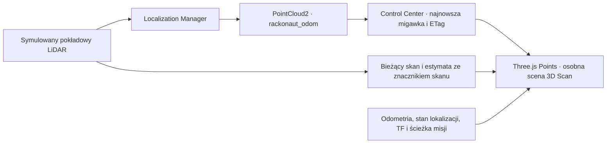

# Mapa pomiarowa 3D Scan

Uruchom [Full Robotics](../README.md#b-full-robotics-demo), otwórz [Control Center](http://127.0.0.1:8765) i wybierz **3D Scan** w panelu magazynu. **2D Map** służy do planowania w rzucie z góry. **3D Model** otwiera istniejący Digital Twin z geometrią referencyjną. **3D Scan** pokazuje zarejestrowane odbicia LiDAR-u, estymowaną pozę drona, jego trajektorię i aktualne punkty w objętości ruchu wskazane przez Obstacle Avoidance. Włącz **Live LiDAR**, aby zobaczyć zsynchronizowane odbicia z bieżącej klatki. **Height** koloruje punkty według Z i pokazuje legendę w metrach. **Uniform** używa jednego koloru.

## Źródło i przepływ danych

Mapa pochodzi z `/rackonaut/localization/measured_map` (`sensor_msgs/msg/PointCloud2`). Rozdzielczość akumulatora wynosi 0,16 m, a limit sesji to 80 tys. wokseli. Lokalizator dopasowuje pozycję do istniejącej mapy referencyjnej, a do chmury pomiarowej zapisuje zmierzone końce promieni. Renderowana scena zawiera tę chmurę i osobne warstwy drona, trajektorii, siatki oraz osi. Bieżący skan z `/rackonaut/drone/lidar/points` jest transformowany na podstawie `/rackonaut/localization/estimate` o pasującym czasie pozyskania. `/rackonaut/drone/odom`, `/rackonaut/localization/state`, `/rackonaut/mission/path` i `/tf` zasilają wizualizację i informacje o aktualności.

`GET /api/measured-map?detail=low|balanced|high` zwraca ciasno upakowane trójki XYZ w kolejności little endian `Float32`. W odpowiedzi są identyfikator sesji, znacznik wersji ETag, liczba zapisanych punktów, wiek próbki, rozdzielczość i rama. `304` bez ciała pozwala zachować obraz przy tej samej wersji. Podgląd rozróżnia liczbę zarejestrowanych i faktycznie rysowanych punktów. Wartość procentowa przy RMS oznacza dopasowanie skanu użyte w lokalizacji.

| Szczegółowość | Limit | Odstęp pobierania |
| --- | ---: | ---: |
| Low | 2 200 | 1,1 s |
| Balanced | 16 000 | 1,3 s |
| High | do 80 000 | 2,3 s |

Low i Balanced wybierają oryginalne punkty z przestrzennie rozłożonych wokseli. High przekazuje wszystkie dostępne punkty. Parametry bieżącego skanu i mapy są dostępne przez osobne żądania. `/api/state` zachowuje dotychczasowy podgląd 2 200 punktów Digital Twin. **3D Model** oraz **3D Scan** używają tej samej kamery i instancji renderera, z odrębnymi scenami. Bufory punktów są wielokrotnie wykorzystywane. Ukrycie 3D Scan albo karty przerywa pobieranie. Po utracie lokalizacji lub odświeżania migawka pozostaje widoczna ze statusem **Historical snapshot**.

Eksport `/rackonaut/localization/export_map` nadal zapisuje binarne `localization-measured.ply` z XYZ z bieżącego akumulatora. Nowy szkic Warehouse Calibration nadal rozpoczyna się z zerem lokalizacji, zerem waypointów i pustym odwołaniem do własnej mapy. Jego obszar mapowania sygnalizuje przyszły lot pomiarowy.

## Zakres zestawów ROS

Odtworzone zebranie testów na wcześniejszym commicie integracji dało **38** pozycji. Na commicie bazowym GOAL 19 `de61082` pełne zebranie dało **43**. GOAL 18 raportował **36** po uruchomieniu podzbioru pakietów. Pominięty w tej komendzie `rackonaut_perception` zawiera siedem testów z `test_inspection.py` i `test_quality.py`. GOAL 18 dodał trzy testy Service, jeden Mission i jeden Safety. Różnica wynika z zakresu: `38 + 5 − 7 = 36`. GOAL 19 dodaje trzy testy mapy do pełnego zestawu.

## Próby integracyjne

Weryfikację przeprowadzono 26 listopada 2026 r. w Gazebo Fortress 6.16.0 i ROS 2 Humble na Ubuntu 22.04.5 w WSL2. Widok sprawdzono w Chrome z Playwright. [Zapis prób i pomiarów](measured-map-evidence/verification.json)

| Próba | Wynik |
| --- | --- |
| A · Widoki na postoju | 2D Map, 3D Model i 3D Scan przełączały się poprawnie. Oba widoki 3D korzystały z jednego elementu canvas. Po wyjściu z 3D Scan nie było nowych żądań o chmurę. |
| B · Lot A-01-01 → A-01-03 | Misja `INS-CONTROL-20261126-094748-0F176DB6` potwierdziła oba odczyty i zakończyła się w doku z `COMPLETE`. Mapa urosła z 1 120 do 54 283 wokseli. |
| C · Przełączanie w locie | Licznik wzrósł z 11 766 do 12 247. Identyfikator misji, liczba startów i aktywna rezerwacja Safety pozostały zgodne. |
| D · Karton w Gazebo | Po wstawieniu modelu przy doku liczba bieżących odbić w obszarze ścian kartonu wzrosła z 30 do 103 w każdej z pięciu porównanych klatek. W tym obszarze mapa wzrosła z 11 do 29 wokseli. |
| E · Utrata danych | Po wstrzymaniu lokalizatora stan przeszedł na `LOST`, a widok zachował 54 301 punktów ze statusem **Historical snapshot**. Serwer zwrócił `304` dla tego samego ETag z rosnącym wiekiem. Po wznowieniu wrócił status **Live accumulation**. |
| F · Kalibracja | Szkic zawierał zero lokalizacji, zero waypointów i pustą referencję mapy. Service nie pobierał chmury. Po anulowaniu ponownie otwarto skan z bieżącej sesji produkcyjnej. |
| G · Regresja | Otworzono Digital Twin, raport HTML i porównanie Mock SAP dla lotu. Przeszła też regresja Service z próby F. |
| H · Business Demo | Widok pokazał komunikat o wymaganej lokalizacji sensorowej, a bezpośrednie żądanie HTTP dostało `404`. 3D Model działał. |

Istniejący eksport zapisał 54 301 wierzchołków PLY w binarnym XYZ o rozmiarze 12 bajtów na wierzchołek. Przeszło 46 testów ROS, 7 testów kontraktu HTTP oraz test dymny API.

## Wydajność

Okna trwały około 14 s po zakończeniu lotu, przy 54 283 punktach, tej samej symulacji i identycznym ruchu kamery dla wszystkich trybów skanu. Miara FPS liczy rzeczywiste rysowania WebGL w Chrome headless. Wiek danych i czas odpowiedzi podano jako p95. Częstotliwość lokalizacji to mediana w czasie rzeczywistym.

| Widok | Punkty | RTF | FPS | LiDAR / IMU p95 | Lokalizacja | `/api/state` p95 | Dane mapy na okno |
| --- | ---: | ---: | ---: | ---: | ---: | ---: | ---: |
| 2D Map | — | 0,608 | — | 291 / 98 ms | 3,67 Hz | 18,67 ms | 0 B |
| Low | 2 200 | 0,606 | 15,5 | 297 / 101 ms | 3,64 Hz | 13,54 ms | 0,24 MB |
| Balanced | 16 000 | 0,601 | 16,1 | 311 / 89 ms | 3,61 Hz | 19,27 ms | 1,73 MB |
| High | 54 283 | 0,603 | 15,2 | 250 / 112 ms | 3,62 Hz | 22,66 ms | 3,26 MB |

| Widok | CPU Chrome, % jednego rdzenia | Suma working set Chrome | CPU Gazebo / lokalizator / Control Center, rdzenie | RSS Gazebo / lokalizator / Control Center |
| --- | ---: | ---: | ---: | ---: |
| 2D Map | 13,6% | 855 MiB | 1,96 / 0,12 / 0,20 | 876 / 222 / 193 MiB |
| Low | 17,2% | 890 MiB | 1,96 / 0,13 / 0,22 | 876 / 222 / 196 MiB |
| Balanced | 16,4% | 899 MiB | 1,97 / 0,13 / 0,22 | 876 / 223 / 196 MiB |
| High | 17,0% | 913 MiB | 1,96 / 0,13 / 0,21 | 876 / 224 / 196 MiB |

Lokalizacja utrzymała `TRACKING` we wszystkich czterech oknach. Balanced jest domyślny. High pobiera dane rzadziej i zużył około 1,9 razy więcej transferu oraz 14 MiB więcej working set Chrome od Balanced w tej próbie. Krótkie okna opisują ten host i zarejestrowaną chmurę. Próba podczas lotu potwierdziła ciągłość działania systemu podczas przełączania map. Mapa przechowuje odbicia z sesji, w tym z obiektów, które później przemieściły się lub zostały usunięte. Szczegóły bieżącej sceny można sprawdzić warstwą Live LiDAR.

## Materiały

- Porównanie z tej samej sesji po dokowaniu. [2D Map](measured-map-evidence/13-reference-2d.png) · [3D Model](measured-map-evidence/14-reference-model.png) · [3D Scan](measured-map-evidence/15-reference-scan.png)
- Rozwój mapy. [Początek lotu](measured-map-evidence/04-scan-flight-start.png) · [W locie](measured-map-evidence/05-scan-mid-flight.png) · [Po zadokowaniu](measured-map-evidence/06-scan-docked.png) · [Przyspieszony film, 23 s](measured-map-evidence/point-cloud-growth.mp4)
- Szczegółowość oraz kolor. [Low](measured-map-evidence/07-detail-low.png) · [Balanced](measured-map-evidence/07-detail-balanced.png) · [High i Height](measured-map-evidence/06-scan-docked.png) · [Uniform](measured-map-evidence/08-uniform.png)
- Próby dodatkowe. [Przed wstawieniem kartonu](measured-map-evidence/10-carton-before.png) · [Karton w skanie](measured-map-evidence/10-carton-live.png) · [Mapa historyczna](measured-map-evidence/11-historical.png) · [Pusta kalibracja](measured-map-evidence/12-service-empty.png) · [Business Demo](measured-map-evidence/16-unsupported.png)
