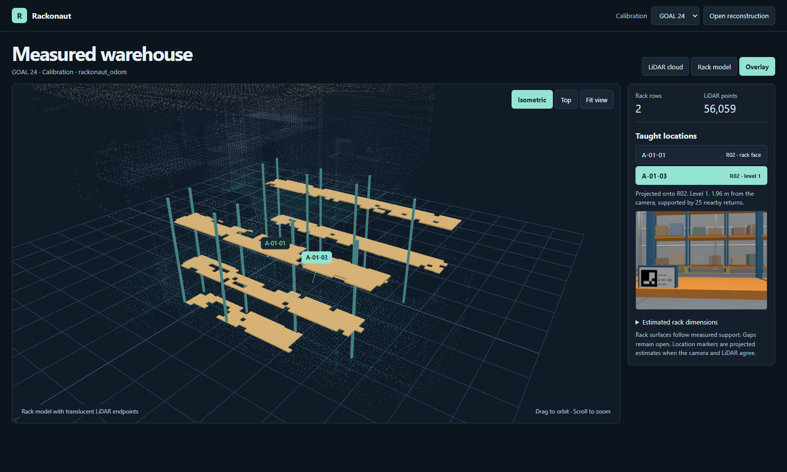

# Rackonaut · rekonstrukcja regałów z LiDAR-u

Prototyp odtwarza obserwowane fragmenty regałów z archiwum Warehouse Calibration. W czterech przelotach znalazł dwa rzędy z trzema powtarzalnymi poziomami. Scena Gazebo zawiera cztery pełne rzędy. Modele obejmują około połowy długości wykrytych rzędów. W oryginalnej chmurze pozostają pomiary ścian, infrastruktury i towarów. Model przedstawia poziome fragmenty półek oraz pionowe fragmenty słupów.

## Uruchomienie

W głównym katalogu repozytorium uruchom serwer statyczny. Przeglądarka wymaga WebGL. Do obejrzenia dołączonych przykładów wystarczy Python i Chrome. Przeglądarka wykonuje wszystkie operacje odczytu i renderowania lokalnie.

```bash
python3 -m http.server 8962 --bind 127.0.0.1
```

Otwórz [przeglądarkę rekonstrukcji](http://127.0.0.1:8962/scripts/reconstruction/viewer/). Wybierz **LiDAR cloud**, **Rack model** albo **Overlay**. Zmiana warstwy zachowuje kamerę, więc zasięg i luki można porównać bez zmiany perspektywy. **Fit view** dopasowuje widok do bieżącej warstwy. **Top** daje rzut ortograficzny. W perspektywie izometrycznej przeciągnij scenę, by ją obrócić, i użyj kółka do zbliżenia. Kliknij identyfikator lokalizacji, żeby zobaczyć przypisanie, zdjęcie i promień, jeśli projekcja została potwierdzona.

Wygenerowanie przykładu z innego archiwum korzysta z zainstalowanego stosu Humble, NumPy, SciPy i OpenCV z ArUco. Wybierz zamknięte archiwum kalibracyjne zawierające `map.ply` i `locations.json`. Jeżeli są dostępne, eksporter odczyta też `localization.npz`, `route.json` i `sensors.json`.

```bash
scripts/robotics/build
source scripts/robotics/activate.bash
python3 scripts/reconstruction/reconstruct.py /ścieżka/do/archiwum /tmp/reconstruction.json \
  --camera-calibration scripts/reconstruction/reference-camera.json
```

Otwórz wynik przez **Open reconstruction**. Podaj profil kamery potwierdzony dla tego archiwum. Bez profilu przeglądarka pokaże zachowane pozycje kamery jako punkty przechwycenia, czyli lokalizacje bez przypisania. Profil dołączony do prototypu pochodzi z `CameraInfo` i statycznej transformacji referencyjnego drona. Matryca ma 320×240 px, ogniskowe około 276,23 px i punkt główny (160, 120). Kamera jest odsunięta o 0,23 m do przodu względem podstawy drona. Wszystkie cztery analizowane sesje należą do tego profilu.

## Dane z kalibracji

Punkty XYZ w `map.ply` zapisano w metrach w `rackonaut_odom`, z pionem w osi Z i początkiem określonym przez instalację doku. Mapa ma już rozdzielczość wokselową 0,16 m. Eksportowana chmura zawiera komplet pierwotnych końcówek pomiarów i zachowuje kolejność oraz format Float32 little-endian. `localization.npz` przechowuje osobno zarejestrowane zwroty, normalne i pozy klatek. Prototyp sprawdza archiwum istniejącym czytnikiem, podaje jego liczebność, a geometrię wyznacza z `map.ply`. Zgodność sesji i ramy trasy jest kontrolą metadanych. Węzły z `route.json` opisują ruch drona.

| Archiwum | Punkty mapy | Klatki LiDAR w NPZ | Węzły trasy | Lokalizacje z fotografią |
| --- | ---: | ---: | ---: | ---: |
| GOAL 22 · `CAL-0E4AA36E…` | 56 549 | — | — | 2 |
| GOAL 23 · `CAL-00A08DD8…` | 55 955 | — | 95 | 2 |
| GOAL 24 · `CAL-F93BD434…` | 56 059 | 183 | 107 | 2 |
| GOAL 26 · `CAL-623FDBCB…` | 55 775 | 182 | 98 | 2 |

W GOAL 24 i 26 konfiguracja zapisuje zorganizowaną chmurę 192×37, zakres 0,10–16,0 m i przesunięcie LiDAR-u o +0,09 m w Z względem drona. NPZ zawiera odpowiednio 488 727 i 488 243 zwroty używane przez zapisane klatki. W `locations.json` pozycja i kwaternion są zarejestrowaną pozą drona zsynchronizowaną z JPEG. W czterech sesjach przeleciał on przez szyb i górny tunel do alejki A. To cztery osobne rejestracje w tej samej hali i o zbliżonym pokryciu.

## Algorytm

1. SciPy `cKDTree` znajduje 12 najbliższych sąsiadów punktu. Analiza wartości własnych macierzy kowariancji wybiera lokalnie płaskie próbki. Normalne pionowych powierzchni głosują na orientację układu w rzucie poziomym. Algorytm rozpatruje dwie prostopadłe osie tego układu.
2. Histogram wysokości dla poziomych powierzchni daje poziomy kandydackie. W każdym bliskim paśmie wysokości raster 0,24 m i składowe spójne wyodrębniają wydłużone skupiska. Dylatacja służy do grupowania. Do renderowania trafiają wyłącznie komórki zawierające pomiary.
3. Rząd wymaga co najmniej trzech skupisk o podobnym rozstawie wysokości, sensownych proporcjach i wspólnym obszarze podłużnym. Możliwe są następne zgodne poziomy oraz dowolna liczba odrębnych rzędów. Z nakładających się kandydatów pozostaje wariant z większym pokryciem. Wymiary wynikają z obwiedni podpartych pomiarami. Wąskie pionowe pasma przy krawędziach, z powtarzalnymi zwrotami na kilku wysokościach, dają odcinki słupów i obserwowaną wysokość. Grubość rysowanych elementów to parametr wyświetlania.
4. Istniejący `Inspector.detect` odczytuje ArUco z zapisanego zdjęcia. Gdy występuje dokładnie jeden znacznik odpowiadający identyfikatorowi, eksporter przelicza jego środek na promień od optycznego środka kamery. Przypisanie wymaga pojedynczej powierzchni wejściowej z lokalnymi zwrotami przy przecięciu i zgodną wysokością w rzędzie. Poziom półki wymaga dodatkowo podparcia komórkami w pobliżu promienia. Więcej niż jedna wiarygodna powierzchnia albo brak odczytu skutkuje oznaczeniem `Unplaced`.

Rozważono RANSAC i segmentację dominujących płaszczyzn z Open3D. W tej mapie istotne statystycznie powierzchnie należą też do podłogi, dachu i tuneli, dlatego kryterium regału oparto na powtarzalnych poziomach i wspólnym położeniu. Implementacja wykorzystuje zainstalowane już SciPy, czytnik PLY i dekoder ArUco z Rackonaut oraz dołączony Three.js z OrbitControls. [Open3D, chmury punktów](https://www.open3d.org/docs/release/tutorial/geometry/pointcloud.html) · [SciPy, cKDTree](https://docs.scipy.org/doc/scipy/reference/generated/scipy.spatial.cKDTree.html)

## Walidacja

Najpierw wyeksportowano i zapisano sumy SHA-256 czterech rekonstrukcji. Osobny walidator odczytał później SDF `localization_showcase.sdf`. Z visuali słupów wyznaczył obwiednie rzędów, z visuali półek wysokości górnych płaszczyzn, a z położenia tabliczki i tekstury pozycję środka ArUco. Użyty generator świata jest identyczny na branchach źródłowych wszystkich czterech archiwów. Walidator przypisuje rzędy na podstawie poprzecznego położenia, zgodności osi i pokrycia wzdłużnego. Rekonstrukcja i przeglądarka otrzymują dane kalibracyjne i pomiarowe. SDF, tekstury referencyjne oraz współrzędne fabryczne używane są w osobnym porównaniu po wygenerowaniu wyników.

| Kontrola | Wynik |
| --- | --- |
| Liczba rzędów | Każda sesja 2 poprawnie przypisane spośród 4 obecnych w świecie. Wszystkie rekonstrukcje odpowiadają `rack_row_2` i `rack_row_3`. |
| Błędne detekcje i pokrycie | 0 fałszywych rzędów w czterech próbach. W obwiedni pierwszego rzędu po marginesie 0,16 m było 0 punktów. Czwarty rząd miał 883–893 zwrotów w obwiedni bez wystarczającej ciągłości kilku półek. Dwa wykryte rzędy miały po 3 760–4 126 zwrotów w obwiedni. |
| Orientacja i położenie | Różnica orientacji osi 0,04–0,13°. Środki przekrojów poprzecznych odbiegają o 0,03–0,06 m. Podłużne środki obserwowanych fragmentów są przesunięte o 4,59–5,02 m względem środka pełnego rzędu. |
| Wymiary | Długość obserwowana 9,28–9,92 m z 19,72 m w świecie. Szerokość 1,17–1,21 m wobec 1,32 m po zewnętrznych krawędziach słupów. Wysokość zachowanych odcinków 5,21–5,45 m wobec 5,70 m w świecie. |
| Poziomy | Trzy rozpoznane poziomy w każdym odtworzonym rzędzie. Pierwszy leży 0,013–0,024 m pod górą półki w SDF, wyższe 0,118–0,130 m poniżej niej. LiDAR może widzieć dolną powierzchnię półki. Sama półka w odniesieniu ma grubość 0,105 m. |
| Zgodność z chmurą | P95 odległości od środka rysowanej komórki półki do najbliższego oryginalnego zwrotu wyniósł 0,097–0,123 m. Miara dotyczy podpór modelu w tej samej chmurze. |
| Lokalizacje | Z 8 zarejestrowanych lokalizacji w czterech sesjach 5 miało unikalną projekcję na właściwy rząd. Odległość do środka ArUco z geometrii i tekstury wyniosła 0,022–0,035 m. Środek tabliczki jest przesunięty względem markera, więc do niego odległość wynosi 0,142–0,149 m. A-01-01 w GOAL 24 i 26 ma przypisanie powierzchni bez lokalnie potwierdzonego poziomu. |
| Modyfikacje chmury | Usunięcie pasma jednego wykrytego rzędu (51 624 punkty) dało jeden rząd. Zachowanie tylko niskiej części chmury (16 013 punktów) dało zero. Obrót o 27° i przesunięcie o (8, −4) m nadal dało dwa rzędy, oba z osią 26,87°. |

[Dane walidacji i identyfikatory archiwów](reconstruction-evidence/validation.json)

Komendy testu geometrii i niezależnego porównania, po aktywacji workspace:

```bash
OPENBLAS_NUM_THREADS=1 python3 -m unittest discover -s scripts/reconstruction -v
python3 scripts/reconstruction/validate.py \
  --world ros2_ws/install/rackonaut_warehouse/share/rackonaut_warehouse/worlds/localization_showcase.sdf \
  --warehouse-assets ros2_ws/src/rackonaut_warehouse \
  --output /tmp/reconstruction-validation.json docs/reconstruction-evidence/goal24.json docs/reconstruction-evidence/goal26.json
```

Pomiar na Ubuntu 22.04 pod WSL2, Pythonie 3.10 i Gazebo Fortress 6.16.0. Eksport liczony od odczytu danych do gotowego modelu zajmował 0,26–0,30 s na tym hoście przy jednym wątku OpenBLAS. Chrome przez Playwright sprawdził zmianę archiwum, warstw, rzut z góry, obrót, zbliżenie, wybór markera, zdjęcie, otwarcie lokalnego pliku i stan bez przypisania. [Wynik przeglądarki](reconstruction-evidence/browser-proof.json)

## Materiały

[Chmura, ta sama kamera](reconstruction-evidence/cloud.png) · [model regałów](reconstruction-evidence/model.png) · [nakładka](reconstruction-evidence/overlay.png) · [rzut z góry](reconstruction-evidence/top.png) · [przeciwny kąt](reconstruction-evidence/oblique.png) · [pełny zasięg chmury](reconstruction-evidence/full-cloud.png) · [druga kalibracja](reconstruction-evidence/second-archive.png)



[Nagranie interakcji w Chrome](reconstruction-evidence/reconstruction-demo.mp4) · [Pakiet GOAL 24](reconstruction-evidence/goal24.json) · [Pakiet GOAL 26](reconstruction-evidence/goal26.json)

## Ograniczenia

Algorytm preferuje jeden dominujący układ osi i regały o powtarzalnej geometrii. Rzędy ukośne względem siebie, krótkie regały, dwa poziomy albo zdarzenia z zasłoniętym frontem mogą nie zebrać wymaganych dowodów. Regularne poziome konstrukcje innego typu mogą wymagać dodatkowej oceny. Próby nie obejmują innego budynku. Chmura wokselowa i widok przelotu ograniczają dokładność krawędzi. Wynik służy wyłącznie do przeglądu wizualnego w osobnej przeglądarce. Control Center, lokalizacja, planowanie lotu i zabezpieczenia korzystają ze swoich dotychczasowych danych.
