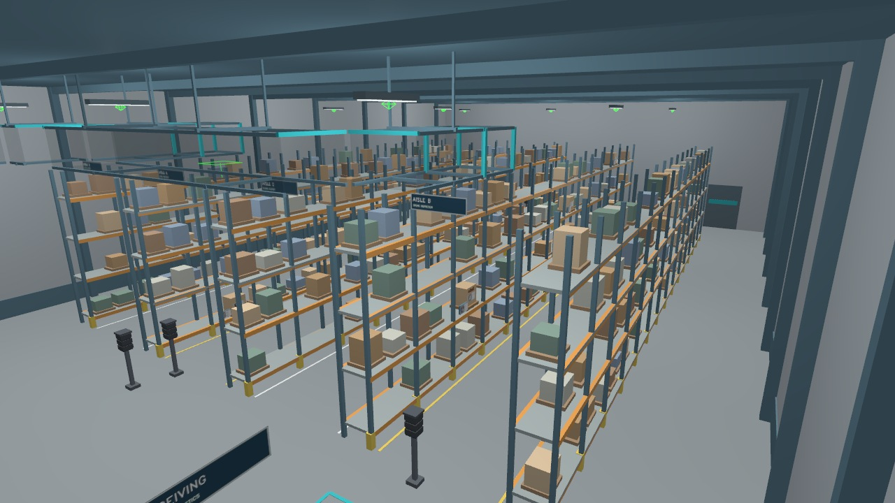
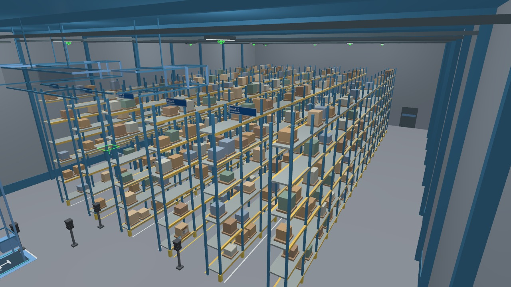
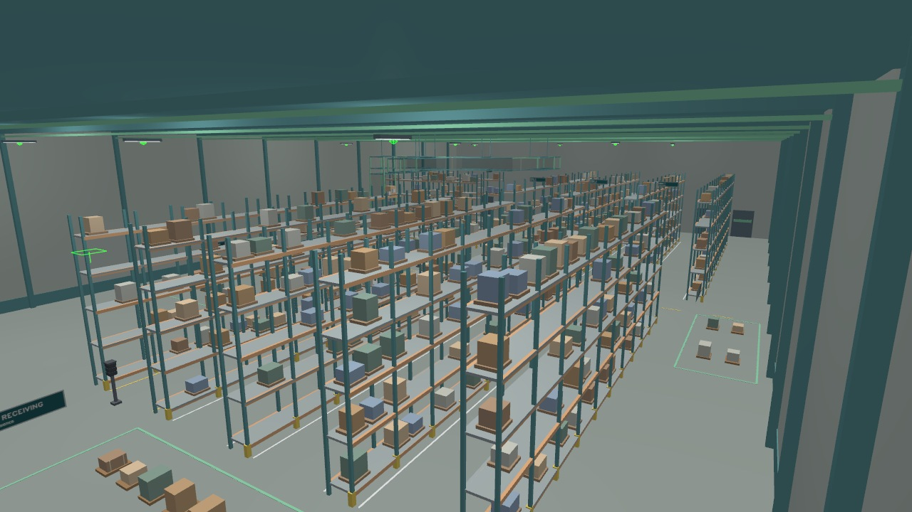

# GOAL 28W · Biblioteka środowisk magazynowych

Trzy światy korzystają ze wspólnego launchera Rackonaut i tych samych układów współrzędnych, tematów ROS oraz kontraktu obserwacji. Każdy ma odrębną geometrię, profil lotu, rejestr markerów i syntetyczny stan oczekiwany w Mock SAP. Bazą jest `dc9813ce7dd8c234311f2e9ec0bc242f6ae5305d` z gałęzi `feature/open-aisle-descent`.

## Hale

| Wariant | Powierzchnia i wysokość wewnętrzna | Rzędy, alejki, poziomy | Odcinki regałów | Funkcjonalne stanowiska | Maks. Z zadanej pozy inspekcyjnej |
| --- | --- | --- | --- | --- | --- |
| `distribution-center` | 55 × 35 m, 12 m | 5 rzędów, 4 alejki, 4 poziomy | 36,40 m, regały 8 m | 6, alejki A i B | 7,06 m |
| `high-bay` | 65 × 40 m, 17 m | 6 rzędów, 5 alejek, 6 poziomów | 44,80 m, regały 12 m | 6, alejki A i B | 11,24 m |
| `logistics-hub` | 90 × 55 m, 15 m | 11 rzędów w 3 blokach, 8 alejek, 5 poziomów | 28,00 / 30,80 / 15,60 m, regały 10 m | 6, alejki A i B w różnych blokach | 9,30 m |

- **Distribution Center.** Długa zabudowa oraz oddzielne strefy przyjęć i wydań. Alejki mają 4,80 m światła. Graf łączy szyb przy zachodnim doku z dwiema bramami na Z = 9,65 m. [Schemat](multi-warehouse-evidence/distribution-center-plan.png)
- **High-Bay Warehouse.** Alejki mają 3,60 m światła. Sześć poziomów sięga od 0,65 do 10,85 m, z tunelem na Z = 13,85 m. Przykładowe stanowisko `A-12-06` ma punkt obserwacji na Z = 11,24 m. Na zachodnim placu stoi scenograficzny podnośnik. [Schemat](multi-warehouse-evidence/high-bay-plan.png)
- **Large Logistics Hub.** Dwa banki podłużne rozdziela szeroki korytarz poprzeczny z dokiem. Północny bank jest obrócony o 90°, z dodatkową alejką H o szerokości 5,40 m. Strefy buforowe są odróżnione od przyjęć i wydań. Tunel na Z = 11,95 m łączy A i B z obu stron korytarza poprzecznego. [Schemat](multi-warehouse-evidence/logistics-hub-plan.png)

## Generowanie i uruchomienie

Źródłem jest jeden generator i trzy konfiguracje JSON. Każda deklaruje obrys hali, moduły rzędów i poziomów, obszary robocze, dok, oś tunelu, miejsca zejścia oraz oczekiwany i fizycznie wystawiony towar. Kolory, ułożenie ładunków oraz tablice są generowane deterministycznie. Build instaluje osobny SDF, profile tła i Safety, rejestr zdjęciowy, mapę markerów, plik Mock SAP i metadane. Stan fizyczny towaru pozostaje w `*_ground_truth.json` do niezależnej walidacji, a odczyty pochodzą z kamery. [Konfiguracje](../ros2_ws/src/rackonaut_warehouse/environments/) · [Generator](../ros2_ws/src/rackonaut_warehouse/scripts/environment_library.py)

Na WSL2 z Humble i Fortress uruchom build z zależnościami według [README](../README.md#start-here). Launcher domyślnie wybiera blokadę dyspozycji produkcyjnej oraz pełny tryb sensorowy do pracy z pustą mapą. Każdy wariant ma własny domyślny katalog danych. Przy ustawianiu `data_dir` użyj osobnego katalogu dla pary wariant–model.

```bash
scripts/robotics/check
python3.10 scripts/api/setup.py
scripts/robotics/build

scripts/robotics/checkpoint live warehouse_variant:=distribution-center
scripts/robotics/checkpoint live warehouse_variant:=high-bay
scripts/robotics/checkpoint live warehouse_variant:=logistics-hub
```

Uruchamiaj jeden przykład naraz. `drone_model:=x3` wybiera przypięte zasoby Fuel v4 zgodnie z dokumentacją X3. `gazebo_gui:=true` włącza widok na hoście z działającym wyświetlaniem. Warianty korzystają z wirtualnego pomiaru obecności Safety i własnego Mock SAP. Kamera i LiDAR drona dostarczają pomiary symulowane. Profil laserowy Safety oraz historyczny backend są odrzucane na wejściu launchera dla tych trzech środowisk. Dotychczasowe warianty zachowują wybór własnych profili. [Integracja X3](X3_FULL_ROBOTICS_INTEGRATION.md)

Poniższe polecenia generują środowiska poza colcon i uruchamiają walidator offline.

```bash
source scripts/robotics/activate.bash
for name in distribution-center high-bay logistics-hub; do
  /usr/bin/python3 ros2_ws/src/rackonaut_warehouse/scripts/generate.py \
    --environment "$name" --environment-output /tmp/rackonaut-warehouse-library
done
/usr/bin/python3 ros2_ws/src/rackonaut_warehouse/scripts/validate_environment_library.py \
  /tmp/rackonaut-warehouse-library
```

Przy samodzielnym ładowaniu SDF dopisz `/tmp/rackonaut-warehouse-library/library` do `IGN_GAZEBO_RESOURCE_PATH`. Build oraz skrypt aktywacji przygotowują tę ścieżkę automatycznie dla zainstalowanych wariantów.

## Stanowiska i ochrona lotu

Każda hala ma sześć rzeczywistych stanowisk z kartami ArUco i kamerowymi punktami obserwacji. W każdym magazynie inspekcja obejmuje poprawny ładunek, puste stanowisko z brakującą paletą, tę samą paletę wystawioną w innym miejscu, widoczne rozerwanie kartonu oraz ładunek z nieczytelną kartą. Stanowiska scenograficzne mają fizyczne regały i zróżnicowane ładunki bez identyfikatorów magazynowych. Numery lokalizacji i HU w systemie raportowania są przypisane do danego magazynu. Trzy zakresy kodów markerów są rozłączne, również względem wcześniej używanych tekstur. Każda seria używa 10 kodów `DICT_4X4_50`. [Procedura kontraktowa](../contracts/http.md#recording-observations)

Oba zejścia są otwarte w dół. Pierścień bramy ma 1,72 × 1,72 m światła, a dolne progi są na poziomie otwartego końca tunelu. Szyb D służy do startu i lądowania nad fizycznym stykiem. Tunel ma podwieszone cięgna, ekrany boczne i odstępy od odsłoniętych opraw. Wszystkie odcinki grafu oraz objętości inspekcyjne porównano ze zbiorem brył wizualnych i kolizyjnych, w tym z oznakowaniem na płaszczyznach. Przy ±0,33 m tolerancji toru i promieniu ochronnym 0,48 m pozostaje 0,05 m z każdej strony na bramie. Po odjęciu ochronnej obwiedni od szerokości alejki zapas boczny wynosi 1,26 m w Distribution Center i Logistics Hub oraz 0,66 m w High-Bay. Wybór A lub B nadal rezerwuje daną alejkę i szyb D. Próba wyznaczenia zejścia poza rezerwacją jest odrzucana przez `Network`. [Koncepcja GOAL 27B](OPEN_AISLE_DESCENT.md) · [Statyczne pomiary geometrii](multi-warehouse-evidence/validation.json)

## Walidacja statyczna i wydajność

Gazebo Fortress zaakceptował wszystkie trzy SDF za pomocą `ign sdf -k`. Porównano 91 plików z niezależnej generacji i z instalacji colcon. Wszystkie SDF, konfiguracje i tekstury były identyczne bajtowo. Porównanie z instalacją bazową `dc9813c` wykazało zgodność bajtową czterech istniejących światów lokalizacyjnych `historical` i `open-aisle`, wraz z mapami lokalizacji i obydwoma profilami infrastruktury. Walidator dekoduje rzeczywiste PNG kart, weryfikuje zgodność z Mock SAP oraz sprawdza wszystkie ścieżki do stanowisk i do doku. Launcher zbudował zestaw akcji dla wszystkich sześciu par wariant–model w próbie offline. Przeszło 85 testów ROS, 62 testy backendu i próba HTTP. [Dane walidatora](multi-warehouse-evidence/validation.json)

| Wariant | Modele | Wizualizacje | Kolizje | Źródła światła | SDF |
| --- | ---: | ---: | ---: | ---: | ---: |
| Distribution Center | 19 | 1 311 | 771 | 10 | 807 016 B |
| High-Bay Warehouse | 21 | 2 001 | 1 154 | 10 | 1 222 227 B |
| Large Logistics Hub | 25 | 2 008 | 1 142 | 10 | 1 221 828 B |

Rząd ma po jednej bryle kolizyjnej na poziom, a paleta używa obwiedni prostopadłościennej. Części wizualne korzystają ze wspólnych materiałów, prostych brył, tej samej siatki placard i wyłączonych cieni punktowych. Kontrola statyczna obejmuje również odstęp opraw od podwieszenia tunelu i wolne obrysy stref buforowych. Światy referencyjne mają tę samą konfigurację sensorów jak pełny profil lokalizacji, w tym LiDAR 16 m i IMU. Ilość brył i rozmiar SDF opisują skalę scen. Obciążenie w locie zależy od widoczności i częstotliwości przebudowy podmapy, więc wymaga osobnej próby ze zmierzonym RTF, czasem rejestracji i przerwami estymat. [Zasoby bazowe](../ros2_ws/src/rackonaut_warehouse/docs/ASSETS.md)

## Gotowość i zależności przed pełną kalibracją

Weryfikacja geometrii obejmuje sześć stanowisk na wariant, dwa bezpieczne piony oraz ciągły graf od fizycznego doku. Gotowość do prób kalibracji wymaga spójnego stanu sensorów przy doku i udokumentowanego wejścia do wybranego korytarza. Pełny lot kalibracyjny, odbiór SLAM na długim odcinku i Teach-and-Repeat wymagają własnych prób dla każdej hali.

| Obszar | Zależność przed pełnym odbiorem |
| --- | --- |
| Energia i długość lotu | Obecny model z rezerwą 8 p.p. daje prognozę 69,15–128,19% w Distribution Center, 87,86–134,56% w High-Bay i 89,87–133,93% w Logistics Hub dla pojedynczych tras tam i z powrotem. Każda hala ma przynajmniej jedno stanowisko w każdej funkcjonalnej alejce w granicy budżetu stacji. Dalsze trasy wymagają organizacji krótszych cykli, punktów operacyjnych lub zweryfikowanego modelu zasięgu. Same wielokrotne starty z tego samego doku nie skracają niedopuszczalnego pojedynczego lotu. |
| Wysokość i kamera | Standardowe miejsca inspekcji wynikają z pozy i rezerwacji. Launcher nowych hal wyłącza adaptacyjne przesunięcia oparte na dotychczasowej geometrii, w tym granicy Z ≤ 3,18 m i historycznym odstępie od regału. Potrzebna kwalifikacja ujęć i zakresu adaptacji na górnych poziomach, w tym osobne ekstrynsyki X3 w rekonstrukcji. |
| LiDAR i SLAM | Nominalne 16 m nie obejmuje przeciwległych ścian dużych hal z centralnej alejki. W Distribution Center z B-08-03 końce regału są odległe o 19,46 i 16,94 m. W High-Bay oba końce są poza zasięgiem z A-07-04 i B-10-05. W Logistics Hub z każdego z sześciu stanowisk przynajmniej jeden koniec regału mieści się w nominalnym zasięgu osiowym. Powtarzalne rzędy utrudniają wyznaczanie osi podłużnej. Potrzebne pomiary obserwowalności dla tunelu, skrzyżowań i wysokiego regału, pomiar tempa estymacji i walidacja dryfu względem czasu skanu. Zapis map, pamięć podmap i kalibracja między odlotami pozostają w zakresie oddzielnego GOAL 28. |
| Safety i powroty | Dwie funkcjonalne alejki używają istniejących identyfikatorów A i B. Większy obszar wymaga deklaratywnych stref, konfiguracji progów sygnalizatorów i obsługi bram dla dodatkowych alejek. Przyjęcie naziemnego Safety laserowego wymaga kalibracji pól oraz walidacji zasłonięć. Polecenia ustawiania testowego pracownika poza bramami zachowują współrzędne dotychczasowej hali, dlatego ich użycie w nowych światach wymaga osobnej konfiguracji. |
| Archiwum i Twin | Pliki runtime muszą obejmować zgodny wariant, model drona i rewizję konfiguracji. Studio może korzystać z referencyjnej geometrii generatora. Nauczony Twin wymaga nowego archiwum LiDAR, zdjęć, walidacji grafu i sprawdzenia rekonstrukcji na wyższych regałach. |
| Markery i backend | Obecny słownik zawiera 50 kodów. Biblioteka przydziela 30, a wcześniejszy demonstrator ma własne kody. Rozszerzenie na wszystkie półki wymaga osobnego projektu zakresów identyfikatorów, zgodności archiwów i akceptacji kontraktu przed zmianą słownika. |

Prognoza w tabeli używa istniejącego modelu demonstratora i po jednym nominalnym locie do stanowiska. To prognoza danego grafu i aktualnej rezerwy. [Prognozy dla 18 stanowisk](multi-warehouse-evidence/validation.json) · [Model energii](../ros2_ws/src/rackonaut_energy/rackonaut_energy/model.py)

## Ujęcia z Gazebo

Plansze i klipy pochodzą z osobnej kamery w Gazebo Fortress, bez interfejsu operatora. Każdy film trwa 6 s i ma 144 różne klatki wejściowe. Pliki MP4 mają rozdzielczość 1280 × 720 i 24 kl./s. Metryki zawierają pozycje kamery, sumy SHA-256 i wyniki dekodowania kart na wszystkich sześciu stanowiskach w każdej hali. Zbliżenia wykonano tą samą kamerą scenograficzną, przy nominalnych pozach inspekcji.

| Ujęcie | Distribution Center | High-Bay Warehouse | Large Logistics Hub |
| --- | --- | --- | --- |
| Cała hala |  |  |  |
| Poziom pracownika | [JPG](multi-warehouse-evidence/distribution-center/02-worker.jpg) | [JPG](multi-warehouse-evidence/high-bay/02-worker.jpg) | [JPG](multi-warehouse-evidence/logistics-hub/02-worker.jpg) |
| Wysokie regały | [JPG](multi-warehouse-evidence/distribution-center/03-rack-height.jpg) | [JPG](multi-warehouse-evidence/high-bay/03-rack-height.jpg) | [JPG](multi-warehouse-evidence/logistics-hub/03-rack-height.jpg) |
| Wzdłuż alejki | [JPG](multi-warehouse-evidence/distribution-center/04-aisle.jpg) | [JPG](multi-warehouse-evidence/high-bay/04-aisle.jpg) | [JPG](multi-warehouse-evidence/logistics-hub/04-aisle.jpg) |
| Tunel pod sufitem | [JPG](multi-warehouse-evidence/distribution-center/05-overhead.jpg) | [JPG](multi-warehouse-evidence/high-bay/05-overhead.jpg) | [JPG](multi-warehouse-evidence/logistics-hub/05-overhead.jpg) |
| Stacja dokująca | [JPG](multi-warehouse-evidence/distribution-center/06-dock.jpg) | [JPG](multi-warehouse-evidence/high-bay/06-dock.jpg) | [JPG](multi-warehouse-evidence/logistics-hub/06-dock.jpg) |
| Panorama | [JPG](multi-warehouse-evidence/distribution-center/07-panorama.jpg) | [JPG](multi-warehouse-evidence/high-bay/07-panorama.jpg) | [JPG](multi-warehouse-evidence/logistics-hub/07-panorama.jpg) |
| Film scenograficzny | [MP4](multi-warehouse-evidence/distribution-center/scenery.mp4) | [MP4](multi-warehouse-evidence/high-bay/scenery.mp4) | [MP4](multi-warehouse-evidence/logistics-hub/scenery.mp4) |
| Metryka ujęć i zdjęcia markerów | [JSON](multi-warehouse-evidence/distribution-center/capture.json) | [JSON](multi-warehouse-evidence/high-bay/capture.json) | [JSON](multi-warehouse-evidence/logistics-hub/capture.json) |

## Pochodzenie zasobów

Konstrukcja hal, tunele, regały, oznakowanie, oprawy, strefy kompletacji i scenograficzne modele zostały wygenerowane z geometrii Rackonaut. Użyto istniejących siatek repozytorium dla tablic i widocznego uszkodzenia opakowania. Kod generowania korzysta z definicji brył SDFormat 1.8 i algorytmu markerów OpenCV. [Pochodzenie zasobów repozytorium](../ros2_ws/src/rackonaut_warehouse/docs/ASSETS.md) · [SDFormat 1.8](https://sdformat.org/spec/1.8/model/)
