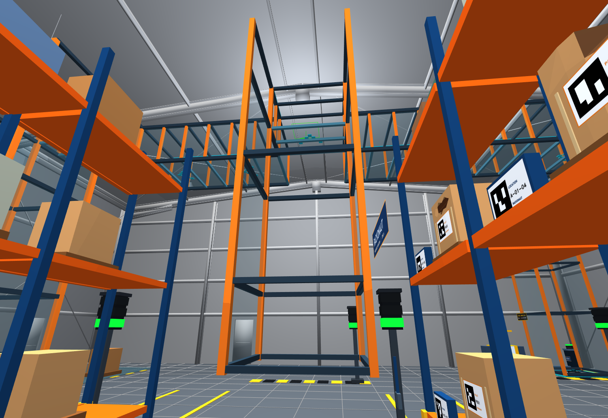
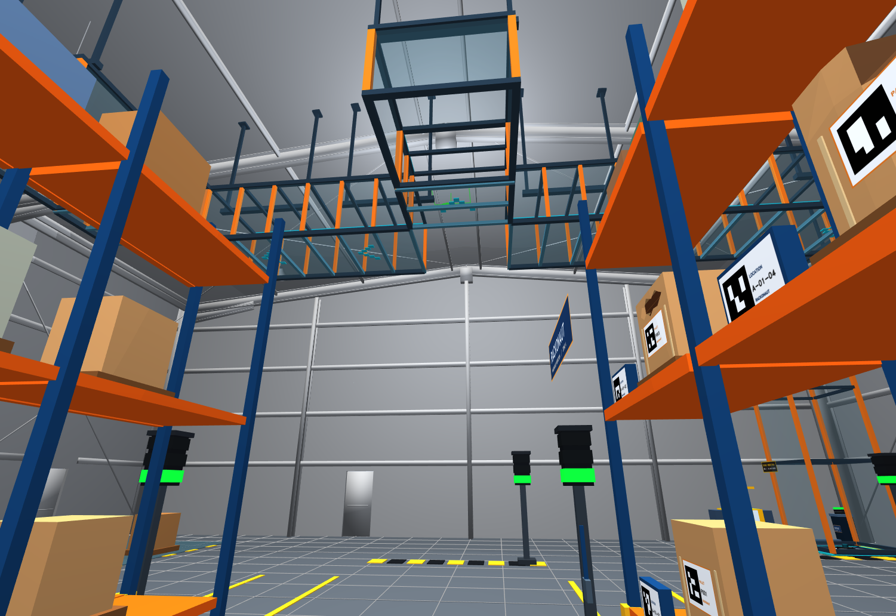

# GOAL 27B — Otwarte zejścia i podwieszony tunel

Wariant `open-aisle` zastępuje pionowe klatki w alejkach A i B krótkimi bramami z otwartym spodem. Dron wylatuje pionowo w dół z końca tunelu, a przy powrocie wznosi się przez ten sam otwór. Środek tunelu pozostał na wysokości 6,70 m. Dok, szyb D, główny przebieg korytarzy, odnogi A i B, oznaczenia posadzki i sygnalizacja zachowują swoje położenie.

| Obszar | Wariant historyczny | Wariant otwarty |
| --- | --- | --- |
| Alejki A i B | W każdej cztery długie słupy i dwa boczne panele z kolizją, u dołu od 1,18 m. Poprzeczki i tabliczka na konstrukcji zejścia. | Pod bramami zostają oznaczenia posadzki i istniejące sygnalizatory poza torem. W obrysie dawnej konstrukcji usunięto po sześć brył kolizyjnych poniżej 6,05 m, wraz z elementami wizualnymi. |
| Bramy podsufitowe | Wlot w dawną klatkę. | Rama z czterema narożnikami, boczne i czołowe osłony, górna osłona i otwór w dół. Dolna krawędź od Z = 6,10 m, przy oryginalnym tunelu. |
| Mocowanie | Szyb D i klatki przy końcach odnóg. | Osiem ram podwieszenia utrzymuje wizualną ciągłość tunelu z halą. Każda składa się z belki nad tunelem, dwóch pionowych cięgien i płyt przy stropie. Szyb D nadal sięga do stacji. |

Punkty mocowania wybrano na dolnych powierzchniach nośnych modelu hali, między Z = 8,35 a 10,31 m. Elementy podwieszenia są wizualne, a rama i osłony bram mają odpowiadające im bryły kolizyjne. Najmniejsza odległość od obwiedni pojedynczych lamp do elementów podwieszenia wyniosła około 0,40 m. Pomiędzy górnym poziomem regałów (5,70 m) a dolną krawędzią nowych bram (6,10 m) pozostaje 0,40 m różnicy wysokości. To geometria demonstracyjna i wizualny sposób mocowania, bez obliczeń wytrzymałościowych.

Na zakrętach i rozgałęzieniu dołożono poziome podłogi oraz osłony po zamkniętych stronach. Każdy wlot prowadzący do sąsiedniego odcinka pozostaje otwarty. Geometria Gazebo, Digital Twin i statyczna mapa lokalizacji powstają z tego samego generatora.

## Otwory i nawigacja

| Pomiar | A | B |
| --- | --- | --- |
| Oś zejścia (X, Y) | 5,10 m, 0,45 m | 5,10 m, −5,55 m |
| Światło otworu w dół | 1,72 × 1,72 m | 1,72 × 1,72 m |
| Światło poziomego połączenia z tunelem | 1,72 m szerokości, od 6,18 do 7,24 m | 1,72 m szerokości, od 6,18 do 7,24 m |
| Prześwit po bokach przy locie w osi, referencyjna obwiednia wirników (promień 0,392 m) | ≥ 0,46 m na stronę | ≥ 0,46 m na stronę |
| Prześwit po bokach przy locie w osi, X3 (promień konserwatywny 0,36 m) | ≥ 0,50 m na stronę | ≥ 0,50 m na stronę |
| Prześwit od krawędzi otworu po uwzględnieniu istniejących 0,33 m od osi i promienia ochronnego 0,48 m | 0,05 m na stronę | 0,05 m na stronę |
| Pionowy zapas w poziomym wlocie przy istniejącej obwiedni ±0,33 m i półwysokości ochronnej 0,17 m | 0,02 m przy dolnym progu, 0,04 m u góry | 0,02 m przy dolnym progu, 0,04 m u góry |

Promień referencyjny obliczono z rozstawu silników i promienia wirnika. Dla X3 uwzględniono położenia wirników, promienie kolizji i konserwatywną granicę z siatek Fuel v4. Prześwity są miarami geometrycznymi. Obliczenia w obwiedni ochronnej wykorzystują istniejące parametry stosu, bez zmiany marginesów hamowania ani warunków rozpoczęcia lotu.

Węzły `entry_A/B` i `foot_A/B`, pionowe odcinki, osie i obwiednie nawigacji, rezerwacje, powrót i Recovery pochodzą ze wspólnego profilu. Misja czeka przy bramie na aktualną zgodę Safety. Collision Prevention nadal sprawdza przestrzeń na podstawie pokładowego LiDAR-u. Pod bramami jest otwarta strefa operacyjna nad roboczą alejką. Sygnalizacja i rezerwacja ograniczają dostęp do niej podczas operacji.

## Uruchomienie i archiwa

Po przygotowaniu projektu według [README](../README.md#start-here):

```bash
scripts/robotics/build
scripts/robotics/checkpoint live warehouse_variant:=open-aisle
```

[Control Center](http://127.0.0.1:8765/) korzysta z geometrii tego samego generatora co Gazebo. W **Digital Twin** przełączniki **Aerial infrastructure** i **Flight corridor** sterują osobno konstrukcją i wirtualną trasą. Strefy **Access zones** nadal mają własną warstwę wizualną. **Service** pokazuje nazwę wybranego wariantu. Dodaj `gazebo_gui:=true`, aby w środowisku z działającym wyświetlaniem włączyć okno Gazebo.

- `drone_model:=x3` wybiera X3. Wymagany jest zweryfikowany model Fuel v4 jak w GOAL 27.
- `safety_sensor:=laser` wybiera drugi wygenerowany świat z naziemnymi skanerami.
- `warehouse_variant:=historical` wybiera wcześniejszą geometrię i jest ustawieniem domyślnym.
- `mapping_only:=true full_route_slam:=true` korzysta z pomiarów własnych. Domyślne dane dla `open-aisle` trafiają do osobnego katalogu; do każdej demonstracji można też podać osobny `data_dir:=`.

Gazebo używa plików `open_aisle_localization_showcase.sdf` i `open_aisle_localization_laser_showcase.sdf`. W trybie znanej mapy lokalizator otrzymuje `open_aisle_localization_map.json`. Referencyjny model w GUI jest z `open_aisle_aerial_layout.json`. Nauczony Digital Twin nadal rekonstruuje z archiwum LiDAR-u. Kalibracje nowego świata zapisują identyfikator wariantu w `result.json`. Starszy zapis bez identyfikatora należy do świata historycznego. Recenzja trasy, aktywacja archiwum i lokalizator egzekwują zgodność świata. Historyczne wyniki zachowują swój przypisany model pomiarowy.

## Walidacja

- Build odtworzył 11 pakietów. `ign sdf -k` zwrócił `Valid.` dla obu nowych SDF. Światy SDF wariantu historycznego, jego mapa i profil są bajtowo zgodne z buildem bazowym. [Sumy kontrolne i kolizje](open-aisle-evidence/geometry.json)
- Zaliczone 85 testów ROS, 62 testy backendu i próba HTTP. Testy porównały bryły SDF, geometrię 3D w Control Center i zmienione bryły w statycznej mapie. W obu SDF pozostałe modele są identyczne. Obrys chronionego ruchu jest drożny w obu kierunkach w obydwu bramach. Próba wyznaczenia przejścia bez rezerwacji alejki jest odrzucana. Sprawdzono też odrzucenie przeglądu starszej trasy w nowym świecie i odwrotnie.
- Dron referencyjny wykonał jeden cykl przez bramę A do `A-01-01`. Przy bramie Safety miało stan `RESERVED`, a Collision Prevention potwierdził ścieżkę aktualnym skanem. Po `WAITING_FOR_AISLE_CLEARANCE` dron zszedł z Z = 6,703 m do 0,794 m, potwierdził stanowisko kamerą i wrócił przez ten sam otwór na Z = 6,701 m. Cykl zakończył się przy fizycznym doku, po 282 s ze stanem `COMPLETE` i `Safety RELEASED`. [Telemetria próby](open-aisle-evidence/reference-flight.json)
- X3 uruchomiono na nowej mapie z wariantem `safety_sensor:=laser`. Potwierdzono `TRACKING`, fizyczny styk doku, aktywny obraz i Safety `AVAILABLE`. Odbiór X3 i przejścia przez B obejmuje prześwity geometryczne, a jedyny manewr w locie wykonano dronem referencyjnym przez A. [Start X3](open-aisle-evidence/x3-startup.json)
- Na kopii zamkniętego archiwum historycznego uruchomiono `learned_warehouse:=true` w nowym świecie. Lokalizator przy doku zgłosił niezgodną geometrię i pozostawił konfigurację niezaładowaną. Zapytanie planowania i aktywny Digital Twin odrzuciły użycie tego archiwum. Metadane lokalizacji wskazywały `slam`. Pliki archiwum zachowały pierwotne bajty. [Odrzucenie archiwum](open-aisle-evidence/archive-guard.json)
- Chrome z Playwright potwierdził podgląd wariantu `open-aisle`, działającą warstwę stref i niezależne przełączanie konstrukcji i korytarza. [Wynik przeglądarkowy](open-aisle-evidence/browser.json)
- Środowisko WSL2 Ubuntu 22.04, ROS 2 Humble i Gazebo Fortress 6.16.0. Liczby prześwitów i walidacja geometrii dotyczą wygenerowanej hali Tevy. Profile Safety, limity energii i Collision Prevention pochodzą z GOAL 27. Nie wykonano pełnej kalibracji, inwentaryzacji 11 lokalizacji ani odbioru pełnej trasy SLAM w nowym świecie.

## Widoki Gazebo i Control Center

| Wcześniej | Open aisle |
| --- | --- |
|  |  |

| Widok | Materiał |
| --- | --- |
| Hala | [Magazyn i przebieg tunelu](open-aisle-evidence/01-warehouse.png) |
| Tunel | [Odnogi i podwieszenia](open-aisle-evidence/02-tunnel.png) |
| A i B | [Brama A od dołu](open-aisle-evidence/03-portal-a.png) · [Brama B od dołu](open-aisle-evidence/04-portal-b.png) |
| Powyżej alejki | [Oznakowane miejsce pod bramą A z góry](open-aisle-evidence/06-aisle-overhead.png) |
| Control Center | [Model referencyjny](open-aisle-evidence/07-control-center.png) · [Model z wirtualnym korytarzem](open-aisle-evidence/08-control-center-corridor.png) |

Zrzuty Gazebo pochodzą z usługi `/gui/screenshot`. Porównanie z poziomu pracownika używa identycznej pozycji i orientacji kamery z `/gui/move_to/pose`. [Pozy kamery](open-aisle-evidence/gazebo-poses.json)
