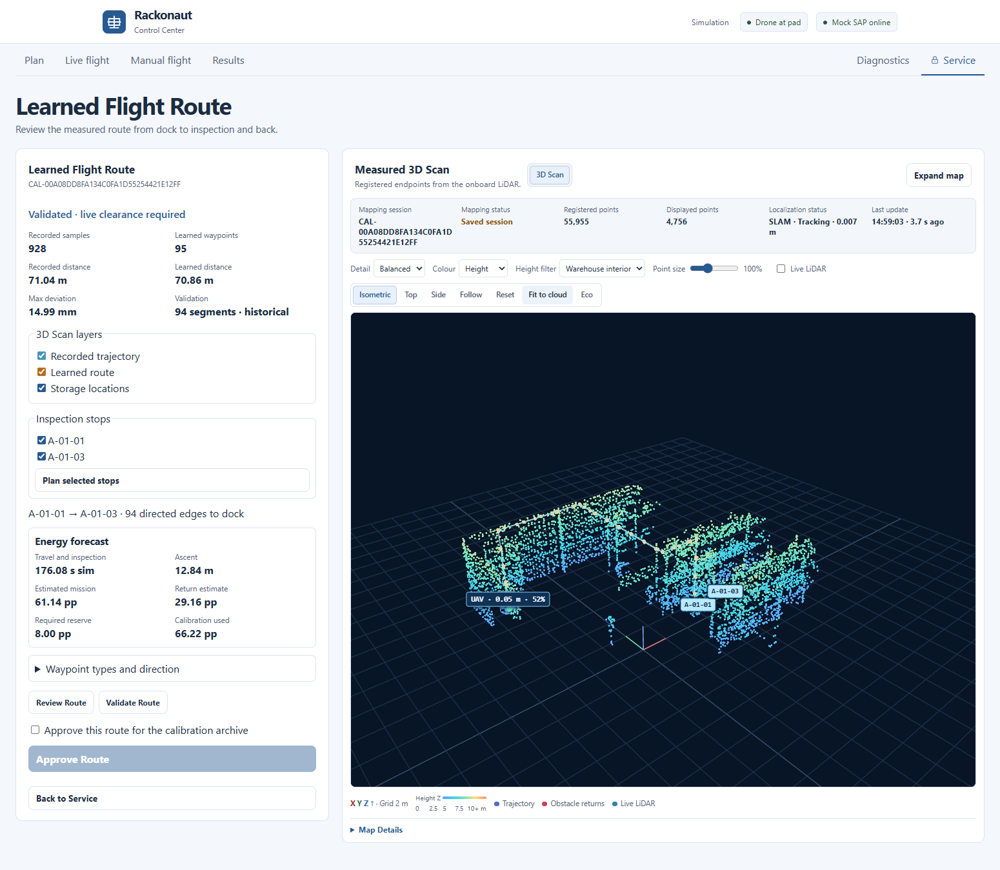

# Rackonaut · Uczenie trasy w Warehouse Calibration

Podczas chronionego lotu kalibracyjnego Rackonaut zapisuje pozycję i orientację estymowaną przez SLAM. Po potwierdzonym dokowaniu operator może porównać surową trajektorię z uproszczoną trasą, zaplanować wybrane postoje i zatwierdzić wynik w archiwum. Zatwierdzenie dotyczy aktualnej rewizji kalibracji. Zwykła inspekcja nadal korzysta z profilu produkcyjnego.

## Uruchomienie

Po wykonaniu kroków z [README](../README.md#start-here) zbuduj pakiety i uruchom profil kalibracji.

```bash
scripts/robotics/build
read -rsp 'Kod do panelu Service: ' RACKONAUT_SERVICE_CODE
printf '\n'
export RACKONAUT_SERVICE_CODE
scripts/robotics/checkpoint live mapping_only:=true full_route_slam:=true
```

Otwórz [Control Center](http://127.0.0.1:8765). Odblokuj **Service** i wybierz **Start Calibration → Open mapping flight**. Upewnij się, że lista miejsc i mapa są puste. Wybierz alejkę i uruchom **Start mapping flight**. Po zatrzymaniu drona przy regale wybierz **Register Storage Location**, obejrzyj zdjęcie i zapisz pozycję. Powtórz przy kolejnym regale. [Sterowanie ręczne](PROTECTED_MANUAL_FLIGHT.md) · [Rejestracja miejsca](STORAGE_LOCATION_TEACHING.md)

Wybierz **Return and end session**. Po potwierdzeniu fizycznego doku przejdź do **Service → Review Route**. Na **3D Scan** można niezależnie włączać warstwy **Recorded trajectory**, **Learned route** i **Storage locations**. Kliknięcie markera pokazuje zdjęcie z lotu. **Validate Route** porównuje propozycję z zapisem lotu i sprawdza budżet energii. Zaznacz wybrane miejsca i wybierz **Plan selected stops**, aby zobaczyć ich kolejność i prognozę. Zatwierdź trasę jawnie przez pole potwierdzenia i **Approve Route**.

## Pomiar i graf

Dziennik `trajectory.jsonl` zapisuje próbki nominalnie z częstotliwością 5 Hz czasu ROS, od potwierdzonego doku przed startem do potwierdzonego doku po powrocie. Każda próbka wiąże identyfikator mapowania z ramą `rackonaut_odom`, XYZ, quaternionem XYZW, prędkością liniową i kątową, błędami standardowymi pozycji, jakością lokalizacji, stanem sprawdzania wolnej przestrzeni i migawką rezerwacji Safety. Nagłówek oraz stopka zapisują wersję formatu, źródło, styki doku, wynik misji, liczbę próbek i energię z symulacji. Kolejka zapisu ma 512 pozycji, dziennik limit 12 000 próbek, a przepełnienie zamyka drogę do walidacji sesji jako kompletnej.

Każde miejsce używa dokładnego czasu ROS zdjęcia, zmierzonej pozy i orientacji oraz dwóch kolejnych próbek trajektorii otaczających akwizycję. Zachowuje identyfikator `LOC-…` i rewizję manifestu. Ponowna rejestracja dostarcza nową pozę i czas zdjęcia. Usunięcie zmienia manifest, a surowy dziennik zachowuje przebytą drogę.

Graf przechowuje wyłącznie skierowane, obserwowane odcinki pętli. Zapisuje węzły `DOCK`, `TAKEOFF`, `TRANSIT`, `TURN`, `INSPECTION`, `RETURN` i `LANDING`, a dla odcinka przechowuje zwrot, długość, źródłowy zakres próbek, strefy i warunki walidacji. Redukcja usuwa nadmiarowe pomiary, zachowując granice faz, postoje inspekcyjne i orientację yaw z tolerancją interpolacji do 7°. Kandydat na skrót musi mieć odchylenie geometryczne do 15 mm, pozostawać w zatwierdzonych objętościach z marginesem błędu pozycji i posiadać potwierdzenie z zarejestrowanych pomiarów Collision Prevention przy ruchu. Kiedy brakuje podstaw do redukcji, graf zachowuje sąsiednie pomiary. Roll i pitch pozostają informacją diagnostyczną. Ruch w przeciwnym kierunku wymaga osobnego potwierdzenia.

Każdy odcinek pozostaje w istniejącej obwiedni chronionego profilu, ograniczonej przez szyb, tunel i rezerwowane strefy. Walidacja odtwarza graf z archiwum, sprawdza ciągłość, świeżość i rezerwację z czasu lotu oraz zachowuje wymaganie aktualnej kontroli wolnej przestrzeni przed ewentualnym przyszłym wykonaniem. Chmura LiDAR pokazuje zmierzone powierzchnie. Historię przejazdu i wymaganie aktualnej kontroli zapisano oddzielnie. [Aerial Network](AERIAL_INFRASTRUCTURE.md) · [Dokumentacja upraszczania ścieżek w OMPL](https://ompl.kavrakilab.org/classompl_1_1geometric_1_1PathSimplifier.html) · [Kierunki w grafie Nav2](https://docs.nav2.org/rolling/configuration_and_development/configuration_guide/core_servers/route_server/configuring_route_server/)

Propozycja pojedynczej lokalizacji jedzie po tej samej skierowanej pętli, a pomijany punkt mija bez postoju. Prognoza korzysta z istniejącego modelu Energy i tempa kontrolera. Uwzględnia trasę do doku, przewidywane trzy sekundy na wybrany postój i rezerwę. Czas, wznoszenie i zużycie są prognozami symulacyjnymi. Wartość zużycia z kalibracji pochodzi z przebiegu modelu Energy w rzeczywistym locie w Gazebo. [Model energii](ENERGY_MANAGEMENT.md)

## Archiwum

W `mapping/CAL-…/` są `map.ply`, `result.json`, `locations.json`, zdjęcia z lotu, `trajectory.jsonl`, `route.json` i `route-validation.json`. Zatwierdzenie jest powiązane przez skrót z dziennikiem, profilem, wynikiem mapowania i rewizją manifestu. Zmiana pozy lub ID miejsca unieważnia poprzednie zatwierdzenie. Po restarcie dokumenty są dostępne do odczytu przez autoryzowany interfejs Service. Wykonanie nauczonej trasy i aktywacja mapy produkcyjnej pozostają osobnymi etapami. [Kontrakt HTTP](../contracts/http.md#local-route-review)

## Próba przed lotem

Historyczny `result.json` z GOAL 22 dostarczył 421 pozycji XYZ. Podgląd geometryczny zachował 74 waypointy, 70,249 m z 70,260 m i odchylenie do 14,09 mm. Dane oznaczono jako podgląd o ograniczonej wartości, bez kwalifikacji do zatwierdzenia, ponieważ brakuje czasów próbek, orientacji i historycznych pomiarów wolnej przestrzeni. Oddzielne odtworzenie oryginalnej odometrii i komunikatów ROS z tego lotu dało 109 waypointów z 964 próbek, 71,018 m z 71,204 m, odchylenie do 14,91 mm oraz oba powiązania zdjęć czasem ROS. [Podgląd XYZ](route-teaching-evidence/legacy-xyz-review.json) · [Odtworzenie zapisu ROS](route-teaching-evidence/timed-rehearsal.txt)

## Lot demonstracyjny

Sesję `CAL-00A08DD8FA134C0FA1D55254421E12FF` wykonano na commicie implementacji `4d88d0b` w Gazebo Fortress 6.16.0 z ROS 2 Humble. Chrome sterowany przez Playwright obsłużył akwizycję obu zdjęć, zmianę warstw, wybór miejsc, walidację i zatwierdzenie. Skrypt testowy pilotował istniejącym chronionym API przez szyb i tunel do A-01-01 oraz A-01-03. SLAM rozpoczął z pustą chmurą i listą 0 miejsc. Plik referencyjny znajdował się poza katalogiem uruchomieniowym podczas całego lotu. Po próbie przywrócono go i potwierdzono sumę kontrolną. Jedynym wydawcą odometrii był `rackonaut_localization`, a polecenia prędkości publikował wyłącznie `rackonaut_mission`. [Przebieg w przeglądarce](route-teaching-evidence/browser-events.json) · [Źródła ROS](route-teaching-evidence/ros-sources.txt) · [Weryfikacja pliku referencyjnego](route-teaching-evidence/map-reference-check.txt)

| Miara | Wynik |
| --- | ---: |
| Surowy dziennik i waypointy po redukcji | 928 i 95 |
| Długość zmierzona i długość trasy | 71,037 m i 70,863 m |
| Maksymalne odchylenie względem surowych pozycji zgodnie z ich czasem | 14,99 mm |
| Najdłuższy odstęp w dzienniku | 0,32 s czasu ROS |
| Zatwierdzone odcinki | 94 z 94, w tym 74 uproszczone |
| Próbki utracone przez bufor | 0 |
| Zmierzona chmura mapy | 55 955 punktów |
| Dokowanie i Safety | `gazebo_dock_switch` · `RELEASED` |

| Miejsce | Czas zdjęcia w symulacji | Węzeł | Indeksy próbek | Yaw |
| --- | ---: | --- | --- | ---: |
| A-01-01 | 119,200 s | `W0046` | 529–530 | 88,0° |
| A-01-03 | 129,400 s | `W0052` | 576–577 | 90,0° |

Oba warianty obejmują zmierzoną pętlę 70,863 m i 12,841 m łącznego wznoszenia. Koszt powrotu zaczyna się przy ostatnim wybranym miejscu, dlatego przy wyborze samego A-01-01 obejmuje również dalszą część alei. W locie kalibracyjnym model Energy zużył 66,216 p.p., od 99,888% przy starcie do 33,672% przy zakończeniu lotu, po 196,42 s symulacji. [Wynik walidacji i pomiary](route-teaching-evidence/review-complete.json) · [Obie propozycje misji](route-teaching-evidence/forecasts.json)

| Wybrane postoje | Czas symulowany | Koszt misji | Koszt powrotu | Rezerwa | Wymagane na start |
| --- | ---: | ---: | ---: | ---: | ---: |
| A-01-01 | 173,08 s | 60,36 p.p. | 31,23 p.p. | 8,00 p.p. | 68,36% |
| A-01-01 → A-01-03 | 176,08 s | 61,14 p.p. | 29,16 p.p. | 8,00 p.p. | 69,14% |

## Wyniki walidacji

| Próba | Wynik |
| --- | --- |
| Przebieg i ciągłość | Zapis objął start z fizycznego doku, ręczny przejazd, powrót i lądowanie. Graf zachował przejazdy przez szyb oraz trzy odcinki tunelu w obu obserwowanych kierunkach. |
| Nieuprawniony odcinek | Na kopii rzeczywistej sesji przesunięto waypoint poza obwiednię. Walidacja wskazała odcinki 46 i 47, a zatwierdzenie odrzuciła. |
| Wybór miejsc | Przeglądarka potwierdziła wariant z jednym i dwoma postojami oraz ten sam ciąg odcinków w obu planach. |
| Zmiana nauczonego miejsca | Zmiana ID przez API Service oznaczyła archiwum `stale`, a próba zatwierdzenia starej rewizji dała HTTP 409. Po przywróceniu ID zatwierdzono nową rewizję 4. Oddzielny test na kopii potwierdził unieważnienie po przesunięciu pozy. |
| Niekompletny zapis | Próby zatwierdzenia w locie zwróciły HTTP 409. Walidator odrzucił kopię archiwum po usunięciu stopki. |
| Uprawnienia | Niezalogowany odczyt trasy zwrócił HTTP 401. Przycisk zatwierdzania wymagał potwierdzenia operatora. |
| Restart | Świeży proces odczytał identyczne zatwierdzenie. Szkic pozostał w `CALIBRATION_BLOCKED` bez aktywnej mapy kalibracyjnej oraz bez rozpoczętej misji. |
| Zwykła inspekcja | Po zamknięciu szkicu profil produkcyjny wykonał A-01-01 w 251,5 s symulacji, osiągnął `COMPLETE`, fizycznie zadokował i zwolnił rezerwację. Mock SAP zawierał 0 obserwacji po kalibracji i 1 po inspekcji. Perception zgłosił `unreadable_label`. |

Kompilacja 10 pakietów, 60 testów ROS, 7 testów backendu i testy dymne ROS i HTTP zakończyły się poprawnie. [Sprawdzenie zapisanej sesji i kopii zmodyfikowanych](route-teaching-evidence/archive-verification.json) · [Restart, zwykła inspekcja i obserwacja Mock SAP](route-teaching-evidence/restart-and-inspection.json)

## Materiały z lotu



- [Nagranie przeglądu i zatwierdzenia trasy, MP4, 12 s](route-teaching-evidence/route-review.mp4).
- [Surowa trajektoria](route-teaching-evidence/02-recorded-trajectory.png) · [Uproszczona trasa](route-teaching-evidence/03-learned-route.png) · [Zdjęcie z kamery po wybraniu A-01-03](route-teaching-evidence/04-inspection-photo.png) · [Zatwierdzenie w Service](route-teaching-evidence/05-approved.png).
- [Surowy dziennik](route-teaching-evidence/mapping/CAL-00A08DD8FA134C0FA1D55254421E12FF/trajectory.jsonl) · [Graf i zatwierdzenie](route-teaching-evidence/mapping/CAL-00A08DD8FA134C0FA1D55254421E12FF/route.json) · [Walidacja zapisana w archiwum](route-teaching-evidence/mapping/CAL-00A08DD8FA134C0FA1D55254421E12FF/route-validation.json).
- [Mapa PLY](route-teaching-evidence/mapping/CAL-00A08DD8FA134C0FA1D55254421E12FF/map.ply) · [Wynik mapowania](route-teaching-evidence/mapping/CAL-00A08DD8FA134C0FA1D55254421E12FF/result.json) · [Lista miejsc i odnośniki do zdjęć](route-teaching-evidence/mapping/CAL-00A08DD8FA134C0FA1D55254421E12FF/locations.json).

Zakres zatwierdzenia obejmuje odtworzoną trajektorię w tym profilu symulacji. Kolejny przejazd wymaga aktualnego sprawdzenia obwiedni i wolnej przestrzeni. Planer korzysta z jednej pętli kalibracyjnej i bieżącej rewizji archiwum. Wykonanie autonomiczne, relokalizacja z własnej mapy oraz obsługa nieobserwowanych połączeń pozostają poza tym etapem.
