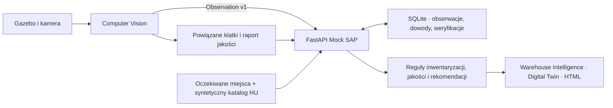

# Rackonaut — Mock SAP i Warehouse Intelligence

Profil Mock SAP przyjmuje obserwacje z kamery Rackonaut i porównuje je z oczekiwanym inwentarzem. Kierownik widzi niezgodności, powiązane zdarzenia, stan produktu, dowody jakościowe i zalecane działania. Dane oczekiwane i produktowe są syntetyczne. Adrian odpowiada za utrzymanie porównania, backend i rekomendacje. [Bieżący podział odpowiedzialności](TEAM_TASKS.md)

## Wyzwanie IN3

Oficjalne wyzwanie PCH7 obejmuje weryfikację fizycznego zapasu na podstawie obrazu, porównanie z SAP, wykrywanie niewłaściwie składowanych HU, pustych lokalizacji, wycofanych produktów i uszkodzeń, a następnie przedstawienie kierownikowi propozycji działań. W demonstratorze źródłem oczekiwanych stanów jest lokalny Mock SAP. [Oficjalny opis RobotHack PCH7](https://robothack.co/#popup:07partner)

## Uruchomienie

Z katalogu repozytorium, na Ubuntu 22.04 lub WSL2 z ROS 2 Humble i Gazebo Fortress.

```bash
python3.10 scripts/api/setup.py
scripts/robotics/build
source scripts/robotics/activate.bash
LP_NUM_THREADS=4 ros2 launch rackonaut_control control.launch.py \
  api_profile:=mock_sap safety:=true adaptive_world:=true
```

W [Control Center](http://127.0.0.1:8765) wybierz *Selected locations* i stanowiska A-01-01, A-01-02 oraz A-01-03. W *Inspection options* włącz *Check for package damage* i *Retry difficult readings*. Po zakończeniu lotu otwórz *Results* i rozwiń *Inventory comparison*. Archiwum udostępnia zdjęcia i raport. Wybierz problem, aby sprawdzić przewidywaną i zaobserwowaną paletę, zdjęcia, historię i lokalizację w Digital Twin.

Profil powietrzny z funkcjami GOAL 15 i 16 uruchamia się tym samym backendem.

```bash
LP_NUM_THREADS=4 ros2 launch rackonaut_control control.launch.py \
  api_profile:=mock_sap safety:=true localization:=sensor_based recovery:=true
```

W profilu powietrznym wybierz A-01-01 i A-01-03. Ten wariant używa wirtualnego nadzoru obecności w strefach naziemnych. [Ograniczenia trasy powietrznej](INTEGRATION.md#route-and-operator-constraints)

W obu wariantach można podać `data_dir:=/ścieżka/do/danych`. W tym katalogu launch przechowuje `warehouse.sqlite3`, raporty i dane misji. Domyślny profil `api_profile:=fixture` zachowuje API testowe. Samodzielny backend Mock SAP korzysta z `RACKONAUT_SAP_DB` lub pliku `.rackonaut-data/warehouse.sqlite3`. [Uruchomienie samego API](../backend/README.md)

## Architektura i dane



Model oczekiwany łączy osiem pozycji A i trzy pozycje B. Katalog HU zawiera identyfikator, SKU, nazwę, partię, oczekiwane miejsce, status cyklu życia, status jakości i status zapasu. `ACTIVE`, `DISCONTINUED`, `BLOCKED` i `UNKNOWN` mają odrębne znaczenia. P001 wskazuje wycofany model przekaźnika w danych produktowych. Do ostrzeżenia wymagany jest rzeczywisty odczyt tego HU. Oczekiwana zawartość stanowiska nie służy do odgadywania produktu. [Katalog Mock SAP](../test_data/mock_sap_products.json)

| Wynik v1 | Reguła |
| --- | --- |
| `match` | Odczytany HU odpowiada oczekiwanemu albo kamera potwierdziła puste miejsce oczekiwane jako puste. |
| `wrong_pallet` | Odczytano inny HU przy przypisanej palecie. |
| `missing_pallet` | Kamera potwierdziła puste miejsce z oczekiwaną paletą. |
| `unexpected_pallet` | Odczytano HU w miejscu oczekiwanym jako puste. |
| `unreadable_label` | Miejsce jest zajęte, a identyfikator jest nieczytelny. |
| `uncertain` | Klatki dały niejednoznaczny pomiar. |
| `uninspected` | Dla tego miejsca brak zdarzenia. |

API v1 zachowuje istniejący schemat, wartości enum, identyfikatory i walidację. W Mock SAP `pending` pozostaje częścią kontraktu, a każda przyjęta obserwacja otrzymuje obliczony wynik. Historia jest izolowana przez `inspection_id`. Identyczny POST zwraca 200, konflikt treści pod tym samym kluczem zwraca 409, a nowa obserwacja zwraca 201. Najnowszy czas wykonania rozstrzyga o podsumowaniu. Przy remisie decyduje leksykograficznie większy identyfikator obserwacji. [Kontrakt HTTP v1](../contracts/http.md)

## Wnioski i obsługa problemów

Silnik reguł tworzy osobne problemy dla stanu inwentarza, cyklu życia produktu i stanu opakowania. Problem przechowuje identyfikator, priorytet, zakres, HU, uzasadnienie, działanie, dowody i status. Korelacja łączy wyłącznie pomiar pustego oczekiwanego miejsca z jednoznacznym odczytem tego samego HU w innym miejscu tej samej inspekcji. Wyniki miejsc nadal są dostępne osobno.

Uszkodzenie wymaga dowodu powiązanego z tą samą inspekcją, obserwacją, lokalizacją, HU i czasem. Starsze próby i pary zdjęć pozostają w historii. Przy aktywnej ocenie wykorzystywany jest najnowszy zgodny dowód tego samego aktualnie odczytanego HU w miejscu lub dowód dokładnie wskazanej obserwacji. Podejrzenia jakościowe bez zweryfikowanego zdjęcia pozostają w istniejącej sekcji kontroli jakości.

*Inventory accuracy* to liczba zgodności podzielona przez liczbę jednoznacznie ocenionych lokalizacji. Mianownik obejmuje zgodności oraz wyniki `wrong_pallet`, `missing_pallet` i `unexpected_pallet`. Panel pokazuje też pokrycie, wyniki wymagające uwagi oraz osobny licznik miejsc do kontroli ręcznej. Opcja *Mark evidence as verified* zapisuje potwierdzenie konkretnej wersji dowodu w SQLite. Nowy dowód może ponownie otworzyć problem. Stan zapasu i decyzja o fizycznym rozwiązaniu pozostają w gestii kierownika.

## Dodatkowe endpointy

Wszystkie poniższe ścieżki dotyczą profilu `mock_sap`. `/openapi.json` w obu profilach nadal udostępnia dokument kontraktu v1.

| Metoda i trasa | Dane |
| --- | --- |
| GET `/api/business/products` | Syntetyczny katalog HU wraz z oczekiwaną lokalizacją. |
| GET `/api/business/summary?inspection_id=INS-…` | Metryki, rekomendacje, statusy i źródła dowodów per lokalizacja. |
| POST `/api/business/quality` | JSON `{report,images:{original,annotated}}`, obie klatki PNG jako Base64. Raport jakości 0.1 wiąże się z przyjętą obserwacją. 201 dla zapisu, 200 dla powtórki, 409 dla konfliktu lub braku odniesienia. |
| GET `/api/business/quality/{inspection}/{quality}/{kind}.png` | Oryginał lub oznaczona klatka, odpowiednio `original` albo `annotated`. |
| POST `/api/business/issues/{issue_id}/verify` | JSON `{inspection_id,revision}`. Zwraca status `VERIFIED`. Nieaktualna wersja zwraca 409. |

Control Center udostępnia widok, weryfikację i zdjęcia przez swój port loopback. Eksporter zapisuje zrzut wyników i osadza zdjęcia w samodzielnym HTML. Potwierdzenia operatora dokonane po eksporcie są widoczne w panelu i bazie.

## Wyniki prób

Przed uruchomieniem Gazebo odtworzono rzeczywiste zapisy GOAL 08, 10 i 16 przez HTTP. Porównania zostały obliczone ponownie ze zdarzeń. Przy odtwarzaniu GOAL 08 i 10 wykorzystano oryginalne pary zdjęć osadzone w ich raportach HTML, połączone po identyfikatorze i czasie obserwacji.

| Źródło | Wynik |
| --- | --- |
| GOAL 08, pełna misja | 11 skontrolowanych lokalizacji, 6 zgodności, 5 wyników wymagających uwagi, w tym jeden `uncertain`. Brak `pending`. Dokładność 66,7% (6/9 jednoznacznie ocenionych). Niezależnie od porównań potwierdzono 3 uszkodzone opakowania i jeden odczytany wycofany produkt. |
| GOAL 10, adaptacja | Pierwszy odczyt A-01-01 był nieczytelny, kolejny rozpoznał P001. Obie próby znajdują się w historii. Najnowszy wynik to `match`, a cykl życia produktu generuje osobne ostrzeżenie. |
| GOAL 16, przerwana i późniejsza misja | Pierwszy raport zachował dwa zdarzenia A-01-01. Drugie zlecenie zgłosiło puste A-01-03, więc wynik obliczono jako `missing_pallet`. Nieskontrolowane miejsca w obu zleceniach są nadal `uninspected`. |

W autonomicznym locie `INS-CONTROL-20261125-170845-BC969566` na krótszym profilu kamera odczytała P001 po adaptacji, rozpoznała P003 z uszkodzeniem w A-01-02 i potwierdziła puste A-01-03. Mock SAP obliczył 1 zgodność na 3 jednoznaczne wyniki i 2 niezgodności magazynowe. Reguły dodały korelację odłożenia P003, wycofanie produktu z HU P001 i jedno uszkodzenie ze zdjęciem. Lot zakończył się `COMPLETE` w około 83 s. Panel odczytał zapisane dowody, operator oznaczył ostrzeżenie P001 jako przejrzane, a osobny filtr pokazał tę weryfikację. Eksporter zapisał samodzielny raport.

W drugim locie `INS-CONTROL-20261125-171103-633849DF` działały infrastruktura powietrzna, lokalizacja sensorowa i włączony profil Recovery. Dron przeleciał tunelem, ponownie odczytał P001 po adaptacji, wrócił i fizycznie zadokował. Mock SAP zapisał zgodny inwentarz i niezależne ostrzeżenie o wycofaniu. Stan misji to `COMPLETE`. Próba sprawdzała współdziałanie uruchomionego profilu podczas zwykłej inspekcji. [Dane z próby kompatybilności](bi-evidence/aerial-compatibility.json)

Przeszło 7 testów HTTP, w tym 4 dotychczasowe testy fixture, 38 testów ROS i oddzielny smoke test fixture. Najważniejsze sprawdzenia obejmują współbieżne ponowienia, konflikty identyfikatorów, kolejność według czasu wykonania, izolację inspekcji, pary zdjęć, korelację i trwałość danych po ponownym uruchomieniu API. [Pomiary reprodukcji](bi-evidence/recorded-replay.json) · [Pomiar lotu](bi-evidence/live-run.json)

## Materiały

- [Film, 45 s](bi-evidence/demo.mp4) · [Raport kierownika HTML](bi-evidence/warehouse-report.html)
- [P003 i uszkodzenie w obrazie z kamery](bi-evidence/camera-p003.jpg) · [Oryginał zdjęcia](bi-evidence/p003-original.png) · [Zdjęcie oznaczone](bi-evidence/p003-annotated.png)
- [Tablica Warehouse Intelligence](bi-evidence/intelligence.png) · [Korelacja dwóch lokalizacji](bi-evidence/correlation.png) · [Wycofany produkt P001](bi-evidence/discontinued.png) · [Weryfikacja operatora](bi-evidence/verified.png)
- [Lokalizacja w Digital Twin](bi-evidence/twin.png) · [Raport w przeglądarce](bi-evidence/report.png)

## Zakres demonstratora

Dane biznesowe pochodzą z lokalnego profilu, bez połączenia z instancją SAP. Kamery i środowisko przestrzenne są symulowane, a obserwacje pochodzą z rzeczywistych klatek symulacji. Dokładność zależy od odczytów wizji. Przegląd operatora jest lokalny i bez integracji z kontami lub uprawnieniami SAP. Zastosowanie procedury przeniesienia, wycofania lub korekty wymaga decyzji upoważnionego pracownika.
