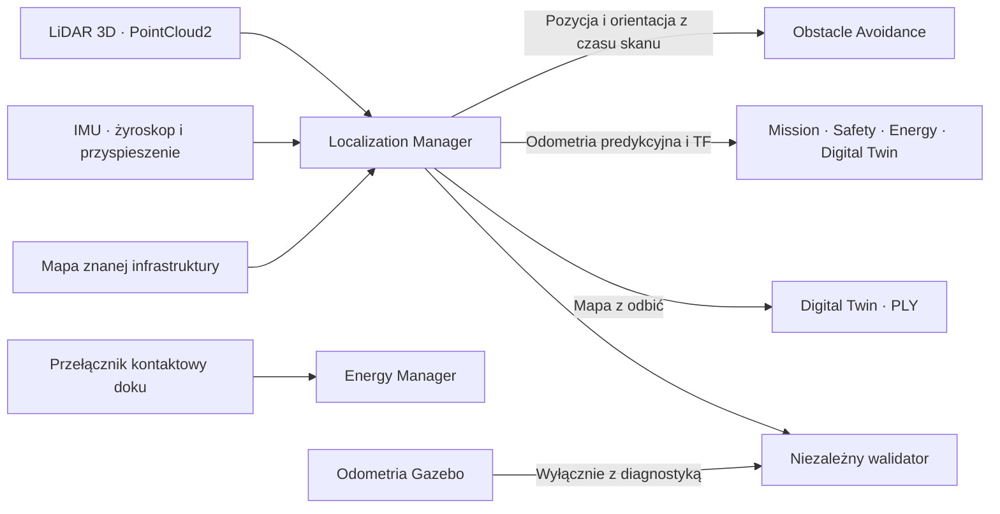

# Rackonaut — lokalizacja z sensorów i mapa 3D

Profil GOAL 15 estymuje pozycję i orientację drona przez dopasowanie pomiarów LiDAR do znanej infrastruktury. IMU uzupełnia ruch między skanami. Z kolejnych pomiarów powstaje osobna chmura magazynu. W trybie sensorowym Mission Manager, Obstacle Avoidance, Safety Manager, Energy Manager i pozycja drona w Digital Twin korzystają ze wspólnego estymatora.

## Uruchomienie

Na Ubuntu 22.04 lub WSL2 z ROS 2 Humble i Gazebo Fortress, z katalogu repozytorium.

```bash
python3.10 scripts/api/setup.py
scripts/robotics/build
source scripts/robotics/activate.bash
LP_NUM_THREADS=4 ros2 launch rackonaut_control control.launch.py \
  localization:=sensor_based safety:=true safety_sensor:=virtual
```

W [Control Center](http://127.0.0.1:8765) poczekaj na `TRACKING` i potwierdzenie doku. Otwórz *3D Digital Twin*, aktywuj *Measured point cloud* i *Estimated trajectory*. Wyłączenie *Warehouse model* odsłania samą chmurę. Zleć `A-01-01` i `A-01-03` w trybie *Custom inspection*. Przy locie do drugiej lokalizacji *Place carton in A* dodaje rzeczywistą przeszkodę do świata. Po *Localization lost* wymagane jest odzyskanie przez operatora.

| Tryb | Pozycja sterująca |
| --- | --- |
| `ground_truth` | Odometria Gazebo jak w GOAL 14. Włącz `avoidance:=true`, aby otrzymać dotychczasowy pokaz omijania. |
| `shadow` | Odometria Gazebo steruje lotem, a estymator pracuje równolegle i buduje mapę. |
| `sensor_based` | Lokalizator jest jedynym publisherem odometrii drona i właścicielem dynamicznej transformacji do `rackonaut_base_link`. |

`localization_diagnostics:=true` dodaje niezależny węzeł porównawczy i przełącznik *Reference trajectory*. Przesyła odometrię Gazebo na odrębny temat wyłącznie do walidacji. `safety_sensor:=laser` aktywuje stacjonarne LiDAR-y. Tryb `virtual` nadal wykorzystuje rzeczywisty LiDAR pokładowy i fizykę Gazebo do lokalizacji i omijania, a strefę obecności pracownika ocenia osobny mechanizm demonstracyjny.

Po locie wyeksportuj zmierzoną chmurę binarną PLY do katalogu `data_dir`.

```bash
ros2 service call /rackonaut/localization/export_map std_srvs/srv/Trigger '{}'
```

## Estymator i granice zaufania



Estymator inicjalizuje pozycję ze znanej stacji montażowej i kalibruje IMU na postoju. Pobiera wyłącznie surowe skończone odbicia z pokładowej chmury i pomiary prędkości kątowej oraz przyspieszenia właściwego z IMU. Częstotliwości nominalne wynoszą 6 Hz dla LiDAR i 50 Hz dla IMU. Orientacja jest estymowana przez całkowanie żyroskopu i rejestrację skanów. Model wykorzystuje nominalną grawitację 9,81 m/s², gaussowski szum IMU i zmierzoną na starcie poprawkę offsetu. Sensor znajduje się w środku układu drona.

Z chmury 192 × 37 filtrowanie wokselowe wybiera do 620 punktów. Statyczne powierzchnie znanej instalacji są próbkowane w indeksie SciPy `cKDTree`. Są to konstrukcja hali i oświetlenia z modelu COLLADA, elementy regałów, tunel, szyby, podłoga i dok. Algorytm iteracyjnego dopasowania punkt–płaszczyzna ogranicza wpływ geometrii spoza mapy przez próg najbliższych powierzchni i odporną funkcję wagową. Korekty estymaty i predykcja IMU sprawiają, że powtórzone segmenty korytarza są dopasowywane lokalnie. Słaba obserwowalność jest oceniana przez wartość własną macierzy dopasowania i niepewność poszczególnych osi. Opublikowane wartości σ opisują lokalną kondycję dopasowania.

W trybie sensorowym odometria sterująca jest przewidywana od estymaty skanu do znacznika czasu IMU. Obstacle Avoidance bierze pozycję z dopasowania **tego samego znacznika czasu** co jego chmura. Safety Manager zachowuje pierwszeństwo i rezerwacje. Brak wiarygodnego statusu kończy zadanie przez `LOCALIZATION_LOST`. Po odzyskaniu pomiarów estymator może ponownie publikować pozycję, a przerwane zadanie pozostaje zakończone. Niskopoziomowy regulator Gazebo nadal steruje prędkością i dynamiką modelu w symulatorze.

Energy Manager oblicza zużycie z ruchu estymowanego. Potwierdzenie dokowania wymaga fizycznej wiadomości kolizyjnej z dedykowanego przełącznika na powierzchni stacji oraz potwierdzenia wyrównania, prędkości i czasu. Do aplikacyjnej decyzji o ładowaniu trafia kontakt pary korpus–powierzchnia, bez współrzędnych punktu kontaktu.

Rozważono gotowy GICP oraz pełny system SLAM. Użycie predykcji inercyjnej z IMU i lokalnego dopasowania pozwoliło wykorzystać obecny LiDAR oraz biblioteki systemowe bez nowego renderowanego sensora. [Gazebo Fortress](https://gazebosim.org/docs/fortress/sensors/) · [Most ROS Humble](https://github.com/gazebosim/ros_gz/tree/humble/ros_gz_bridge) · [Rejestracja punkt–płaszczyzna](https://www.open3d.org/docs/latest/tutorial/pipelines/icp_registration.html) · [Indeks SciPy](https://docs.scipy.org/doc/scipy/reference/generated/scipy.spatial.cKDTree.html)

## Mapa pomiarowa

Odbicia LiDAR są przenoszone do układu magazynu przez estymowaną pozę z czasu skanu. W nowych komórkach wokselowych o boku 0,16 m zapisują obserwacje. Kolejne odbicia aktualizują położenie reprezentatywnego punktu. Limit 80 000 komórek ogranicza zużycie pamięci, a warstwa przeglądarki otrzymuje do 2200 punktów. Złote punkty pokazują zwroty oddalone od znanych powierzchni. Chmura jest mapą odbić, a obszary bez obserwacji pozostają puste. Zarejestrowane obiekty ruchome mogą zostawić ślad historyczny.

## Próby w Gazebo Fortress

Najpierw przelot odbył się w trybie `shadow`. Uproszczona geometria ścian dała 4,23 cm RMSE w 3D. Zastąpienie jej znaną siatką hali obniżyło RMSE do 0,83 cm. Kryteria przejścia do sterowania sensorowego obejmowały p95 poniżej 2,5 cm, maksimum poniżej 5,5 cm, ponad 600 porównanych próbek i końcowy stan `TRACKING`. Po spełnieniu kryteriów uruchomiono niezależną misję `sensor_based`. Obie próby obejmowały postój, pionowy start, tunel, zejście, obrót, lot przy regałach, ruch boczny i powrót do stacji.

| Porównanie z odrębną odometrią walidacyjną | Próbki lotu | RMSE XYZ [cm] | RMSE 3D [cm] | p95 / maks. 3D [cm] | RMSE orientacji |
| --- | ---: | --- | ---: | --- | ---: |
| `shadow`, dopasowanie na znaczniku skanu | 1116 | 0,44 / 0,21 / 0,67 | 0,83 | 1,40 / 3,77 | 0,082° |
| `sensor_based`, dopasowanie na znaczniku skanu | 1117 | 0,45 / 0,19 / 0,70 | 0,86 | 1,41 / 3,04 | 0,082° |
| `sensor_based`, odometria przekazana sterowaniu | 3701 | 0,59 / 0,26 / 0,76 | 1,00 | 1,66 / 4,74 | 0,116° |

Trzeci pomiar rozpoczął się po pionowym starcie. Pokrycie pionowego startu zapewnia walidacja próbek na znaczniku LiDAR. Walidator interpolował pozycję i orientację Gazebo do znacznika każdej próbki. Zmiana średniego wektora błędu pomiędzy postojem przed lotem a końcowym dokowaniem wyniosła 1,34 cm w `shadow` i 1,52 cm w `sensor_based`. Największe odchylenie rzeczywistej pozycji od osi tunelu wyniosło 2,35 cm, a największy błąd odometrii sterującej w tunelu 2,34 cm. W szybie startowym odchylenie było poniżej 0,3 cm, przy zejściu poniżej 0,6 cm. Przy używanym przez planer obrysie o promieniu 0,48 m i półwysokości 0,17 m pozostaje około 0,36 m w konserwatywnym oszacowaniu przekroju tunelu oraz ponad 0,30 m w polu zejścia A. Obliczenie wykorzystuje istniejącą geometrię i pomiary z tej trasy. W stacji faktyczny kontakt zweryfikował osobny sensor.

Próba `sensor_based` z wirtualnym nadzorem stref ukończyła obie inspekcje `A-01-01` i `A-01-03`. Po fizycznym wstawieniu kartonu dron ominął go po drodze do regału i w drodze powrotnej. Na podglądzie bieżącego skanu wykryto sześć zwrotów spoza mapy w pobliżu kartonu. W wyeksportowanej mapie jest 56 423 punktów, w tym 55 wewnątrz obrysu kartonu powiększonego o 3 cm. Pozycja kartonu posłużyła wyłącznie do weryfikacji tych zwrotów. Przełącznik stacji sygnalizował kontakt przed startem i po powrocie, a w locie był rozłączony. Po lądowaniu stan Energy Managera przeszedł do `CHARGING`, a Safety Manager zwolnił strefy.

W odrębnej próbie z laserowym nadzorem stref i wyłączoną walidacją zatrzymano proces mostu lokalizacji przy wlocie do tunelu. Panel wskazał `LOST` po 0,43 s od wstrzymania mostu. Misja zakończyła się `LOCALIZATION_LOST`, z utrzymaniem D i A w stanie `RECOVERY`. Po wznowieniu mostu wrócił `TRACKING` po 0,09 s. Rezerwacje i zakończenie misji pozostały w mocy. Czasy są odczytami stanu aplikacji z krótkiej kontrolowanej przerwy. W grafie ROS przed próbą była jedna publikacja odometrii sterującej i brak tematu walidacyjnego.

W locie sensorowym lokalizator aktualizował dopasowanie z medianą 3,53 Hz czasu rzeczywistego i 6,03 Hz czasu symulacji. Czas między odebraniem wiadomości w aplikacji a zakończeniem dopasowania, łącznie z oczekiwaniem na synchronizację i aktualizacją mapy, wyniósł 25,42 ms w medianie i 37,85 ms dla p95. Sama praca na zsynchronizowanym skanie zajęła 13,95 ms w medianie i 16,67 ms dla p95.

## Wydajność

Pomiar na postoju w doku, Ubuntu 22.04.5 na WSL2, ROS 2 Humble i Gazebo Fortress 6.16.0. Wszystkie próby wykorzystywały renderowanie programowe llvmpipe z `LP_NUM_THREADS=4`. RTF to stosunek przyrostu czasu symulacji do czasu rzeczywistego w oknie 96 odczytów statystyk Gazebo. Częstotliwości zmierzono po stronie ROS w czasie rzeczywistym. Pomiar `sensor_based` z wirtualnym nadzorem obejmuje także diagnostykę porównawczą.

| Lokalizacja | Nadzór stref | RTF | Kamera RGB [Hz] | LiDAR drona [Hz] | LiDAR strefy A [Hz] | IMU [Hz] |
| --- | --- | ---: | ---: | ---: | ---: | ---: |
| `ground_truth` | wirtualny | 0,610 | 6,09 | 3,67 | — | — |
| `sensor_based` | wirtualny | 0,597 | 5,99 | 3,61 | — | 30,28 |
| `ground_truth` | laserowy | 0,393 | 3,87 | 2,33 | 1,94 | — |
| `sensor_based` | laserowy | 0,406 | 4,03 | 2,43 | 2,03 | 19,59 |

Pomiar pokazuje małą różnicę między profilami lokalizacji przy znacznie większej różnicy między rodzajami nadzoru. Krótkie okna nie rozstrzygają, czy dodatnia różnica RTF w profilu laserowym powtórzy się na tym samym hoście. RTF wynoszący 0,406 jest bliski około 0,41 odnotowanemu w GOAL 14. [Dane porównawcze](localization-evidence/performance/summary.json)

## Ograniczenia

Estymator potrzebuje znanego punktu startu, postoju do kalibracji IMU i aktualnego modelu instalacji. Odzyskanie po krótkiej przerwie wykorzystuje ostatnią wiarygodną pozę i lokalne dopasowanie. Długie przerwy, duże przesunięcie drona, powtarzalna geometria oraz niezamodelowane zmiany infrastruktury mogą uniemożliwić odzyskanie. Mapa z pomiarów przechowuje próbki powierzchni. Nie ma w niej jawnego stanu wolnej przestrzeni, globalnego relokalizowania ani domykania pętli. Dokładność i marginesy zmierzono dla opisanych prób symulacji, z regulatorem prędkości i kontaktem stacji nadal symulowanymi przez Gazebo.

## Weryfikacja pakietów

Build ROS objął dziewięć pakietów. Przeszły 34 testy ROS i cztery testy kontraktu HTTP. Walidator SDF zaakceptował oba nowe światy i model drona z IMU. Porównanie bajtowe potwierdziło identyczność 14 wcześniejszych światów i obu wcześniejszych modeli drona.

## Materiały

- [Film z lotu, mapowania i utraty lokalizacji](localization-evidence/demo.mp4)
- [Chmura pomiarowa PLY](localization-evidence/measured-map.ply) · [Przyrostowa mapa podczas powrotu](localization-evidence/map-in-flight.png)
- [Przelot tunelem](localization-evidence/tunnel-panel.png) · [Inspekcja](localization-evidence/aisle-panel.png) · [Wykryta przeszkoda](localization-evidence/obstacle-panel.png) · [Koniec misji](localization-evidence/complete-panel.png) · [Stan LOST](localization-evidence/localization-lost.png)
- [Porównanie trajektorii i wykres błędu](localization-evidence/trajectory-and-error.png) · [Wyniki pomiarów z identyfikatorami misji](localization-evidence/metrics.json)
- [Subskrypcje estymatora](localization-evidence/estimator-graph.txt) · [Odometria sterująca](localization-evidence/navigation-graph.txt) · [Oddzielna walidacja](localization-evidence/validation-graph.txt) · [Tematy ROS w próbie bez walidacji](localization-evidence/no-ground-truth-topics.txt) · [Pomiary przełącznika doku](localization-evidence/dock-switch.json)
