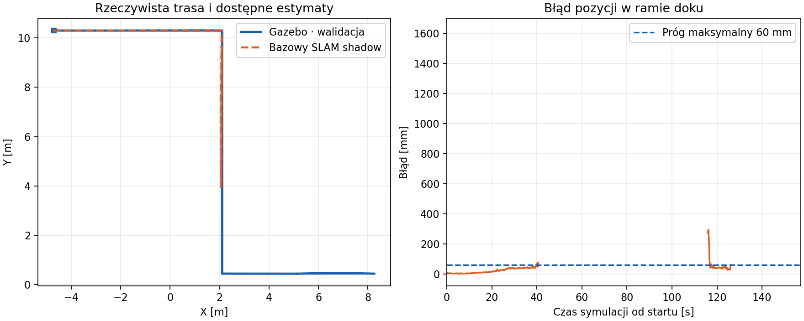
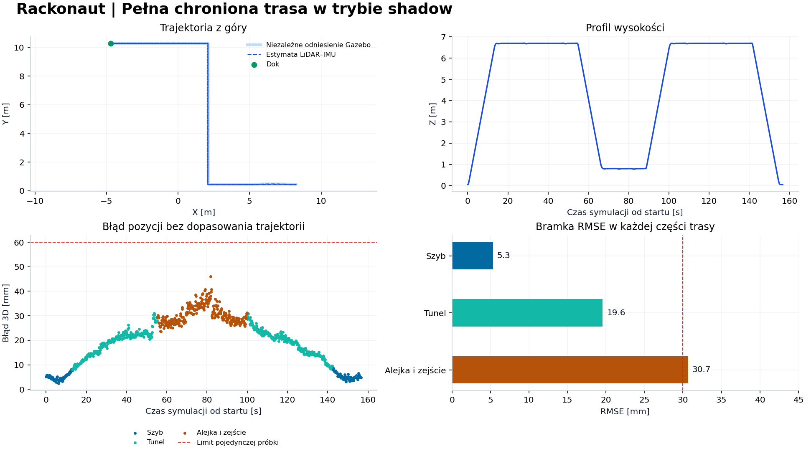
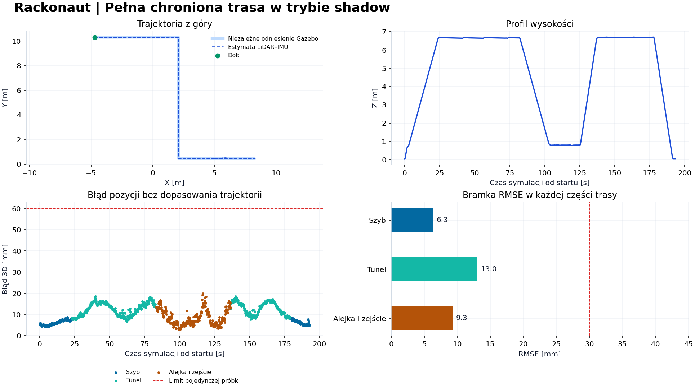
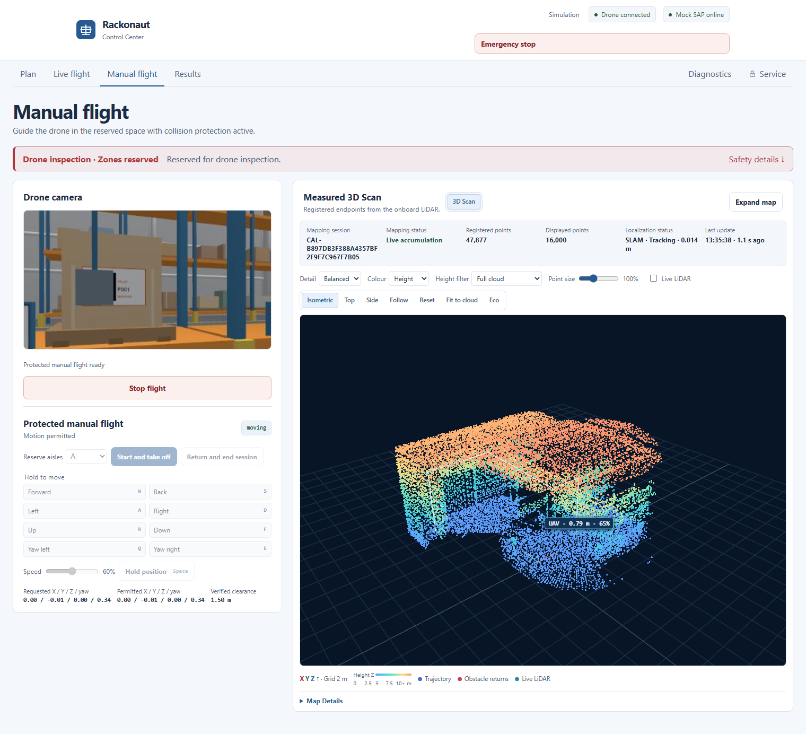
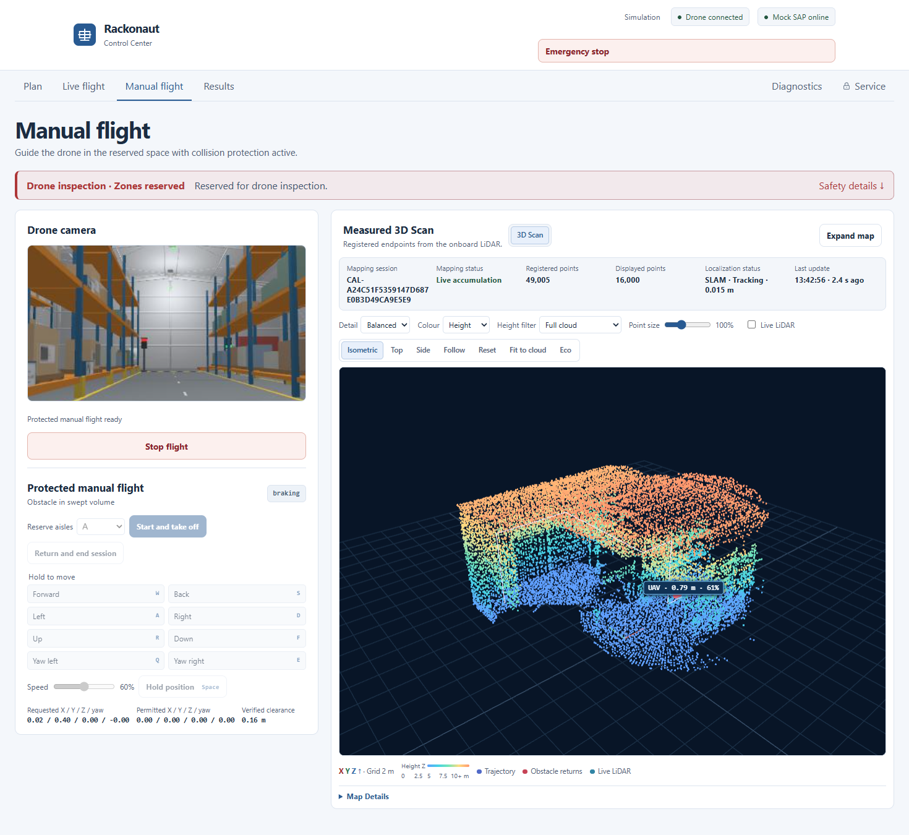

# Rackonaut · Walidacja SLAM na pełnej trasie

**PASS.** Dwa chronione loty ze sterowaniem wyłącznie z lokalizacji SLAM odwiedziły A-01-01 i A-01-03 i fizycznie zadokowały. Oba wykonano bez dostępnej mapy referencyjnej. W drugim, niezależnym uruchomieniu LiDAR wykrył przesunięty karton i Collision Prevention wyzerował ruch w jego stronę.

Pierwszy pełny lot shadow ujawnił utratę lokalizacji bazowego SLAM w tunelu. Dotychczasowy lokalizator produkcyjny doprowadził drona do A-01-01 i A-01-03, po czym fizycznie zadokował. Wynik bramki SLAM dla próby bazowej to **FAIL**.

## Metoda i bramka jakości

Punktem odniesienia jest GOAL 21, commit `222c0d0d90d1bb91a9d6b2acd382dd0cb0e1ade6`. Próby wykonano na Ubuntu 22.04.5 LTS w WSL2, z ROS 2 Humble oraz Gazebo Fortress 6.16.0. Pełny profil uruchomiono z diagnostyką, a w oddzielnym węźle tryb `slam_shadow` z wyjściami pod `/rackonaut/slam_shadow/`. Walidator zestawił estymaty ze zinterpolowaną odometrią Gazebo przy znacznikach czasu skanów. Porównanie używa wspólnej ramy znanego doku. Nie stosowano dopasowania trajektorii po locie.

Progi przyjęte przed próbami to **RMSE ≤ 30 mm**, **p95 ≤ 45 mm**, **maksimum ≤ 60 mm**, **dryf po powrocie ≤ 35 mm**, **minimum 3 Hz w czasie rzeczywistym** i **RTF ≥ 0,45**. Korytarze mają roboczą połówkę przekroju 0,33 m wokół zatwierdzonej osi, a ogranicznik ręcznego lotu rezerwuje 0,06 m przy ich granicy. Błąd równy 60 mm może zużyć cały margines granicy. Dlatego ocena obejmuje także dostępność estymat w każdej strefie i rzeczywisty przebieg wewnątrz zatwierdzonej przestrzeni. Zakres rezerwacji i ustawienia Safety, Energy oraz Collision Prevention pozostają takie jak w profilu referencyjnym.

Log pozycji referencyjnej służy wyłącznie ocenie. Kandydat shadow subskrybuje pokładowe skany i IMU. Znane korytarze wyznaczają trasę produkcyjnego kontrolera i podział wyników na strefy.

## Bazowy pełny lot shadow

Lot `INS-CONTROL-20261126-112510-2D7DB5EC` miał **70,78 m** długości według próbkowanej trajektorii Gazebo, maksymalne oddalenie przestrzenne **16,30 m** i zakres wysokości **0,054–6,705 m**. Trwał **267,4 s** czasu rzeczywistego i **157,26 s** czasu symulacji, z **RTF 0,588**. Zużycie wyniosło **55,697 p.p.** energii. Zarejestrowano obie obserwacje, potwierdzono fizyczny kontakt z dokiem i przejście Safety do `RELEASED`.

| Strefa | Próbki SLAM / referencyjne | RMSE | p95 | Maksimum |
| --- | ---: | ---: | ---: | ---: |
| Szyb | 78 / 166 | 3,5 mm | 6,1 mm | 6,5 mm |
| Tunel | 230 / 511 | 122,2 mm | 64,2 mm | 1 619,8 mm |
| Alejka i zejście | 0 / 268 | brak | brak | brak |
| Cała trasa, dla dostępnych estymat | 308 / 945 | 105,7 mm | 53,7 mm | 1 619,8 mm |

Maksymalny błąd orientacji dostępnych estymat wyniósł 2,61°. Najdłuższa przerwa wyniosła 72,04 s czasu symulacji. Średnia dostępność na pełnym locie wyniosła 1,15 estymaty na sekundę czasu rzeczywistego. Dryf przy dokowaniu jest nieweryfikowalny z próby bazowej. Pierwotny stan lokalizatora nie publikował licznika klatek kluczowych. Ground truth pokazuje pełny lot, mimo luk w estymacji kandydata.

[Telemetria próby](slam-full-route-evidence/baseline-verification.json) · [Estymaty shadow](slam-full-route-evidence/baseline-shadow.jsonl) · [Ślad odniesienia](slam-full-route-evidence/baseline-reference.jsonl)

## Analiza tunelu

Przed przerwą dopasowanie w osi tunelu zaczęło odchylać się od kolejnych obserwacji. Na próbce przy czasie symulowanym 615,196 s błąd przekroczył limit, a przy 618,352 s osiągnął 1,62 m, przede wszystkim w osi Y. Lokalne dopasowania nie dostarczały w tym obszarze wystarczająco stabilnych ograniczeń. Bazowa mapa używała krótkiego zasięgu dopasowania i ograniczonego okna ostatnich klatek. Próby porównawcze odtwarzają pakiety LiDAR i IMU z Gazebo przy zachowaniu czasów odbioru i porównują wynik osobno z zapisem walidacyjnym. [ROS Bag Humble](https://github.com/ros2/rosbag2/tree/humble/rosbag2_py) · [Metryka APE](https://github.com/MichaelGrupp/evo/wiki/Metrics)

Drugi pełny zapis z kontrolerem referencyjnym objął drogę powrotną i dokowanie. W odtworzeniu jego rozszerzona podmapa z korektą prędkości dała 944 estymaty. Uzyskała 34 mm RMSE, 66 mm p95 i 95 mm maksymalnego błędu. Lepsza dostępność estymat pozwala ocenić cały lot, a błędy nadal przekraczają bramkę. Porównania KISS-ICP i small_gicp na pierwszym zapisie również przekroczyły limity. [KISS-ICP](https://github.com/PRBonn/kiss-icp) · [small_gicp](https://github.com/koide3/small_gicp)

## Pełna trasa przez chroniony interfejs ręczny

Lot `INS-CONTROL-20261126-114028-6CDB8441` użył standardowych żądań Manual Flight i zatwierdzonych współrzędnych docelowych. Stan pozycji pochodził z lokalizatora referencyjnego. Dron pokonał **70,70 m**, oddalił się na **16,30 m**, utrzymał rezerwację i zapisał obraz kamerowy przy obu stanowiskach. Zakończenie potwierdził fizyczny styk doku i stan `RELEASED`. Czas wyniósł **329,3 s** przy **RTF 0,576**, a zużycie energii **64,032 p.p.** To sprawdzenie ścieżki sterowania dla przyszłej próby po przejściu bramki shadow. [A-01-01 z kamery](slam-full-route-evidence/reference-a-01-01.jpg) · [A-01-03 z kamery](slam-full-route-evidence/reference-a-01-03.jpg) · [Telemetria](slam-full-route-evidence/reference-manual.json)

## Profil pełnej trasy

Porównanie rzeczywistych zapisów wykazało, że dłuższe pomiary ujawniają odległe płaszczyzny poprzeczne do tunelu. W sześciu kontrolnych klatkach z Gazebo było od 451 do 583 powrotów powyżej 8 m, a największy zmierzony zasięg wyniósł 15,996 m. Profil `full_route_slam:=true` używa 16 m zasięgu w tym samym formacie 192 × 37. Estymator zachowuje do 240 klatek kluczowych i dopasowuje skan do maksymalnie 60 lokalnych klatek z promienia 12 m. W dopasowaniu wagi uwzględniają gęstość próbkowania, kąt padania wiązki i udział płaszczyzn w różnych kierunkach. Używa tych samych bramek obserwowalności i jakości estymaty. Ochrona ruchu nadal korzysta z dotychczasowego horyzontu obserwacji 8 m.

Odtworzenie pełnego zapisu 16 m przez tę implementację dało **944 estymaty** i wyniki **18,6 mm RMSE**, **25,6 mm p95**, **31,8 mm maksimum**, przy 173 zarejestrowanych klatkach kluczowych na końcu lotu. To próba z odtwarzania danych. Niezależna próba shadow na żywo stanowi bramkę dla sterowania.

### Niezależny lot shadow 16 m

Lot `INS-CONTROL-20261126-115445-100F3CAC` przez standardowy interfejs Manual Flight i lokalizację referencyjną pokonał **70,67 m** oraz oddalił się przestrzennie o **16,29 m**. Dron odwiedził oba stanowiska, wrócił przez tunel i zakończył lot potwierdzonym kontaktem oraz `RELEASED`. Zakres wysokości wyniósł **0,054–6,704 m**. Czas lotu to **335,1 s** rzeczywistych i **189,88 s** symulowanych, z **RTF 0,567**. Zużyto **64,198 p.p.** energii.

| Strefa | Próbki | RMSE | p95 | Maksimum |
| --- | ---: | ---: | ---: | ---: |
| Szyb | 225 | 7,3 mm | 11,3 mm | 12,3 mm |
| Tunel | 602 | 22,0 mm | 28,6 mm | 33,6 mm |
| Alejka i zejście | 316 | **33,5 mm** | 41,6 mm | 46,6 mm |
| Cała trasa | 1 143 | 24,0 mm | 37,4 mm | 46,6 mm |

Estymata shadow utrzymała **3,41 Hz** w czasie rzeczywistym. Najdłuższy odstęp wyniósł 0,168 s czasu symulacji, dryf przy doku 2,16 mm, a maksymalny błąd orientacji 0,257°. Estymator przyjął **181 klatek kluczowych** i zarejestrował **55 636 wokseli**. Czas dopasowania skanu wyniósł p95 **125,9 ms**. Z 372 próbek procesu zmierzono medianę **15,56% jednego rdzenia** i p95 **27,78%**. Najwyższe RSS wyniosło **185,35 MiB**. Gazebo w tym samym oknie zajmowało medianę **198,33% jednego rdzenia** i maksymalnie **864 MiB RSS**.

W alejce dominuje utrzymujące się przesunięcie w osi X, średnio −28,3 mm. **Bramka całościowa pozostaje niezaliczona**, ponieważ RMSE w tej strefie przekroczył lokalny próg 30 mm. Sterowanie pozostało na lokalizatorze referencyjnym. [Wykres](slam-full-route-evidence/extended-shadow.png) · [Pomiary](slam-full-route-evidence/extended-shadow-verification.json) · [Trajektorie](slam-full-route-evidence/extended-shadow-trace.jsonl)

### Niezależne powtórzenie shadow 16 m na trasie autonomicznej

Lot `INS-CONTROL-20261126-121130-BDAD1CCB` na tej samej trasie geometrycznej ukończył autonomiczną inspekcję A-01-01 i A-01-03 pod kontrolą lokalizatora referencyjnego. Pokonał **70,77 m**, osiągnął **16,30 m** oddalenia i zakres wysokości **0,054–6,705 m**. Czas rzeczywisty wyniósł **279,9 s**, symulowany **156,60 s**, **RTF 0,5595**, zużycie energii **55,609 p.p.** Potwierdzono fizyczny kontakt z dokiem i zwolnienie rezerwacji.

| Strefa | Próbki | RMSE | p95 | Maksimum |
| --- | ---: | ---: | ---: | ---: |
| Szyb | 166 | 5,33 mm | 7,64 mm | 8,97 mm |
| Tunel | 510 | 19,57 mm | 27,12 mm | 31,08 mm |
| Alejka i zejście | 268 | **30,66 mm** | 37,54 mm | 46,00 mm |
| Cała trasa | 944 | 21,88 mm | 34,16 mm | 46,00 mm |

Częstotliwość wyniosła **3,37 Hz**, największy odstęp **0,168 s** czasu symulacji, a dryf przy dokowaniu **1,89 mm**. RMSE orientacji wyniósł 0,080°, p95 0,128° i maksimum 0,203°. Przyjęto **173 klatki kluczowe** i zaobserwowano do **54 854 wokseli**. Plik PLY wyeksportowany podczas końcowego zniżania zawiera **54 767** punktów. Czas dopasowania p95 to **131,2 ms**. Gazebo zajmowało medianę **198,88% jednego rdzenia** i do **867,5 MiB RSS**. Pomiar procesu SLAM jest dostępny z poprzedniego lotu, ponieważ nazwa procesu z relatywną ścieżką w tym locie nie została rozpoznana przez próbnik zasobów.

RMSE w alejce ponownie przekroczył 30 mm. Bramka **FAIL** zakończyła skrypt przed uruchomieniem profilu sterowania SLAM. [Pomiary](slam-full-route-evidence/autonomous-shadow-verification.json) · [Trajektorie](slam-full-route-evidence/autonomous-shadow-trace.jsonl) · [Chmura PLY](slam-full-route-evidence/autonomous-shadow-map.ply)

## Ograniczenie dryfu przy wejściu do alejki

W trzecim shadow, z eksperymentalnym uśrednianiem położeń wewnątrz wokseli, autonomiczny lot `INS-CONTROL-20261126-122013-050FDCFD` osiągnął **24,81 mm RMSE w alejce** i fizycznie zadokował. Pełna bramka nadal dała **FAIL**. W oknie lotu pojawiły się dwa komunikaty stanu innego niż `TRACKING`. Nagranie pakietów z kolejnego pełnego lotu ręcznego pokazało też, że ten wariant może dać **38,44 mm RMSE w alejce** przy powolniejszym przelocie. [Wyniki shadow](slam-full-route-evidence/centroid-only-shadow-verification.json) · [Trajektorie](slam-full-route-evidence/centroid-only-shadow-trace.jsonl)

Profil pełnej trasy ogranicza teraz dobór płaszczyzn przy krawędziach i w mieszanych skupiskach punktów. W powtarzających się obserwacjach tego samego wokselu zachowuje normalną najstarszej lokalnej obserwacji, a do położenia domiesza niewielki udział średniej. Zmiany wynikają z różnicy między zapisem autonomicznym a ręcznym. W odtworzeniu ręcznym odchylenia X i Z narastały już w tunelu, przed zejściem do regałów. Oba zestawy danych idą przez ten sam estimator. Ground truth służy obliczeniu błędów po estymacji.

| Pełny zapis | Próbki | RMSE całej trasy | RMSE alejki | Maksymalny błąd | Dryf przy powrocie |
| --- | ---: | ---: | ---: | ---: | ---: |
| Autonomiczny, 16 m | 944 | 15,42 mm | 21,57 mm | 32,59 mm | 1,00 mm |
| Ręczny, 16 m | 1 168 | 18,38 mm | 25,42 mm | 40,87 mm | 0,63 mm |

W obu odtworzeniach odstęp między estymatami wyniósł najwyżej 0,168 s czasu symulacji. Pierwsza wersja 16 m uzyskała **46,20 mm RMSE w alejce** na tym samym zapisie ręcznym. Zbudowano 10 pakietów ROS i zaliczono 53 testy jednostkowe. Próba sterowania wymaga zaliczenia bramki przez ten wariant na nowym pełnym locie shadow. [Pomiary porównawcze](slam-full-route-evidence/plane-selection-replay.json)

## Zaliczenie bramki shadow na pełnej trasie

Nową próbę `INS-CONTROL-20261126-122607-B3FE74B9` wykonano standardowym chronionym interfejsem ręcznym. Lokalizator referencyjny nadal dostarczał pozycję do sterowania, a nowy estymator LiDAR–IMU działał równolegle. Dron pokonał **70,87 m**, oddalił się **16,30 m** i osiągnął **6,704 m** wysokości. Kamera obserwowała A-01-01 oraz A-01-03. Stan `COMPLETE`, fizyczny kontakt doku oraz `RELEASED` potwierdziły zakończenie. Lot trwał **355,8 s** przy **RTF 0,5435**, z zużyciem **65,123 p.p.** energii.

| Strefa | Próbki | RMSE | p95 | Maksimum |
| --- | ---: | ---: | ---: | ---: |
| Szyb | 225 | 6,32 mm | 8,13 mm | 8,63 mm |
| Tunel | 618 | 13,01 mm | 16,85 mm | 18,59 mm |
| Alejka i zejście | 321 | 9,26 mm | 15,50 mm | 19,80 mm |
| Cała trasa | 1 164 | 11,01 mm | 16,48 mm | 19,80 mm |

Przebieg zawiera **3,27 estymaty/s czasu rzeczywistego**, z maksymalnym odstępem **0,168 s** czasu symulacji i ciągłym stanem `TRACKING`. Dryf przy doku wyniósł **0,23 mm**, a maksymalny błąd orientacji **0,327°**. Lokalizator przyjął **182 klatki kluczowe**, zarejestrował **54 486 wokseli**, wykonał dopasowanie w czasie p95 **119,2 ms** i użył do **187,91 MiB RSS**. Mediana obciążenia lokalizatora wyniosła **16,67% jednego rdzenia**, a p95 **28,89%**. Gazebo używało mediany **200,01% jednego rdzenia** i do **868 MiB RSS**.

Bramka **PASS** została zapisana przed aktywacją sterowania SLAM. [Telemetria i błędy stref](slam-full-route-evidence/final-shadow-verification.json) · [Trajektorie](slam-full-route-evidence/final-shadow-trace.jsonl) · [Chmura PLY](slam-full-route-evidence/final-shadow-map.ply)

## Pełny lot sterowany przez SLAM

Po zaliczeniu shadow uruchomiono profil `full_route_slam:=true mapping_only:=true` w osobnej domenie ROS i osobnym świecie Gazebo. Przed uruchomieniem plik `localization_map.json` przeniesiono poza katalog instalacyjny, a jego brak sprawdzono po dokowaniu. Lot `INS-CONTROL-20261126-123220-AD362C41` rozpoczął się od pomiarów z pustej sesji `CAL-B897DB3F388A4357BF2F9F7C967F7B05` przy fizycznym doku.

Dron wystartował, przeszedł szyb i tunel, zarejestrował obraz przy A-01-01 oraz A-01-03 i wrócił przez uprzednio obserwowaną przestrzeń. Długość trajektorii wyniosła **70,92 m**, maksymalne oddalenie **16,31 m**, a zakres wysokości **0,054–6,721 m**. Lot zakończył się po **347,6 s** rzeczywistych i **193,38 s** symulowanych, z **RTF 0,5563**, zużyciem **65,395 p.p.** i fizycznie aktywnym stykiem doku. Safety zwolniło rezerwację. Wszystkie **1 164** odcinki między kolejnymi niezależnymi próbkami środka drona mieściły się w zatwierdzonej przestrzeni D i A.

| Strefa | Próbki | RMSE | p95 | Maksimum |
| --- | ---: | ---: | ---: | ---: |
| Szyb | 225 | 3,85 mm | 4,83 mm | 7,50 mm |
| Tunel | 620 | 12,50 mm | 16,99 mm | 18,46 mm |
| Alejka i zejście | 320 | 11,85 mm | 17,41 mm | 24,60 mm |
| Cała trasa | 1 165 | 11,16 mm | 16,80 mm | 24,60 mm |

Dryf przy doku wyniósł **0,19 mm**, a błąd orientacji osiągnął **0,179° RMSE**, **0,261° p95** i **0,331° maksimum**. Estymacja działała ciągle z częstotliwością **3,35 Hz** w czasie rzeczywistym. Przyjęto **181 klatek kluczowych** i zapisano **55 249 punktów PLY**. Dopasowanie trwało **119,2 ms p95**. Lokalizator używał mediany **17,78% jednego rdzenia**, p95 **28,89%** i najwyżej **193,32 MiB RSS**. Gazebo używało mediany **198,89% jednego rdzenia** i maksymalnie **859,30 MiB RSS**.

Graf ROS z lotu pokazał jeden nadajnik komend ruchu, `rackonaut_mission`, jeden nadajnik odometrii sterowania, `rackonaut_localization`, i jednego subskrybenta ground truth, `rackonaut_localization_validation`. Weryfikacja używa pozycji Gazebo wyłącznie do oceny. [Graf ROS](slam-full-route-evidence/active-first-ros-graph.txt) · [Metryki](slam-full-route-evidence/active-first-verification.json) · [Trajektorie](slam-full-route-evidence/active-first-trace.jsonl)

[Pełny lot MP4](slam-full-route-evidence/full-slam-flight.mp4) · [Mapa PLY](slam-full-route-evidence/active-first-map.ply) · [Obraz A-01-01](slam-full-route-evidence/active-first-a-01-01.jpg) · [Obraz A-01-03](slam-full-route-evidence/active-first-a-01-03.jpg) · [Fizyczne dokowanie](slam-full-route-evidence/active-first-docked.png)

## Niezależne powtórzenie ze zmienioną geometrią

Lot `INS-CONTROL-20261126-123912-DA6A34EA` uruchomiono z nowym procesem lokalizacji, nowym światem Gazebo i domeną ROS 218. Pierwszy lot używał domeny 216. Nowa sesja `CAL-A24C51F5359147D687E0B3D49CA9E5E9` rozpoczęła mapowanie od zera przy doku. Przed startem przeniesiono karton `avoidance_aisle_box` na `(6,95; 1,30; 0,82) m` i potwierdzono tę pozycję w strumieniu Gazebo. Plik referencyjny nadal znajdował się poza miejscem odczytu przez cały lot. Po obu próbach przywrócono go i potwierdzono identyczną sumę SHA-256. [Odczyt pozycji kartonu](slam-full-route-evidence/active-obstacle-gazebo-pose.txt)

Po obserwacji A-01-01 pilot testowy poprosił o przesunięcie w bok z prędkością **0,40 m/s** w stronę kartonu. **15,28 m od doku** Collision Prevention ustawił dopuszczoną prędkość na **0,00 m/s** z powodem `Obstacle in swept volume`. Telemetria zarejestrowała **132 powroty od przeszkody** oraz **0,159 m** zweryfikowanej przestrzeni dla danego polecenia. Safety nadal miało stan `RESERVED`, a Energy potwierdzało budżet powrotu przy **60,971%** baterii. Dron pozostał w alejce, wykonał obserwację A-01-03, a następnie wrócił i fizycznie zadokował. Wszystkie **1 211** odcinków między próbkami środka drona mieściły się w zatwierdzonej przestrzeni.

Długość drugiego lotu wyniosła **71,04 m**, maksymalny dystans od doku **16,31 m** i zakres wysokości **0,054–6,721 m**. Lot trwał **375,4 s** rzeczywistych i **201,26 s** symulowanych, z **RTF 0,5361**. Zużyto **67,437 p.p.** energii. Po fizycznym dokowaniu Safety przeszło w `RELEASED`.

| Strefa | Próbki | RMSE | p95 | Maksimum |
| --- | ---: | ---: | ---: | ---: |
| Szyb | 226 | 3,74 mm | 4,72 mm | 7,08 mm |
| Tunel | 624 | 12,74 mm | 16,94 mm | 18,02 mm |
| Alejka i zejście | 362 | 18,68 mm | 26,62 mm | 31,96 mm |
| Cała trasa | 1 212 | 13,80 mm | 22,44 mm | 31,96 mm |

Osiągnięto **3,23 Hz**, największy odstęp **0,168 s** czasu symulacji, dryf przy doku **0,73 mm** oraz maksymalny błąd orientacji **0,277°**. Przyjęto **187 klatek kluczowych** i zapisano **55 626 punktów PLY**. W objętości kartonu, z 3–4 cm tolerancji względem rozmiaru modelu, znaleziono **54 punkty** drugiej mapy i **0 punktów** pierwszej. Czas dopasowania skanu to **128,1 ms p95**. Lokalizator użył mediany **19,98% jednego rdzenia**, p95 **32,22%** i maksymalnie **191,13 MiB RSS**. Proces Gazebo drugiej próby użył mediany **202,23% jednego rdzenia** i maksymalnie **859,38 MiB RSS**.

[Metryki](slam-full-route-evidence/active-obstacle-verification.json) · [Trajektorie](slam-full-route-evidence/active-obstacle-trace.jsonl) · [Porównanie obu lotów i zdarzenie blokady](slam-full-route-evidence/end-to-end-proof.json) · [Graf ROS](slam-full-route-evidence/active-obstacle-ros-graph.txt) · [Mapa PLY](slam-full-route-evidence/active-obstacle-map.ply) · [Wykres błędów](slam-full-route-evidence/active-obstacle.png)

## Regresja autonomicznej inspekcji na domyślnym profilu

Lot `INS-CONTROL-20261126-120343-DB9A5E1F` uruchomiono końcowym kodem profilu z domyślnym zasięgiem 8 m. Kontroler referencyjny przeszedł przez szyb, tunel i zejście, zapisał po jednej obserwacji A-01-01 i A-01-03 oraz zakończył w stanie `COMPLETE` z fizycznym kontaktem doku i Safety `RELEASED`. Trajektoria miała **70,76 m**. Lot trwał **290,0 s** z **RTF 0,539** i zużyciem **55,601 p.p.** energii. Wyniki odczytu etykiet zapisano zgodnie z raportem inspekcji. [Telemetria regresji](slam-full-route-evidence/default-autonomy-regression.json)

## Scenariusze

| # | Próba | Obecny stan |
| --- | --- | --- |
| 1 | Pełna trasa shadow | **PASS po korekcie.** Pełny lot 70,87 m, ciągła estymata, wszystkie progi strefowe, dwie obserwacje i fizyczny dok. |
| 2 | Pełna trasa sterowana SLAM | **PASS.** 70,92 m, dwie obserwacje, fizyczny dok i zaliczona bramka strefowa. |
| 3 | Niezależne powtórzenie pełnej trasy sterowanej SLAM | **PASS.** Nowy proces, domena ROS i sesja mapowania. 71,04 m, dwie obserwacje i fizyczny dok. |
| 4 | Powtarzalna geometria regałów | **PASS w locie sterowanym SLAM.** 320 estymat w alejce i RMSE 11,85 mm. |
| 5 | Powrót przez obserwowaną przestrzeń | **PASS.** Powrót przez tunel i szyb z aktywnym SLAM oraz fizyczne dokowanie. |
| 6 | Zmieniona geometria w alejce | **PASS.** Fizycznie przeniesiony karton został zaobserwowany przez LiDAR i zapisany w drugiej chmurze. |
| 7 | Mapa referencyjna fizycznie niedostępna | **PASS.** Plik instalacyjny był poza katalogiem odczytu od uruchomienia każdego profilu do fizycznego dokowania. |
| 8 | Zabezpieczenia w oddaleniu od doku | **PASS.** LiDAR zablokował ruch w stronę kartonu 15,28 m od doku. Safety utrzymało rezerwację, a Energy potwierdziło budżet powrotu. |
| 9 | Regresja produkcyjnej trasy autonomicznej | **PASS na domyślnym profilu po zmianach.** Dwie obserwacje, stan `COMPLETE`, potwierdzony dok i `RELEASED`. |

Zakres walidacji obejmuje zatwierdzony przebieg D–A w symulowanym magazynie, dwie pozycje obserwacji oraz jedną zmianę geometrii. Dwa loty sterowane SLAM używały istniejącego chronionego interfejsu Manual Flight z programowo wysyłanymi poleceniami. Regresja autonomicznej inspekcji używała dotychczasowego profilu referencyjnego.
